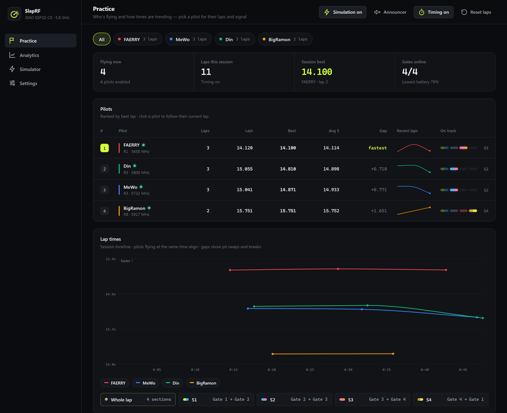
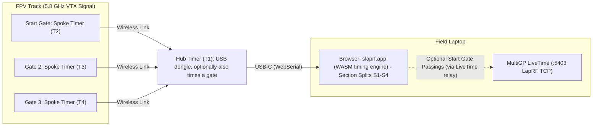
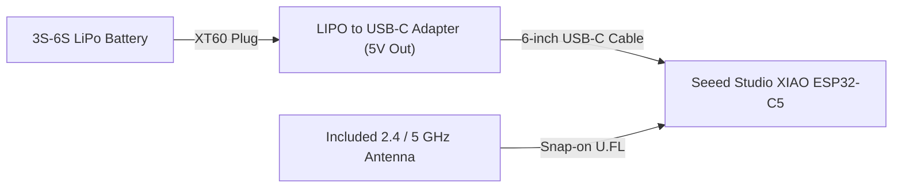

# SlapRF

SlapRF is a multi-gate 5.8 GHz sector timing system for FPV drone racing.

The name **SlapRF** comes from how you build it: you slap four off-the-shelf parts together with no soldering, no custom PCBs, and no wiring harness.

A standard lap timer measures only total lap time at the start gate. SlapRF places additional timers at gates around the track to measure split times for each track section (`S1`, `S2`, `S3`, `S4`). Pilots can compare section times across laps to see where they gained or lost time.

## Demo

Try SlapRF right in your browser—no hardware or installation required:

👉 **[Launch the Live Demo (`kaack.github.io/SlapRF`)](https://kaack.github.io/SlapRF/)**

The live demo runs a built-in 4-gate, 4-pilot track simulator so you can explore live lap & section timing (`S1`–`S4`), per-pilot bottleneck analytics, 5.8 GHz gate signal traces, spoken lap callouts, and the USB firmware flasher directly in the browser.

## Intended Use: LiveTime Companion or Standalone Practice

SlapRF does not replace official race timing systems such as **MultiGP LiveTime** or **ImmersionRC LapRF**.

You can use SlapRF in two ways:

1. **Companion to MultiGP LiveTime**: SlapRF emulates an ImmersionRC LapRF 8-way timer on TCP port `5403` (through the small [`slaprf-relay`](#livetime) helper). When you connect LiveTime to it, SlapRF receives the pilot callsigns and 5.8 GHz frequencies from LiveTime. When a pilot crosses the start gate, SlapRF sends that crossing to LiveTime for official lap scoring and records the intermediate section splits (`S1`, `S2`, `S3`, `S4`) in the SlapRF web interface.
2. **Standalone practice timer**: You can run SlapRF on a laptop or phone at the field with 1 to 6 timers. The web interface provides spoken lap times, live 5.8 GHz signal graphs, threshold calibration, and section comparisons.

## How It Works

A SlapRF setup uses one **Hub timer** and up to 6 **Spoke timers**:

- **Hub timer**: A USB-C dongle plugged into your laptop. It collects the wireless readings from all Spoke timers and passes them to the browser; by default it is not on any gate and does not measure anything itself. If a gate is within USB cable reach, you can drag the Hub onto it in the **Track** editor: it then times that gate too (it sweeps 5.8 GHz like a Spoke). Drag it off to make it a pure dongle again.
- **Spoke timers**: Placed at the gates around the track (the first Spoke becomes the start/finish gate). They continuously measure 5.8 GHz VTX signal strength for up to 8 pilots and stream their readings wirelessly back to the Hub.

You flash and configure the timers directly from Chrome, Edge, or Brave over USB-C (even from the [web app](https://kaack.github.io/SlapRF/) with no software installed). No compiler, driver installation, or command-line tool is required.

## Parts List and Cost

Each gate timer uses four off-the-shelf parts. One XIAO ESP32-C5 draws less than `100 mA` at `5 V` (`0.5 W`), so a `650 mAh` 3S LiPo battery powers a timer for about 8 hours.

| Part | Purpose | Product Links | Est. Cost (USD) |
| :--- | :--- | :--- | :--- |
| **Seeed Studio XIAO ESP32-C5** (includes external 2.4 / 5 GHz U.FL antenna) | Measures 5.8 GHz VTX signal strength and sends data over ESP-NOW (the Hub passes it to the laptop over USB-C). | <ul><li>[Seeed Studio XIAO ESP32-C5](https://www.seeedstudio.com/Seeed-Studio-XIAO-ESP32C5-p-6609.html)</li></ul> | $6.90 |
| **LIPO to USB-C Adapter** | Converts 3S to 6S LiPo battery power to `5 V` USB-C output. | <ul><li>[SpeedyBee Goggles BEC](https://www.google.com/search?tbm=shop&q=SpeedyBee+Goggles+BEC)</li><li>[AOKoda XT60 to USB Converter](https://www.google.com/search?tbm=shop&q=AOKoda+XT60+to+USB+Converter)</li></ul> | $8.00 – $20.00 |
| **Short USB-C to USB-C cable (straight plugs)** | Connects the LIPO to USB-C Adapter to the XIAO ESP32-C5. Also used to flash firmware from a laptop. | <ul><li>[Adafruit 6" USB-C to USB-C Cable](https://www.adafruit.com/product/4198)</li></ul> | $8.50 |
| **Small 3S LiPo battery (XT60)** | Powers the timer in the field. A minimum of `650 mAh` provides about 8 hours of runtime (or use any retired 3S–6S flight pack). | <ul><li>[Tattu 850mAh 3S XT60 LiPo](https://www.google.com/search?tbm=shop&q=Tattu+850mAh+3S+XT60+LiPo)</li></ul> | $15.00 (or $0 with a spare pack) |

### Estimated Total Cost

- **1 timer**: $23 to $35 (using an existing LiPo battery) or $38 to $50 (with a new 3S LiPo)
- **3-gate track (`1 Hub + 3 Spokes`)**: $92 to $140 total (using existing LiPo batteries; drag the Hub onto a fourth gate if it is within USB cable reach)

## Hardware Assembly

No soldering is required.

1. Attach the included U.FL antenna to the antenna connector on the XIAO ESP32-C5.
2. Connect the XIAO ESP32-C5 to your laptop with a USB-C cable.
3. Open **Settings > Flasher** in the SlapRF web interface. Flash one timer as **Hub** and the remaining timers as **Spoke**.
4. At the field, connect each XIAO ESP32-C5 to a LIPO to USB-C Adapter and a LiPo battery. Place one timer at each gate.
5. Open **Settings > Track** and drag each timer (`T1`, `T2`, `T3`, `T4`) onto the track line in the order pilots fly the course. Click the checkered flag icon below a gate to set the start gate.

## Run

Open **[slaprf.app](https://slaprf.app)** in Chrome, Edge, or Brave. There is nothing to download or install: the whole timing engine runs in the browser (WebAssembly), and the Hub timer plugs into your laptop over USB-C (WebSerial). The same page flashes timers from **Settings > Flasher**.

Developers can run the app locally with `go run ./cmd/devserver` (dev-only server on `http://localhost:8090`); see [docs/DEVELOPER.md](docs/DEVELOPER.md).

## LiveTime

Browsers can't accept TCP connections, so MultiGP LiveTime reaches SlapRF through **`slaprf-relay`**, a tiny single-file helper that copies bytes between LiveTime (TCP `5403`) and the SlapRF tab (WebSocket on `127.0.0.1:5404`). All LapRF protocol logic runs in the browser.

1. Download the relay for your OS from the [latest release](https://github.com/kaack/SlapRF/releases/latest): `slaprf-relay-windows-amd64.exe`, `slaprf-relay-macos-arm64`, `slaprf-relay-macos-amd64`, `slaprf-relay-linux-amd64` or `slaprf-relay-linux-arm64` (on macOS/Linux run `chmod +x` on it first).
2. Run it on the computer that has SlapRF open, and leave its window open.
3. In SlapRF, open **Settings > MultiGP LiveTime** and turn it on. Chrome may ask to allow access to devices on your local network: choose **Allow**.
4. In LiveTime, add an **ImmersionRC LapRF (8-way)** timing device at the relay computer's IP address, port `5403` (`127.0.0.1` if LiveTime runs on the same computer). Allow the firewall prompt if LiveTime is on another PC.

The relay accepts one LiveTime connection and one SlapRF tab at a time (a new one replaces the old). It only accepts browser connections from `https://slaprf.app` and `localhost`; add others with `-allow-origin`. Run `slaprf-relay -h` for all options.
