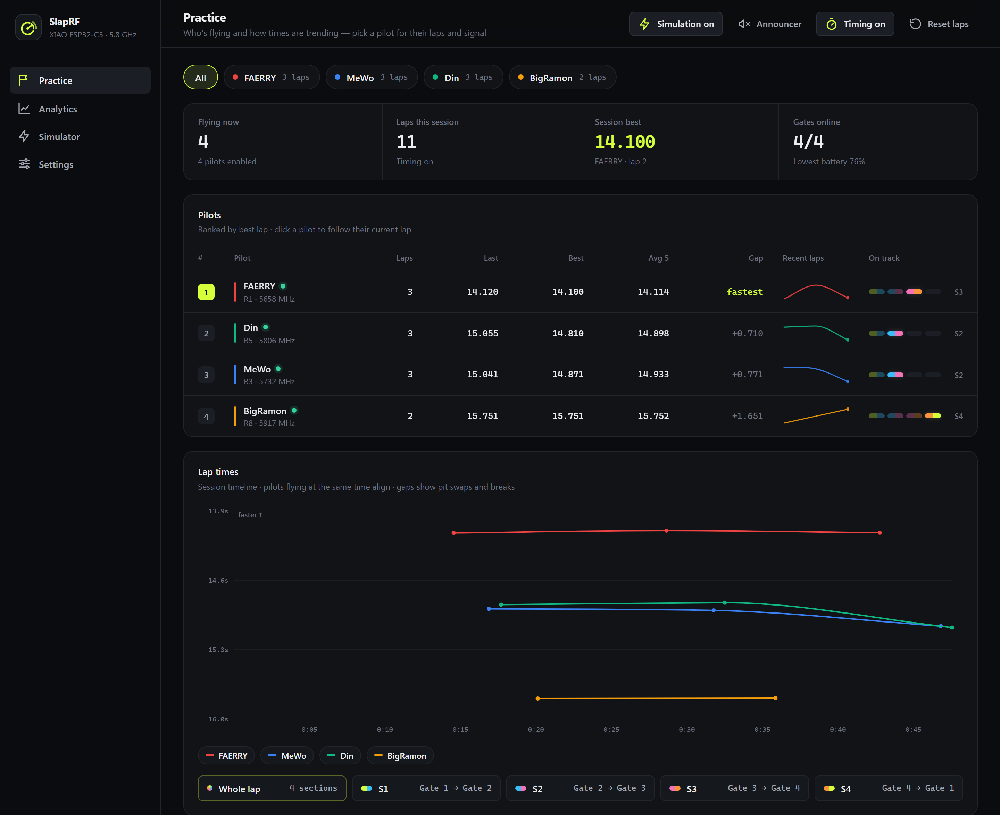
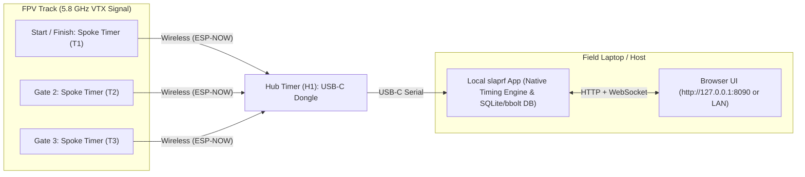
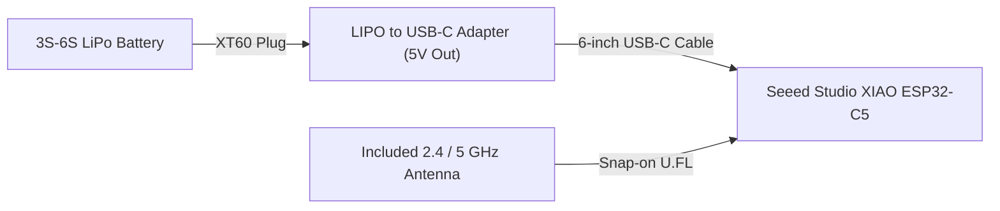

# SlapRF

SlapRF is a standalone FPV drone timing and race management application with native multi-gate 5.8 GHz section split timing.

The name **SlapRF** comes from how you build our DIY gate timers: you slap four off-the-shelf parts together with no soldering, no custom PCBs, and no wiring harness—while the SlapRF app itself also works with existing **RotorHazard** and **ImmersionRC LapRF 8-Way** timing systems.

A single-gate timer measures total lap time at the start/finish gate. When you place additional timers at gates around the course, SlapRF also measures split times for every track section (`S1`, `S2`, `S3`, ...) so pilots can see exactly where they gained or lost time.

## Demo

Preview SlapRF in your browser with no hardware or installation required:

👉 **[Explore the Interactive Demo (`slaprf.app`)](https://slaprf.app)**

> **Note:** `slaprf.app` is an interactive **browser demo** pre-loaded with a simulated SlapRF Hub + 3 Spoke timers, sample practice sessions, and sample race tournaments so you can explore the interface right away. Because browser tab throttling and WebAssembly scheduling performance can vary across devices, **`slaprf.app` is for demonstration only**—to time real practices or run live races, [download and run the local SlapRF app](#run) on your computer.

## Intended Use

SlapRF stands on its own as a complete timing suite that you can use in two primary ways:

1. **Practice Timer**: Run open or structured practice sessions with spoken lap callouts, live 5.8 GHz signal traces, per-pilot threshold calibration, consistency metrics, and multi-gate section split analytics (`S1`, `S2`, `S3`, ...).
2. **Race Management**: Organize and run full race events from pilot check-in to podium—including a visual stage & bracket editor (Double Elimination, Single Elimination, Qualifying, Open Qualifier, Points Mains, Chase the Ace, or custom round graphs), live Race Control with automated horn/voice announcements, Marshal Review with recorded Start/Finish RSSI waveforms, and MultiGP Chapter race import/result upload.

## Compatibility

SlapRF connects to DIY SlapRF timers as well as established FPV timing hardware over USB or local network:

| Timing Hardware | USB | Network (LAN) | Notes |
| :--- | :---: | :---: | :--- |
| **SlapRF** (XIAO ESP32-C5 Hub & Spoke) | ✅ | — | USB-C Hub dongle + wireless ESP-NOW Spoke timers (1–6 gates, full section splits, built-in USB firmware flasher) |
| **RotorHazard** | ✅ | ✅ | Direct USB serial nodes or LAN connection to a RotorHazard timing server (`HTTP` / `Socket.IO`) |
| **ImmersionRC LapRF 8-Way** | — | ✅ | Ethernet LAN connection over the native LapRF binary protocol (`TCP :5403`) |

## How SlapRF Hardware Works

When using DIY **SlapRF** timers, a track setup uses one **Hub timer** and up to 6 **Spoke timers**:

- **Hub timer (`H1`)**: A USB-C dongle plugged into your laptop. It receives wireless readings from all Spoke timers over ESP-NOW and streams them to the local `slaprf` server over USB-C; by default it sits off-track as a dedicated receiver. If a gate is within USB cable reach, you can drag the Hub onto that gate in the **Track** editor so it times a gate too.
- **Spoke timers (`T1`–`T6`)**: Placed at gates around the course (the first gate serves as Start / Finish). Each Spoke continuously sweeps up to 8 active 5.8 GHz VTX frequencies across Raceband, Fatshark, Boscam, and IMD6 channels and transmits its readings wirelessly to the Hub.

You flash and configure SlapRF XIAO ESP32-C5 boards directly from the **Flasher** view in the local app—no compiler, Arduino IDE, or command-line flashing tool required.

## Parts List and Cost (DIY SlapRF Timers)

Each SlapRF gate timer uses four off-the-shelf parts. One XIAO ESP32-C5 draws less than `100 mA` at `5 V` (`0.5 W`), so a `650 mAh` 3S LiPo battery powers a gate timer for about 8 hours.

| Part | Purpose | Product Links | Est. Cost (USD) |
| :--- | :--- | :--- | :--- |
| **Seeed Studio XIAO ESP32-C5** (includes external 2.4 / 5 GHz U.FL antenna) | Measures 5.8 GHz VTX signal strength and sends data over ESP-NOW (the Hub passes it to the laptop over USB-C). | <ul><li>[Seeed Studio XIAO ESP32-C5](https://www.seeedstudio.com/Seeed-Studio-XIAO-ESP32C5-p-6609.html)</li></ul> | $6.90 |
| **LIPO to USB-C Adapter** | Converts 3S to 6S LiPo battery power to `5 V` USB-C output. | <ul><li>[SpeedyBee Goggles BEC](https://www.google.com/search?tbm=shop&q=SpeedyBee+Goggles+BEC)</li><li>[AOKoda XT60 to USB Converter](https://www.google.com/search?tbm=shop&q=AOKoda+XT60+to+USB+Converter)</li></ul> | $8.00 – $20.00 |
| **Short USB-C to USB-C cable (straight plugs)** | Connects the LIPO to USB-C Adapter to the XIAO ESP32-C5. Also used to flash firmware from a laptop. | <ul><li>[Adafruit 6" USB-C to USB-C Cable](https://www.adafruit.com/product/4198)</li></ul> | $8.50 |
| **Small 3S LiPo battery (XT60)** | Powers the timer in the field. A minimum of `650 mAh` provides about 8 hours of runtime (or use any retired 3S–6S flight pack). | <ul><li>[Tattu 850mAh 3S XT60 LiPo](https://www.google.com/search?tbm=shop&q=Tattu+850mAh+3S+XT60+LiPo)</li></ul> | $15.00 (or $0 with a spare pack) |

### Estimated Total Cost

- **1 timer**: $23 to $35 (using an existing LiPo battery) or $38 to $50 (with a new 3S LiPo)
- **3-gate track (`1 Hub + 3 Spokes`)**: $92 to $140 total (using existing LiPo batteries; drag the Hub onto a fourth gate if it is within USB cable reach)

## Hardware Assembly

No soldering is required.

1. Attach the included U.FL antenna to the antenna connector on the XIAO ESP32-C5.
2. Connect the XIAO ESP32-C5 to your computer with a USB-C cable.
3. Open **Flasher** in the local SlapRF web interface. Flash one board as **Hub** and the remaining boards as **Spoke**.
4. At the field, connect each Spoke timer to a LIPO to USB-C Adapter and a LiPo battery, and place one timer at each gate. Plug the Hub timer into your laptop over USB-C.
5. Open **Track** and drag each timer onto the track map in the order pilots fly the course. Click the checkered flag icon on a gate to set Start / Finish.

## Run

For real practices and races, run the standalone `slaprf` application locally on your laptop (Windows, macOS, or Linux) or Raspberry Pi and connect to it from your browser:

1. Download the binary for your operating system from [GitHub Releases](https://github.com/kaack/SlapRF/releases/latest):
   - Windows: `slaprf-windows-amd64.exe`
   - macOS (Apple Silicon / Intel): `slaprf-darwin-arm64` or `slaprf-darwin-amd64`
   - Linux (`x86_64` / ARM64): `slaprf-linux-amd64` or `slaprf-linux-arm64`
2. Launch the binary (on macOS/Linux, run `chmod +x slaprf-*` first). By default it starts the native timing server on `http://127.0.0.1:8090`, stores all event and lap data locally in `slaprf.db`, and opens your default browser automatically.
3. To allow Race Directors, spotters, or pilots on the same Wi-Fi/LAN to view or control the timer from phones and tablets, start it with `-addr 0.0.0.0:8090` (and optionally enable HTTP Basic Authentication under **Settings**).

Developers building from source can run `go run ./cmd/build-portable` or `go run ./cmd/slaprf`; see [docs/DEVELOPER.md](docs/DEVELOPER.md) and [docs/ARCHITECTURE.md](docs/ARCHITECTURE.md).

## Related ESP32-C5 Projects & References

Other open-source projects exploring 5.8 GHz SDR capture, spectrum scanning, video reception, and FPV timing on the ESP32-C5 chip:

- [**C5VRX** (`Twotoz/C5VRX`)](https://github.com/Twotoz/C5VRX) — Pioneering experimental project turning an ESP32-C5 into a 5.8 GHz analog FPV video receiver.
- [**ESP-SDR** (`ESPARGOS/esp-sdr`)](https://github.com/ESPARGOS/esp-sdr) — Software-defined radio (SDR) raw I/Q capture on the ESP32-C5 using the internal radio ADC test path.
- [**FPVGate** (`LouisHitchcock/FPVGateC5MK`)](https://github.com/LouisHitchcock/FPVGateC5MK) — ESP32-C5 5.8 GHz FPV lap timing firmware and hardware radio internals reference.
- [**Widscan58** (`CapnBry/widscan58`)](https://github.com/CapnBry/widscan58) — Wideband 5.8 GHz FPV spectrum scanner on the ESP32-C5 by CapnBry.

