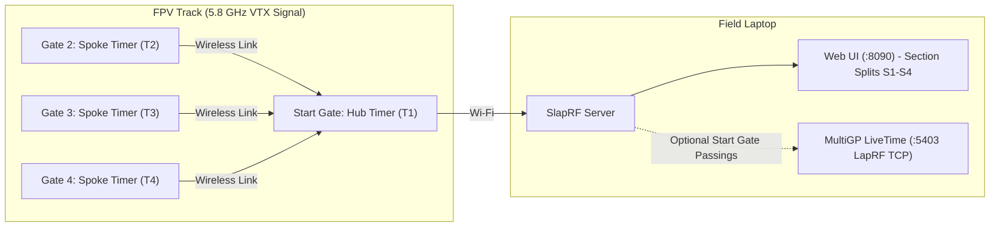
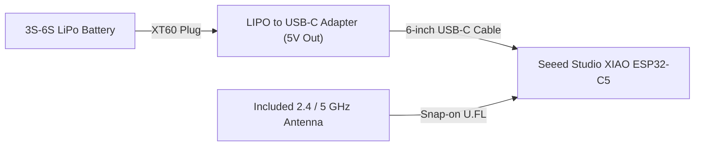

# SlapRF

SlapRF is a multi-gate 5.8 GHz sector timing system for FPV drone racing.

The name **SlapRF** comes from how you build it: you slap four off-the-shelf parts together with no soldering, no custom PCBs, and no wiring harness.

A standard lap timer measures only total lap time at the start gate. SlapRF places additional timers at gates around the track to measure split times for each track section (`S1`, `S2`, `S3`, `S4`). Pilots can compare section times across laps to see where they gained or lost time.

## Demo

Try SlapRF right in your browser—no hardware or installation required:

👉 **[Launch the Live Demo (`kaack.github.io/SlapRF`)](https://kaack.github.io/SlapRF/)**

The live demo runs a built-in 4-gate, 4-pilot track simulator so you can explore live lap & section timing (`S1`–`S4`), per-pilot bottleneck analytics, 5.8 GHz gate signal traces, spoken lap callouts, and the USB firmware flasher directly in the browser.

## Intended Use: LiveTime Companion or Standalone Practice

SlapRF does not replace official race timing systems such as **MultiGP LiveTime** or **ImmersionRC LapRF**.

You can use SlapRF in two ways:

1. **Companion to MultiGP LiveTime**: SlapRF emulates an ImmersionRC LapRF 8-way timer over TCP on port `5403`. When you connect LiveTime to `localhost:5403`, SlapRF receives the pilot callsigns and 5.8 GHz frequencies from LiveTime. When a pilot crosses the start gate, SlapRF sends that crossing to LiveTime for official lap scoring and records the intermediate section splits (`S1`, `S2`, `S3`, `S4`) in the SlapRF web interface.
2. **Standalone practice timer**: You can run SlapRF on a laptop or phone at the field with 1 to 6 timers. The web interface provides spoken lap times, live 5.8 GHz signal graphs, threshold calibration, and section comparisons.

## How It Works

A SlapRF setup uses one **Hub timer** and up to 5 **Spoke timers** (up to 6 timers total):

- **Hub timer**: Placed at the start/finish gate and connected to your laptop or phone hotspot over Wi-Fi. It measures 5.8 GHz VTX signal strength at its own gate and collects wireless readings from all Spoke timers on the course.
- **Spoke timers**: Placed at intermediate gates around the track. They continuously measure 5.8 GHz VTX signal strength for up to 8 pilots and stream their readings wirelessly back to the Hub.

You flash and configure the timers directly from Chrome, Edge, or Brave over USB-C (even from the [web app](https://kaack.github.io/SlapRF/) with no software installed). No compiler, driver installation, or command-line tool is required.

## Parts List and Cost

Each gate timer uses four off-the-shelf parts. One XIAO ESP32-C5 draws less than `100 mA` at `5 V` (`0.5 W`), so a `650 mAh` 3S LiPo battery powers a timer for about 8 hours.

| Part | Purpose | Product Links | Est. Cost (USD) |
| :--- | :--- | :--- | :--- |
| **Seeed Studio XIAO ESP32-C5** (includes external 2.4 / 5 GHz U.FL antenna) | Measures 5.8 GHz VTX signal strength and sends data over ESP-NOW and Wi-Fi. | <ul><li>[Seeed Studio XIAO ESP32-C5](https://www.seeedstudio.com/Seeed-Studio-XIAO-ESP32C5-p-6609.html)</li></ul> | $6.90 |
| **LIPO to USB-C Adapter** | Converts 3S to 6S LiPo battery power to `5 V` USB-C output. | <ul><li>[SpeedyBee Goggles BEC](https://www.google.com/search?tbm=shop&q=SpeedyBee+Goggles+BEC)</li><li>[AOKoda XT60 to USB Converter](https://www.google.com/search?tbm=shop&q=AOKoda+XT60+to+USB+Converter)</li></ul> | $8.00 – $20.00 |
| **Short USB-C to USB-C cable (straight plugs)** | Connects the LIPO to USB-C Adapter to the XIAO ESP32-C5. Also used to flash firmware from a laptop. | <ul><li>[Adafruit 6" USB-C to USB-C Cable](https://www.adafruit.com/product/4198)</li></ul> | $8.50 |
| **Small 3S LiPo battery (XT60)** | Powers the timer in the field. A minimum of `650 mAh` provides about 8 hours of runtime (or use any retired 3S–6S flight pack). | <ul><li>[Tattu 850mAh 3S XT60 LiPo](https://www.google.com/search?tbm=shop&q=Tattu+850mAh+3S+XT60+LiPo)</li></ul> | $15.00 (or $0 with a spare pack) |

### Estimated Total Cost

- **1 timer**: $23 to $35 (using an existing LiPo battery) or $38 to $50 (with a new 3S LiPo)
- **4-gate track (`1 Hub + 3 Spokes`)**: $92 to $140 total (using existing LiPo batteries)

## Hardware Assembly

No soldering is required.

1. Attach the included U.FL antenna to the antenna connector on the XIAO ESP32-C5.
2. Connect the XIAO ESP32-C5 to your laptop with a USB-C cable.
3. Open **Settings > Flasher** in the SlapRF web interface. Flash one timer as **Hub** and the remaining timers as **Spoke**.
4. At the field, connect each XIAO ESP32-C5 to a LIPO to USB-C Adapter and a LiPo battery. Place one timer at each gate.
5. Open **Settings > Track** and drag each timer (`T1`, `T2`, `T3`, `T4`) onto the track line in the order pilots fly the course. Click the checkered flag icon below a gate to set the start gate.

## Download and Run

Download the latest standalone binary for your operating system from the [Releases page](https://github.com/kaack/SlapRF/releases/latest):

| Operating System | Download |
| :--- | :--- |
| **Windows (x64)** | [`slaprf-windows-amd64.exe`](https://github.com/kaack/SlapRF/releases/latest/download/slaprf-windows-amd64.exe) |
| **macOS (Apple Silicon)** | [`slaprf-macos-arm64`](https://github.com/kaack/SlapRF/releases/latest/download/slaprf-macos-arm64) |
| **macOS (Intel)** | [`slaprf-macos-amd64`](https://github.com/kaack/SlapRF/releases/latest/download/slaprf-macos-amd64) |
| **Linux (x64)** | [`slaprf-linux-amd64`](https://github.com/kaack/SlapRF/releases/latest/download/slaprf-linux-amd64) |
| **Linux (ARM64)** | [`slaprf-linux-arm64`](https://github.com/kaack/SlapRF/releases/latest/download/slaprf-linux-arm64) |

1. **Windows**: Double-click `slaprf-windows-amd64.exe`. It starts the server and opens `http://localhost:8090` in your browser automatically.
2. **macOS and Linux**: Run `chmod +x slaprf-* && ./slaprf-*` in a terminal to start the server and open `http://localhost:8090`.
3. For USB timer flashing (`Settings > Flasher`), open `http://localhost:8090` in Chrome, Edge, or Brave.
