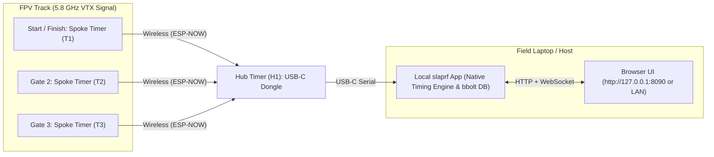
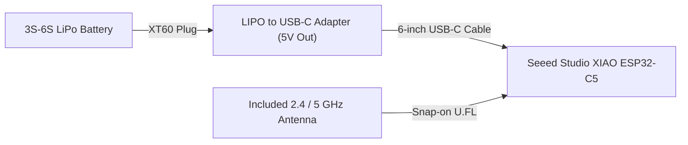

# SlapRF

SlapRF is a standalone FPV drone timing and race management application with multi-gate 5.8 GHz section split timing.

The name **SlapRF** comes from the DIY gate hardware: you assemble four off-the-shelf parts with no soldering, no custom PCBs, and no wiring harness. The SlapRF application also works with **RotorHazard** and **ImmersionRC LapRF 8-Way** timing systems.

A single-gate timer measures total lap time at the start/finish gate. When you place additional timers at gates around the track, SlapRF also measures split times for each track section (`S1`, `S2`, `S3`, and so on) so pilots can see where they gained or lost time.

## Demo

Preview SlapRF in your browser with no hardware or installation required:

👉 **[Open the Interactive Demo (`slaprf.app`)](https://slaprf.app)**

> **Note:** `slaprf.app` is an interactive **browser demo** preloaded with a simulated SlapRF Hub, 3 Spoke timers, sample practice sessions, and sample races. Because browser tab throttling and WebAssembly timing performance vary by device, **`slaprf.app` is for demonstration only**. To time real practices or run live races, [download and run the local SlapRF app](#run) on your computer.

## How SlapRF System Works

A DIY **SlapRF** track uses one **Hub timer** and up to 6 **Spoke timers**:

- **Hub timer (`H1`)**: A USB-C dongle connected to your computer. It receives wireless readings from all Spoke timers over ESP-NOW and sends them to the local `slaprf` server over USB-C. By default, it stays off-track as a dedicated receiver. If a gate is within USB cable reach, you can drag the Hub onto that gate in the **Track** editor so it times that gate as well.
- **Spoke timers (`T1`–`T6`)**: Placed at gates around the track (Gate 1 is Start / Finish). Each Spoke sweeps up to 8 active 5.8 GHz VTX frequencies across Raceband, Fatshark, Boscam, and IMD6 channels and sends its readings wirelessly to the Hub.

You flash and configure SlapRF XIAO ESP32-C5 boards directly from the **Flasher** page in the local app. No compiler, Arduino IDE, or command-line flashing tool is required. Flashing runs in the browser over WebSerial, so use Chrome, Edge, or Opera on a desktop computer.

## Intended Use

SlapRF is a complete timing application with two main workflows:

1. **Practice Timer**: Run open or structured practice sessions with spoken lap callouts, live 5.8 GHz signal traces, per-pilot threshold calibration, consistency metrics, and multi-gate section split analytics (`S1`, `S2`, `S3`, ...).
2. **Race Management**: Manage full race events from pilot check-in to podium. Features include a visual stage and bracket editor (Double Elimination, Single Elimination, Qualifying, Open Qualifier, Points Mains, Chase the Ace, or custom round graphs), live Race Control with automated horn and voice announcements, Marshal Review with recorded Start/Finish RSSI waveforms, and MultiGP Chapter race import and result upload.

## Compatibility

SlapRF supports DIY SlapRF timers and standard FPV timing hardware over USB or local network:

| Timing Hardware | USB | Network (LAN) | Notes |
| :--- | :---: | :---: | :--- |
| **SlapRF** (XIAO ESP32-C5 Hub & Spoke) | ✅ | — | USB-C Hub dongle with wireless ESP-NOW Spoke timers (1–6 gates, section splits, built-in USB firmware flasher) |
| **RotorHazard** | ✅ | ✅ | Direct USB serial nodes or LAN connection to a RotorHazard timing server (`HTTP` / `Socket.IO`) |
| **ImmersionRC LapRF 8-Way** | — | ✅ | Ethernet LAN connection over the native LapRF binary protocol (`TCP :5403`) |

## Parts List and Cost (DIY SlapRF Timers)

Each SlapRF gate timer uses four off-the-shelf parts. One XIAO ESP32-C5 draws less than `100 mA` at `5 V` (`0.5 W`), so a `650 mAh` 3S LiPo battery powers a timer for about 8 hours.

| Part | Purpose | Product Links | Est. Cost (USD) |
| :--- | :--- | :--- | :--- |
| **Seeed Studio XIAO ESP32-C5** (includes external 2.4 / 5 GHz U.FL antenna) | Measures 5.8 GHz VTX signal strength and sends telemetry over ESP-NOW (the Hub forwards packets to the computer over USB-C). | <ul><li>[Seeed Studio XIAO ESP32-C5](https://www.seeedstudio.com/Seeed-Studio-XIAO-ESP32C5-p-6609.html)</li></ul> | $6.90 |
| **LIPO to USB-C Adapter** | Converts 3S to 6S LiPo battery power to `5 V` USB-C output. | <ul><li>[SpeedyBee Goggles BEC](https://www.google.com/search?tbm=shop&q=SpeedyBee+Goggles+BEC)</li><li>[AOKoda XT60 to USB Converter](https://www.google.com/search?tbm=shop&q=AOKoda+XT60+to+USB+Converter)</li></ul> | $8.00 – $20.00 |
| **Short USB-C to USB-C cable (straight plugs)** | Connects the LIPO to USB-C Adapter to the XIAO ESP32-C5. Also used to flash firmware from a computer. | <ul><li>[Adafruit 6" USB-C to USB-C Cable](https://www.adafruit.com/product/4198)</li></ul> | $8.50 |
| **Small 3S LiPo battery (XT60)** | Powers the timer in the field. A `650 mAh` pack gives about 8 hours of runtime (or use any spare 3S–6S flight pack). | <ul><li>[Tattu 850mAh 3S XT60 LiPo](https://www.google.com/search?tbm=shop&q=Tattu+850mAh+3S+XT60+LiPo)</li></ul> | $15.00 (or $0 with a spare pack) |

### Estimated Total Cost

- **1 timer**: $23 to $35 (with an existing LiPo battery) or $38 to $50 (with a new 3S LiPo)
- **3-gate track (`1 Hub + 3 Spokes`)**: $92 to $140 total (with existing LiPo batteries; drag the Hub onto a fourth gate if it is within USB cable reach)

## Hardware Assembly

No soldering is required.

1. Attach the included U.FL antenna to the antenna connector on the XIAO ESP32-C5.
2. Connect the XIAO ESP32-C5 to your computer with a USB-C cable.
3. Open **Flasher** in the local SlapRF web interface. Flash one board as **Hub** and the remaining boards as **Spoke**.
4. At the field, connect each Spoke timer to a LIPO to USB-C Adapter and a LiPo battery, and place one timer at each gate. Plug the Hub timer into your laptop over USB-C.
5. Open **Track** and drag each timer onto the track map in the order pilots fly the course. Click the checkered flag icon on a gate to set Start / Finish.

### Tips for Reliable Flashing

- **Use a good USB-C data cable.** A known, good-quality cable (USB 3.x is best) works much better than a cheap or charge-only cable. The short field cable may not be good enough for flashing.
- **Plug the board straight into the computer.** Do not use a USB hub, dock, or extension cable while you flash.
- **Use Chrome, Edge, or Opera on a desktop computer.** Flashing uses WebSerial. Firefox and Safari do not support it.
- **Flash one board at a time.** When the browser asks for a USB port, pick the **USB JTAG/serial** device of the board you want to flash.
- **Keep the Hub and all Spokes on the same firmware version.** When updating firmware, reflash both the Hub and every Spoke timer so their wire protocol matches.
- **If a board stops responding,** unplug it for a few seconds (also disconnect its battery, if one is attached), plug it back in, and try again. The BOOT button is not needed for normal flashing.

## Powering

When timing a practice or race, **only the Hub timer (`H1`) needs to be connected to your computer**. All **Spoke timers (`T1`–`T6`)** communicate wirelessly with the Hub and should be powered separately from a LiPo battery (with a LiPo-to-USB-C adapter), a USB-C power bank, or a USB wall charger (`1 A` or more).

When flashing firmware, you may be tempted to plug multiple timers into your computer at the same time. **Avoid this and connect only one board at a time.** Each XIAO ESP32-C5 draws about `90 mA` on average while sweeping and short peaks up to `320 mA` when transmitting on 2.4 GHz at `+20 dBm` (Espressif ESP32-C5 datasheet: 802.11b TX at 20 dBm = 320 mA peak, RX = 87 mA). Because computer USB ports supply `500 mA` (USB 2.0) or `900 mA` (USB 3.x) and often share a single `5 V` power rail, having several boards plugged into the computer at once causes overlapping transmit peaks that sag the `5 V` supply and trigger brownout resets:

- Boards appear and disappear in the browser's USB port list or operating system.
- A Spoke LED stays blinking yellow (searching for the Hub) and never joins.
- Flashing fails partway through with a lost connection.

## Run

For real practices and races, run the standalone `slaprf` application on your laptop (Windows, macOS, or Linux) or Raspberry Pi and open it in your browser:

1. Download the binary for your operating system from [GitHub Releases](https://github.com/kaack/SlapRF/releases/latest):
   - Windows: `slaprf-windows-amd64.exe`
   - macOS (Apple Silicon / Intel): `slaprf-darwin-arm64` or `slaprf-darwin-amd64`
   - Linux (`x86_64` / ARM64): `slaprf-linux-amd64` or `slaprf-linux-arm64`
2. Start the binary (on macOS and Linux, run `chmod +x slaprf-*` first). By default, it starts the local server at `http://127.0.0.1:8090`, saves all event and lap data to `slaprf.db`, and opens your default browser.
3. To let Race Directors, spotters, or pilots on the same Wi-Fi network view or control the timer from phones and tablets, start it with `-lan` (and optionally enable HTTP Basic Authentication in **Settings**).

Developers building from source can run `go run ./cmd/build-portable` or `go run ./cmd/slaprf`. See [docs/DEVELOPER.md](docs/DEVELOPER.md) and [docs/ARCHITECTURE.md](docs/ARCHITECTURE.md).

## Related ESP32-C5 Projects & References

Other open-source projects exploring 5.8 GHz SDR capture, spectrum scanning, video reception, and FPV timing on the ESP32-C5 chip:

- [**C5VRX** (`Twotoz/C5VRX`)](https://github.com/Twotoz/C5VRX): Experimental project that turns an ESP32-C5 into a 5.8 GHz analog FPV video receiver.
- [**ESP-SDR** (`ESPARGOS/esp-sdr`)](https://github.com/ESPARGOS/esp-sdr): Software-defined radio (SDR) raw I/Q capture on the ESP32-C5 using the internal radio ADC test path.
- [**FPVGate** (`LouisHitchcock/FPVGateC5MK`)](https://github.com/LouisHitchcock/FPVGateC5MK): ESP32-C5 5.8 GHz FPV lap timing firmware and hardware radio internals reference.
- [**Widscan58** (`CapnBry/widscan58`)](https://github.com/CapnBry/widscan58): Wideband 5.8 GHz FPV spectrum scanner on the ESP32-C5 by CapnBry.
