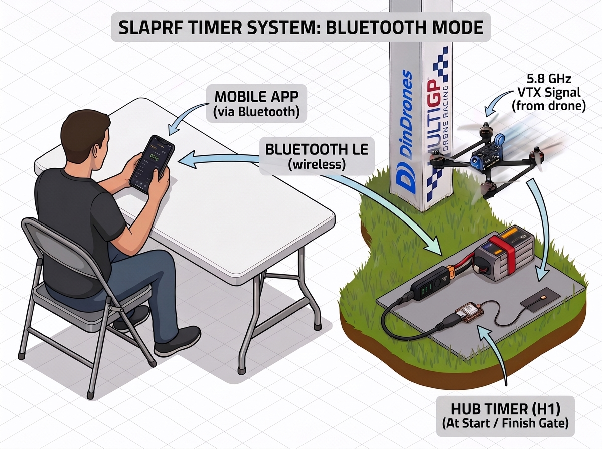
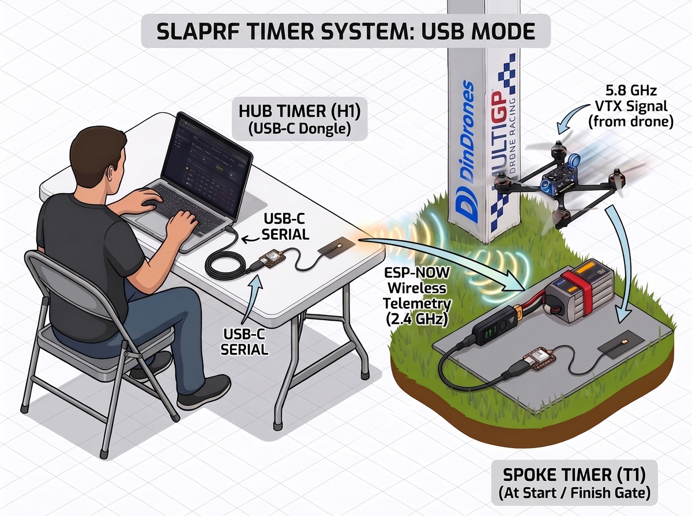
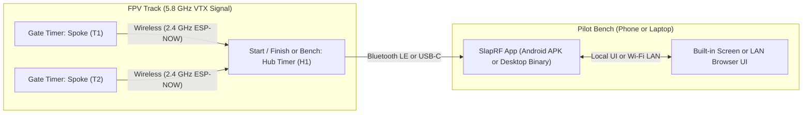
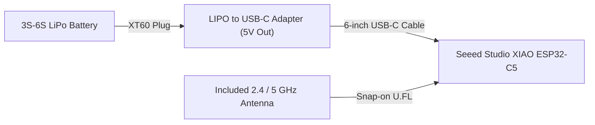

# SlapRF

SlapRF is a standalone FPV drone timing and race management application with multi-gate 5.8 GHz section split timing.

The name **SlapRF** comes from the DIY gate hardware: you assemble four off-the-shelf parts with no soldering, no custom PCBs, and no wiring harness. The SlapRF application runs natively on Windows, macOS, Linux, and Android, and also supports **RotorHazard** and **ImmersionRC LapRF 8-Way** timing systems.

A single-gate timer measures total lap time at the Start / Finish gate. When you place additional timers at gates around the track, SlapRF also measures split times for each track section (`S1`, `S2`, `S3`, and so on) so pilots can see where they gained or lost time.

  
  
  
  
  

## Demo & Community

- 👉 **[Open the Interactive Demo (`slaprf.app`)](https://slaprf.app)**: Preview SlapRF in your browser with no hardware or installation required.
- 💬 **[Join the SlapRF Discord Server (`discord.gg/zNrV3auRss`)](https://discord.gg/zNrV3auRss)**: Ask questions, share your XIAO ESP32-C5 gate timer builds, get help with calibration, and follow new releases.

> **Note:** `slaprf.app` is an interactive **browser demo** preloaded with a simulated SlapRF Hub, 3 Spoke timers, sample practice sessions, and sample races. Because browser tab throttling and WebAssembly timing performance vary by device, **`slaprf.app` is for demonstration only**. To time real practices or run live races, [download and run the SlapRF app](#run) on your computer or Android phone.

## How the SlapRF System Works

A DIY **SlapRF** track uses one **Hub timer (`H1`)** and up to 6 **Spoke timers (`T1` to `T6`)**:

- **Hub timer (`H1`)**: Collects wireless readings from all Spoke timers over 2.4 GHz ESP-NOW and sends them to the SlapRF app on your phone or computer. You can run the Hub in **Bluetooth** mode or **USB** mode:
  - **Bluetooth Hub (wireless)**: Place the Hub at the Start / Finish gate on a battery. It times the Start / Finish gate directly and sends all track readings over Bluetooth to your phone or laptop at the pilot bench. No USB cable is needed during flight, which makes setup fast for regular practice.
  - **USB Hub (wired)**: Plug the Hub into your laptop or Android phone with a USB-C cable. USB gives the lowest latency when you want minimum delay. By default, a USB Hub stays at the bench as a receiver, or you can drag it onto a gate in the **Track** editor if your USB cable reaches that gate.
- **Spoke timers (`T1` to `T6`)**: Placed at gates around the track. Each Spoke sweeps up to 8 active 5.8 GHz VTX frequencies across Raceband, Fatshark, Boscam, and IMD6 channels and sends its readings wirelessly to the Hub.

### Bluetooth Mode

### USB Mode

You flash and configure SlapRF XIAO ESP32-C5 boards directly from the **Flasher** page in Chrome, Edge, or Opera on a desktop computer over USB-C. No compiler, Arduino IDE, or command-line tool is required. In the Flasher, choose **Hub (Bluetooth)** or **Hub (USB)** for your Hub board, and **Spoke** for your remaining gate boards.

## Intended Use

SlapRF supports two main workflows:

1. **Practice Timer**: Run open or structured practice sessions with spoken lap callouts, live 5.8 GHz signal traces, one-tap threshold calibration, per-timer detection fine-tuning, consistency metrics, and multi-gate section split analytics (`S1`, `S2`, `S3`, ...).
2. **Race Management**: Manage full race events from pilot check-in to podium. Features include a visual stage and bracket editor (Double Elimination, Single Elimination, Qualifying, Open Qualifier, Points Mains, Chase the Ace, or custom round graphs), live Race Control with automated horn and voice announcements, Marshal Review with recorded Start / Finish RSSI waveforms, and MultiGP Chapter race import and result upload.

## Compatibility

SlapRF supports DIY SlapRF timers and standard FPV timing hardware over Bluetooth, USB, or local network:

| Timing Hardware | Bluetooth | USB | Network (LAN) | Notes |
| :--- | :---: | :---: | :---: | :--- |
| **SlapRF** (XIAO ESP32-C5 Hub & Spoke) | Yes | Yes | No | Wireless Bluetooth Hub or wired USB-C Hub with wireless ESP-NOW Spoke timers (1 to 6 gates, section splits, built-in USB firmware flasher) |
| **RotorHazard** | No | Yes | Yes | Direct USB serial nodes or LAN connection to a RotorHazard timing server (`HTTP` / `Socket.IO`) |
| **ImmersionRC LapRF 8-Way** | No | No | Yes | Ethernet LAN connection over the native LapRF binary protocol (`TCP :5403`) |

## Parts List and Cost (DIY SlapRF Timers)

Each battery-powered gate timer uses four off-the-shelf parts. One XIAO ESP32-C5 draws less than `100 mA` at `5 V` (`0.5 W`), so a `650 mAh` 3S LiPo battery powers a timer for about 8 hours.

| Part | Purpose | Product Links | Est. Cost (USD) |
| :--- | :--- | :--- | :--- |
| **Seeed Studio XIAO ESP32-C5** (includes external 2.4 / 5 GHz U.FL antenna) | Measures 5.8 GHz VTX signal strength and communicates over ESP-NOW, Bluetooth LE, or USB-C. | <ul><li>[Seeed Studio XIAO ESP32-C5](https://www.seeedstudio.com/Seeed-Studio-XIAO-ESP32C5-p-6609.html)</li></ul> | $6.90 |
| **LIPO to USB-C Adapter** | Converts 3S to 6S LiPo battery power to `5 V` USB-C output. | <ul><li>[SpeedyBee Goggles BEC](https://www.google.com/search?tbm=shop&q=SpeedyBee+Goggles+BEC)</li><li>[AOKoda XT60 to USB Converter](https://www.google.com/search?tbm=shop&q=AOKoda+XT60+to+USB+Converter)</li></ul> | $8.00 to $20.00 |
| **Short USB-C to USB-C cable (straight plugs)** | Connects the LIPO to USB-C Adapter to the XIAO ESP32-C5. | <ul><li>[Adafruit 6" USB-C to USB-C Cable](https://www.adafruit.com/product/4198)</li></ul> | $8.50 |
| **Small 3S LiPo battery (XT60)** | Powers the timer on the track. A `650 mAh` pack gives about 8 hours of runtime (or use any spare 3S to 6S flight pack). | <ul><li>[Tattu 850mAh 3S XT60 LiPo](https://www.google.com/search?tbm=shop&q=Tattu+850mAh+3S+XT60+LiPo)</li></ul> | $15.00 (or $0 with a spare pack) |

### Estimated Total Cost

- **1 battery-powered gate timer (Bluetooth Hub)**: $23 to $35 (with a spare LiPo battery) or $38 to $50 (with a new 3S LiPo)
- **3-gate Bluetooth track (`1 Bluetooth Hub at Start/Finish + 2 Spokes`)**: $69 to $105 total (with spare LiPo batteries)
- **3-gate USB track (`1 USB Hub at laptop + 3 Spokes`)**: $76 to $112 total (the USB Hub gets power from the laptop USB port and needs no battery adapter)

## Hardware Assembly

No soldering is required.

1. Snap the included U.FL antenna onto the antenna connector on the XIAO ESP32-C5.
2. Connect one XIAO ESP32-C5 at a time to a desktop computer with a USB-C data cable.
3. Open **Flasher** in Chrome, Edge, or Opera. Flash one board as **Hub (Bluetooth)** or **Hub (USB)**, and flash the remaining boards as **Spoke**.
4. At the field:
   - **Bluetooth mode**: Power the Bluetooth Hub and each Spoke timer from a LiPo battery (or USB power bank). Place the Bluetooth Hub at the Start / Finish gate and place Spokes at the remaining gates. Keep your phone or laptop with you at the bench, open **Network**, and connect to the Hub over Bluetooth.
   - **USB mode**: Power each Spoke timer from a LiPo battery at its gate, and plug the USB Hub into your laptop or Android phone over USB-C.
5. Open **Track** and arrange the timers in the order pilots fly the course. Click the checkered flag icon on a gate to mark Start / Finish.

### Tips for Reliable Flashing

- **Use a good USB-C data cable.** A good USB data cable works much better than a charge-only cable.
- **Plug the board straight into the computer.** Do not use a USB hub, dock, or extension cable while flashing.
- **Use Chrome, Edge, or Opera on a desktop computer.** Flashing uses WebSerial. Firefox and Safari do not support WebSerial.
- **Flash one board at a time.** When the browser asks for a USB port, pick the **USB JTAG/serial** device of the board you want to flash.
- **Keep all Spokes on the matching firmware version.** When updating firmware, update both your Hub and your Spoke timers so their wire protocol matches.
- **If a board stops responding,** unplug it for a few seconds (and disconnect any attached battery), plug it back in, and try again. You do not need to press the BOOT button for normal flashing.

## Powering

- **Bluetooth Hub mode**: Nothing plugs into your phone or laptop during flight. Both the Bluetooth Hub at the Start / Finish gate and all Spoke timers run from LiPo batteries (with a `5 V` USB-C adapter) or USB-C power banks (`1 A` or higher).
- **USB Hub mode**: Only the USB Hub (`H1`) plugs into your computer or phone. All Spoke timers (`T1` to `T6`) run from LiPo batteries or USB power banks at their gates.

When flashing firmware over USB, **connect only one board to your computer at a time**. Each XIAO ESP32-C5 draws about `90 mA` on average while sweeping and short peaks up to `320 mA` when transmitting on 2.4 GHz at `+20 dBm` (Espressif ESP32-C5 datasheet: 802.11b TX at 20 dBm = 320 mA peak, RX = 87 mA). Computer USB ports supply `500 mA` (USB 2.0) or `900 mA` (USB 3.x) and often share a single `5 V` rail. Plugging several boards into the computer at once can cause voltage drops and brownout resets:

- Boards appear and disappear in the USB port list.
- A Spoke LED stays blinking yellow (searching for the Hub) and never joins.
- Flashing fails partway through with a lost connection.

## Run

Download the latest release for your device from [GitHub Releases](https://github.com/kaack/SlapRF/releases/latest):

- **Android (`ARM64` phone or tablet)**: `slaprf-android-arm64.apk`
- **Windows (`x86_64`)**: `slaprf-windows-amd64.exe`
- **macOS (Apple Silicon / Intel)**: `slaprf-macos-arm64` or `slaprf-macos-amd64`
- **Linux (`x86_64` / `ARM64`)**: `slaprf-linux-amd64` or `slaprf-linux-arm64`

### Android App

1. Download `slaprf-android-arm64.apk` on your Android phone or tablet and install it.
2. Open **SlapRF**, go to **Settings -> Hardware** to select **SlapRF (Bluetooth)** or **SlapRF (USB)**, and connect to your Hub in **Network**.

### Desktop & Raspberry Pi

1. Start the downloaded binary (on macOS and Linux, run `chmod +x slaprf-*` first). By default, it starts the local server at `http://127.0.0.1:8090`, saves all event and lap data to `slaprf.db`, and opens your default browser.
2. To let other phones, tablets, or laptops on the same Wi-Fi network view or control the timer, start it with `-lan` (and optionally enable HTTP Basic Authentication in **Settings**).

Developers building from source can run `go run ./cmd/build-portable`, `go run ./cmd/build-android`, or `go run ./cmd/slaprf`. See [docs/DEVELOPER.md](docs/DEVELOPER.md) and [docs/ARCHITECTURE.md](docs/ARCHITECTURE.md).

## Related ESP32-C5 Projects & References

Other open-source projects exploring 5.8 GHz SDR capture, spectrum scanning, video reception, and FPV timing on the ESP32-C5 chip:

- [**C5VRX** (`Twotoz/C5VRX`)](https://github.com/Twotoz/C5VRX): Experimental project that turns an ESP32-C5 into a 5.8 GHz analog FPV video receiver.
- [**ESP-SDR** (`ESPARGOS/esp-sdr`)](https://github.com/ESPARGOS/esp-sdr): Software-defined radio (SDR) raw I/Q capture on the ESP32-C5 using the internal radio ADC test path.
- [**FPVGate** (`LouisHitchcock/FPVGateC5MK`)](https://github.com/LouisHitchcock/FPVGateC5MK): ESP32-C5 5.8 GHz FPV lap timing firmware and hardware radio internals reference.
- [**Widscan58** (`CapnBry/widscan58`)](https://github.com/CapnBry/widscan58): Wideband 5.8 GHz FPV spectrum scanner on the ESP32-C5 by CapnBry.
