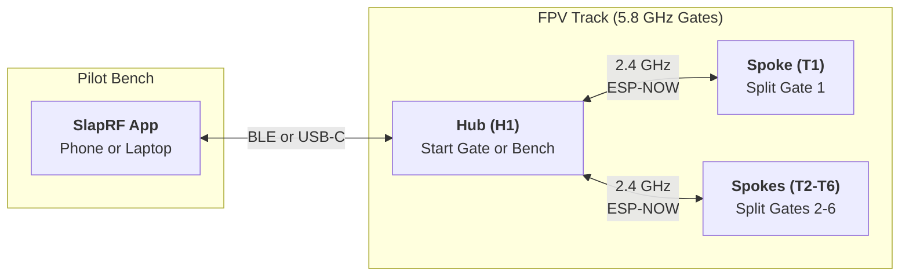

SlapRF separates race logic on your phone or laptop from raw 5.8 GHz signal measurement at the gates, giving you low-cost hardware on the course and full race analytics at the pilot bench.

## System Overview

Gate timers (`H1` and `T1` through `T6`) sweep up to 8 active 5.8 GHz VTX frequencies and stream timestamped RSSI samples to the host device. The SlapRF app filters the live signal stream, detects gate crossings, computes lap and section split times (`S1`, `S2`, `S3`), announces spoken callouts, and stores all session history in `slaprf.db`.

## Bluetooth vs. USB Mode

A SlapRF track uses one Hub timer (`H1`) and up to 6 optional Spoke timers (`T1` through `T6`). Both Hub modes support single-gate lap timing and multi-gate section split timing.


  
  Bluetooth Mode (`slaprf-xiao-c5-ble.bin`) removes all cables between the track and the pilot bench.

  Power the Bluetooth Hub (`H1`) from a LiPo battery (via a `5 V` USB-C BEC) or USB power bank and place it directly at the Start / Finish gate. Your phone or laptop stays with you at the bench and connects over Bluetooth Low Energy. Optional Spoke timers (`T1` to `T5`) at split gates link to the Hub over 2.4 GHz ESP-NOW, and the Hub forwards every gate reading over Bluetooth.

  
  
  
  USB Mode (`slaprf-xiao-c5.bin`) connects the Hub directly to your laptop or Android phone over a USB-C data cable for minimum transport latency.

  The host USB port powers `H1` directly with no battery required at the bench. Battery-powered Spoke timers (`T1` to `T6`) sit at the track gates, including Start / Finish. If your USB cable reaches the Start / Finish gate, you can also place `H1` directly on the Start / Finish gate in the **Track** editor.

  
  


### Mode Comparison

| Aspect | Bluetooth Hub | USB Hub |
| :--- | :--- | :--- |
| Firmware Image | `slaprf-xiao-c5-ble.bin` | `slaprf-xiao-c5.bin` |
| Host Connection | Wireless Bluetooth LE | USB-C data cable |
| Hub Power Source | LiPo + `5 V` BEC (or power bank) | Host phone or laptop USB port |
| Typical Placement | At the Start / Finish gate | At the pilot bench (or Start / Finish via cable) |
| Wireless Spokes | Up to 5 Spokes + Hub (6 gates) | Up to 6 Spokes |
| Transport Latency | Low (ideal for solo & club practice) | Lowest (ideal for formal race heats) |

> [!TIP]
> For everyday practice, Bluetooth Mode is the fastest field setup: place one battery-powered Hub at the Start / Finish gate, connect from your phone at the bench, and fly. For formal race heats where lowest wired latency matters most, use a USB Hub.
