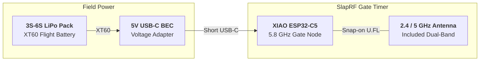

Each battery-powered SlapRF Gate Timer snaps together from off-the-shelf parts with no soldering or custom PCBs required, and fits inside a compact 3D-printed case for field durability.

## Bill of Materials

One Seeed Studio XIAO ESP32-C5 draws under `100 mA` at `5 V` (`0.5 W`), so a compact `650 mAh` 3S LiPo pack runs a gate timer for roughly 8 hours.

| Part | Purpose | Example Source | Est. Cost |
| :--- | :--- | :--- | ---: |
| XIAO ESP32-C5 | Measures 5.8 GHz VTX RSSI and communicates over ESP-NOW, Bluetooth LE, or USB-C (includes snap-on U.FL antenna). | [Seeed Studio](https://www.seeedstudio.com/Seeed-Studio-XIAO-ESP32C5-p-6609.html) | \$6.90 |
| 5 V USB-C BEC | Steps down 3S-6S LiPo voltage to regulated `5 V` USB-C power. | [SpeedyBee BEC](https://www.google.com/search?tbm=shop&q=SpeedyBee+Goggles+BEC) [AOKoda XT60 USB](https://www.google.com/search?tbm=shop&q=AOKoda+XT60+to+USB+Converter) | \$8.00 - \$20.00 |
| Short USB-C Cable | Short USB-C PD cable connecting the `5 V` BEC output to the XIAO ESP32-C5. | [Short USB-C PD Cable](https://www.amazon.com/s?k=short+usb-c+pd-cable) | \$5.00 - \$9.00 |
| 3S-6S LiPo Pack | Powers the gate timer in the field (any spare XT60 flight pack or low-current USB power bank works). | [Tattu 850mAh 3S](https://www.google.com/search?tbm=shop&q=Tattu+850mAh+3S+XT60+LiPo) | \$15.00 |

### Example Track Costs

| Setup | Boards Needed | Typical Total |
| :--- | :--- | ---: |
| 1-Gate Bluetooth | 1 Bluetooth Hub (`H1`) + spare LiPo | \$23 - \$35 |
| 3-Gate Bluetooth | 1 Bluetooth Hub + 2 Spokes (`T1`, `T2`) | \$69 - \$105 |
| 3-Gate Wired USB | 1 USB Hub (laptop-powered) + 3 Spokes (`T1`-`T3`) | \$76 - \$112 |

## Board Layout

Use this callout diagram to locate the USB-C port, yellow status LED (`L`), U.FL antenna connector, `BOOT` button (`B`), and `RESET` button (`R`) on the XIAO ESP32-C5:

## Hardware Assembly

The setup below shows the barebones way to put a gate timer together using a USB-C adapter and a spare LiPo pack. While barebones wiring works right away for testing, we recommend buying or 3D printing an enclosure (see [Recommended Cases](#recommended-cases) below) to protect the XIAO board and U.FL antenna from prop strikes, dust, and wet grass on the course.

{}

### Attach Antenna

Align the included dual-band (`2.4 / 5 GHz`) U.FL antenna plug flat over the gold receptacle on the XIAO ESP32-C5 and press straight down until it clicks into place.

> [!WARNING]
> Always snap on the U.FL antenna before applying power. Operating without the antenna severely reduces both 5.8 GHz VTX sensitivity and 2.4 GHz wireless range.

### Flash Firmware

Connect one XIAO ESP32-C5 at a time to a desktop computer over USB-C and flash its role using the [Flashing Firmware](flashing) page. Mark each board (`H1`, `T1`, `T2`, `T3`) with tape or a paint pen so placement at the field takes seconds.

### Connect Power

Plug a 3S-6S LiPo battery into the XT60-to-USB-C adapter, then connect the short USB-C cable to the XIAO ESP32-C5. Set the timer flat on the ground centered inside the gate opening.

{}

## Recommended Cases

Enclosing each timer keeps the snap-on U.FL antenna strain-relieved and shields the electronics at the base of the gate. If you do not own a 3D printer, local print shops or online print services can print these STL/3MF files in PETG, ASA, or TPU for a few dollars:

| Enclosure | Design Highlights | Model Link |
| :--- | :--- | :--- |
| Compact XIAO Case | Minimal snap-fit case with a USB-C cutout and dedicated internal space for the included Seeed U.FL antenna. Pair with your external USB-C adapter and LiPo pack. | [MakerWorld #3567817](https://makerworld.com/en/models/3567817-xaio-esp32-c5-case-with-usb-slot-and-antenna-hole) |
| Biscuit 18650 Tube | All-in-one rugged tube enclosure that houses the XIAO ESP32-C5, internal antenna, and an integrated `18650` battery compartment in a single unit. | [MakerWorld #2612343](https://makerworld.com/en/models/2612343-biscuit-diy-node-tube-case-seeed-xiao-esp32-c5) |
| More XIAO C5 Cases | Community enclosures, mounts, and gate clips designed for the Seeed Studio XIAO ESP32-C5 form factor. | [Browse MakerWorld](https://makerworld.com/en/search/models?keyword=xiao+esp32-c5) |

## Track Placement

Center each gate timer on the ground at the base of its gate with the flat antenna element facing upward toward the flight path. Keep pilot pits and powered VTX benches at least 5 to 10 meters away from active gates so parked quads do not hold channel RSSI elevated.

On tight technical courses where an adjacent lane passes right beside a gate, placing the XIAO inside a shallow open-top metal cup or foil-lined tray shields side-lobe RF energy so only direct overhead passes register a peak.
