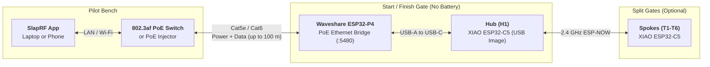

Connect a SlapRF USB Hub (`H1`) or any USB serial device over a single `802.3af` Power-over-Ethernet cable (`up to 100 m`, `100 Mbps` full-duplex) using a Waveshare `ESP32-P4-POE-ETH` board. The PoE cable powers both the bridge and Hub `H1` at the Start / Finish gate with no battery at the gate and `< 0.5 ms` wired LAN latency.

## How It Works

The `slaprf-p4-poe-bridge.bin` firmware turns the Waveshare `ESP32-P4-POE-ETH` into a protocol-agnostic USB-Serial/JTAG to Ethernet bridge:

- **Raw Data Plane (`TCP :5480`)**: Streams raw serial bytes (`TCP_NODELAY=1`) between the onboard USB-A Host port and Ethernet with zero added framing or injected bytes.
- **Out-of-Band Discovery & Control (`UDP :5480`)**: Answers LAN broadcast discovery (`DISCOVER?`) and remote serial line control (`CTRL dtr=<0|1> rts=<0|1> baud=<rate>`) without touching the TCP byte stream.

## Parts Needed

| Part | Purpose | Notes |
| :--- | :--- | :--- |
| Waveshare `ESP32-P4-POE-ETH` | Bridges USB-A serial to `100 Mbps` RMII Ethernet (`IP101GRI`) and regulates `5 V` from PoE. | Use the standard `ESP32-P4-POE-ETH` with the Waveshare `802.3af` PoE hat/module installed. On `WIFI6` variants, the bridge holds `GPIO54` low so the secondary radio stays powered off (`0 mA`, zero `2.4 GHz` noise). |
| XIAO ESP32-C5 (`H1`) | Measures `5.8 GHz` RSSI at the gate and collects `2.4 GHz` ESP-NOW Spokes (`T1`-`T6`). | Flash with the **Hub (`USB cable`)** image (`slaprf-xiao-c5.bin`) and snap on the included U.FL antenna. |
| Short USB-A to USB-C Data Cable | Connects the P4's **USB-A Host** port to the XIAO ESP32-C5 USB-C port. | Must carry USB `D+`/`D-` data lines (not a charge-only cable). |
| `802.3af` PoE Switch or Injector | Injects `48 V` PoE power onto the Cat5e/Cat6 Ethernet cable. | Any IEEE `802.3af` / `802.3at` switch or inline PoE injector works. |
| Cat5e or Cat6 Ethernet Cable | Carries power and `100 Mbps` full-duplex data up to `100 m` (`328 ft`). | Outdoor-rated jacket recommended for permanent field runs. |

## Setup Steps

{}

### Flash Hub H1 (USB Mode)

Plug your Seeed Studio XIAO ESP32-C5 into your computer over USB-C, open the flasher below, select **Hub**, keep **USB cable** (`slaprf-xiao-c5.bin`) in Step 2, and flash `H1`. Unplug the XIAO when finished.



### Flash the ESP32-P4 PoE Bridge

Plug a USB-C data cable into the **USB-C (`UART0` / `CH343`)** port on the Waveshare `ESP32-P4-POE-ETH` and connect it to your computer (or flash from `#/flasher` in the SlapRF desktop or Android app). Click **Open PoE Bridge Flasher** below (`PoE Bridge` is pre-selected), click **Next** through to Step 3, click **Flash PoE Bridge to USB**, and choose the `USB Single Serial` (`1A86:55D3`) port.



### Connect USB-A and PoE at the Gate

Unplug the USB-C programming cable from your computer. Plug Hub `H1` into the **USB-A Host** port on the `ESP32-P4-POE-ETH` using a short USB-A to USB-C data cable, then plug your energized Cat5e/Cat6 PoE cable into the RJ45 port. Both boards boot automatically from PoE power.

### Connect in SlapRF (`SlapRF (Network)`)

Open the SlapRF desktop or Android app on the same network and go to **Network**:

1. Set **Timing system** to **`SlapRF (Network)`**.
2. Click **Discover** to scan `UDP :5480` on the local subnet, select your `ESP32-P4-POE-ETH` bridge, and click **Connect** (or type its IP address and port `5480` directly and click **Connect**).
3. Verify **Hub `H1`** shows **`Ethernet · Active`** in **Topology** with live `100 Hz` `5.8 GHz` RSSI bars. Any powered Spokes (`T1`-`T6`) link to `H1` over `2.4 GHz` ESP-NOW automatically.

{}

## Network Addressing Modes

The bridge works on a router/switch LAN, on a direct cable between a laptop and a PoE injector with no router, or with a fixed static IP:

| Network Topology | Addressing Behavior | How to Connect in SlapRF |
| :--- | :--- | :--- |
| Router or Managed LAN | Acquires an IPv4 lease via **DHCP** on boot. | Click **Discover** in **Network -> `SlapRF (Network)`**, or enter the DHCP IP (`:5480`). |
| Direct Laptop <-> PoE Injector <-> Bridge | Falls back automatically to RFC 3927 link-local **AutoIP** (`169.254.x.x/16`) when no DHCP server answers. | Set your laptop Ethernet adapter to DHCP / Link-Local, then click **Discover** in **Network**. |
| Fixed Static IP | Saved in NVS flash over the USB-C `UART0` console (`115200` baud). | Enter the configured static IP and port `5480`, then click **Connect**. |

## USB-C Management & Generic Serial Reference

You can inspect or configure the bridge over its USB-C port (`115200` baud, newline-terminated ASCII) without affecting the USB-A device:

| `UART0` Command | Action |
| :--- | :--- |
| `STATUS?` | Prints `@{"t":"bridge",...}` JSON with Ethernet link speed, IP, MAC, and attached USB-A `VID:PID`. |
| `NETCFG?` | Prints current DHCP / static IP settings stored in NVS. |
| `NETCFG STATIC <ip> <mask> <gw>` | Saves a static IPv4 configuration in NVS and applies it on reboot. |
| `NETCFG DHCP` | Restores automatic DHCP + link-local AutoIP addressing. |
| `BAUD <rate>` | Sets default UART line coding (`9600` to `2000000`, default `115200`) for USB-UART adapters on USB-A. |
| `REBOOT` | Restarts the `ESP32-P4` bridge. |

> [!TIP]
> Because `TCP :5480` is a raw byte pipe with zero SlapRF-specific framing, you can also plug any CDC-ACM, USB-Serial-JTAG, CP210x, FTDI, or CH34x serial device into USB-A and open it from standard tools (`nc <ip> 5480`, `socat`, PySerial `socket://<ip>:5480`, or `tcp://<ip>:5480`).
