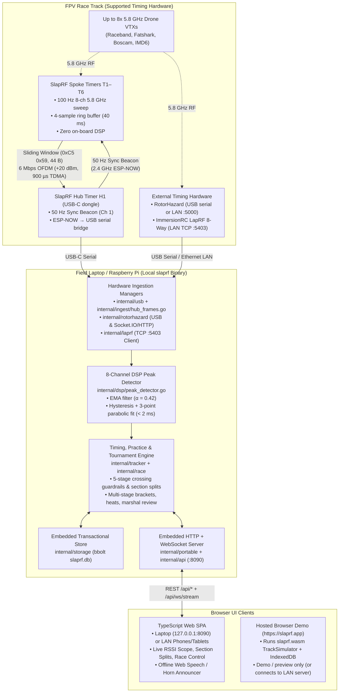
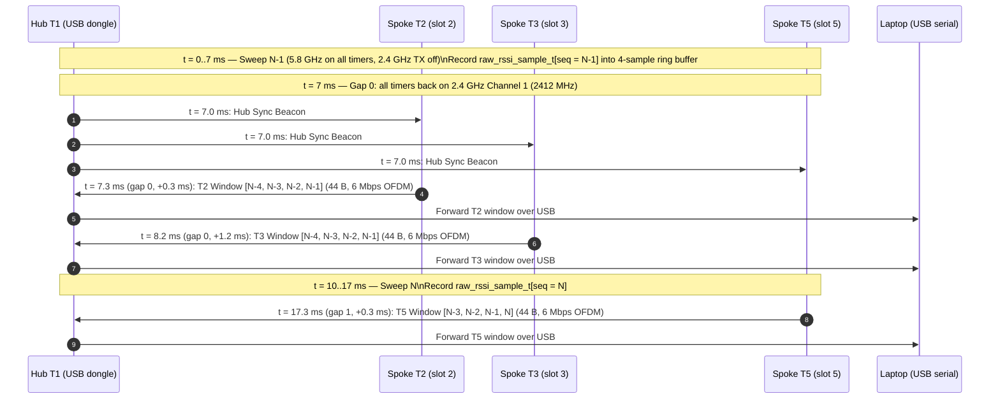
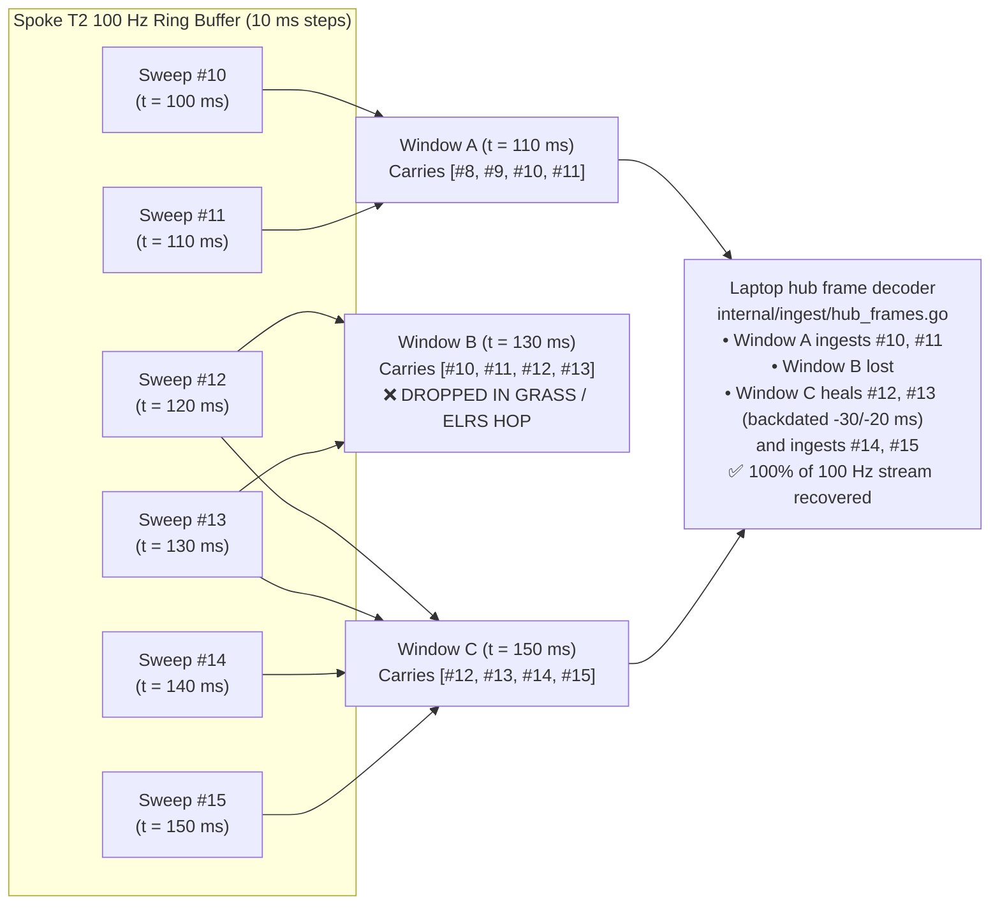
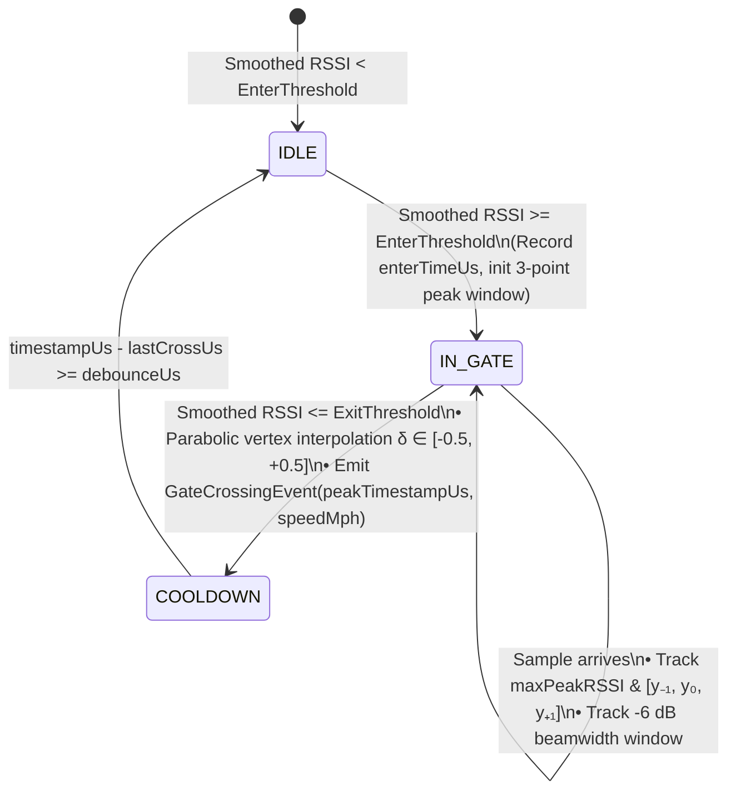
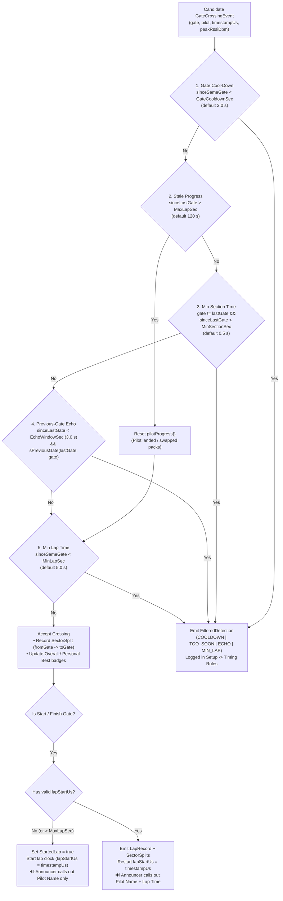
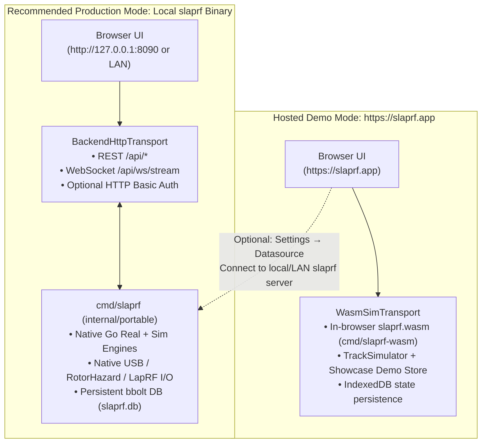

# SlapRF Low-Level Architecture & Protocol Reference

This document details the client–server runtime architecture, hardware drivers, RF link layer, binary wire protocols, digital signal processing (DSP), multi-gate timing & tournament state machines, firmware image patching, and browser demo WebAssembly build of **SlapRF**.

For setting up your local development environment, running the live dev server, compiling binaries/WASM, and running the test suite, see **[`docs/DEVELOPER.md`](DEVELOPER.md)**.

## Low-Level Reference Overview

- **[1. System Overview & Design Principles](#1-system-overview--design-principles)**: Native local timing server, pure-sensor Spokes, and multi-hardware support.
- **[2. End-to-End Data Flow](#2-end-to-end-data-flow)**: Architecture diagram from timing hardware across the track to the native `slaprf` server and browser clients.
- **[3. XIAO ESP32-C5 5.8 GHz SDR & Time-Division Schedule](#3-xiao-esp32-c5-58-ghz-sdr--time-division-radio-schedule)**: Single-synthesizer 5.8 GHz / 2.4 GHz multiplexing and the 20 ms superframe schedule.
- **[4. Ground-Interference Mitigation & 2.4 GHz Link Protocol](#4-ground-interference-mitigation--24-ghz-link-protocol)**: Two-ray grass path-loss physics, 6 Mbps OFDM ESP-NOW at `+20 dBm`, 900 µs TDMA slots, and 4-sample sliding-window recovery under 50% packet loss.
- **[5. Binary Wire Formats (`0xC5 0x59` & `SLAPRF02`)](#5-binary-wire-formats-0xc5-0x59-sliding-window--slaprf02)**: Byte-by-byte layouts of the variable-length sliding-window frame, the Hello / Join / Assign / beacon frames, and the 160-byte flash config block.
- **[6. DSP Pipeline & Parabolic Peak Interpolation](#6-dsp-pipeline--sub-frame-parabolic-peak-interpolation)**: Zero-phase EMA smoothing, hysteresis state machine, and `< 2 ms` sub-frame parabolic vertex fitting.
- **[7. Multi-Gate Timing Rules & Section Analytics Engine](#7-multi-gate-timing-rules--section-analytics-engine)**: The 5-stage guardrail pipeline (cool-down, stale progress, min section, previous-gate echo, min/max lap) and bottleneck math.
- **[8. Native USB Serial Driver & Firmware Flasher](#8-native-usb-serial-driver--firmware-flasher)**: Native USB-JTAG ROM bootloader flashing (`internal/usb`, `internal/firmware`) and `SLAPRF02` binary patching.
- **[9. Multi-Hardware Drivers & MultiGP Integration](#9-multi-hardware-drivers--multigp-integration)**: RotorHazard (USB & Network), ImmersionRC LapRF 8-Way (`TCP :5403`), and MultiGP Chapter sync.
- **[10. Client-Server Architecture vs. Browser Demo (`slaprf.app`)](#10-client-server-architecture-vs-browser-demo-slaprfapp)**: Native Go server (`cmd/slaprf` + `BackendHttpTransport`) for real timing vs. WebAssembly (`cmd/slaprf-wasm` + `WasmSimTransport`) for the `slaprf.app` interactive demo.

---

## 1. System Overview & Design Principles

SlapRF is built around four core engineering constraints:

1. **Zero Compute on Spoke Timers (Pure Recording Sensors)**:
   Spoke timers (`T2`–`T6`) placed out on the track perform **no peak detection, no threshold filtering, and no lap math**. They act purely as synchronized 100 Hz 8-channel 5.8 GHz RSSI recorders that stream raw dBm sweeps back to the laptop. Centralizing all DSP and timing rules on the laptop (`internal/dsp`, `internal/tracker`) allows live threshold recalibration, retrospective signal inspection, and cross-gate echo rejection without reflashing or reconfiguring field hardware.
2. **Single-Radio Dual-Band Multiplexing on Seeed Studio XIAO ESP32-C5**:
   Each gate timer uses a single `$6.90` dual-band (2.4 GHz / 5 GHz) RISC-V **XIAO ESP32-C5** module. Because a single RF synthesizer is shared between 5.8 GHz VTX power measurement and 2.4 GHz telemetry transport, the Hub (`T1`) and Spokes (`T2`–`T6`) follow a deterministic time-division schedule so no Spoke transmits on 2.4 GHz while the Hub is off-channel sweeping 5.8 GHz.
   **Hub role**: the Hub is a USB collector dongle (timer ID 1, `isHub`). Neither the real nor the simulated engine ever puts it on a gate automatically (`internal/tracker/track.go`: `provisionCollectorHubLocked`, `ProvisionGate`, `AddSimulatedTimer`); Spokes take the gates and the first one becomes start/finish. If the user drags the Hub onto a gate (a normal gate assignment, `AssignedTimerID` = the Hub's timer ID), the Hub also sweeps 5.8 GHz and times that gate. The browser keeps the Hub in sync over USB (`web/src/services/hub_gate_sync.ts`): the Hub's STATUS JSON reports `"hubGate"`, and `HUBGATE 1` / `HUBGATE 0` turns its own sweep + slot-1 telemetry on/off. The flag is runtime-only (off after a Hub reboot), so the browser re-sends it whenever the reported value differs from the course (at most once per second). The simulator follows the same model: the simulated Hub (`H1`) only generates RSSI telemetry while it is on a gate.
3. **Ground-Grazing & 2.4 GHz ELRS Immunity**:
   Gate timers typically sit flat on the grass beneath gates separated by 40–150 m while pilots transmit 250 mW – 1 W of 2.4 GHz ExpressLRS FHSS control packets nearby. SlapRF combines short **6 Mbps OFDM ESP-NOW frames at `+20 dBm`** in a beacon-synchronized TDMA schedule with a **4-sample sliding-window packet sent every 2 sweeps (`2×` overlap Forward Error Correction)** so even **50% packet loss** results in **0% lost 100 Hz telemetry samples** at the laptop.
4. **Native Local Timing Server + Zero-Install Browser Demo**:
   For real practices and races, **all hardware I/O, DSP peak detection, tournament bracket resolution, and database persistence run natively on the host computer** inside a single self-contained Go binary (`cmd/slaprf`, backed by `internal/portable` and `slaprf.db`). Browsers connect locally (`http://127.0.0.1:8090` or over LAN) as lightweight UI clients, eliminating browser tab throttling and WebSerial limitations. Meanwhile, the hosted site at **`https://slaprf.app`** compiles the simulation engine to WebAssembly (`cmd/slaprf-wasm`) strictly as an interactive **browser demo** so anyone can explore the full application with zero installation.

---

## 2. End-to-End Data Flow

---

## 3. XIAO ESP32-C5 5.8 GHz SDR & Time-Division Radio Schedule

Each Seeed Studio XIAO ESP32-C5 uses its 5 GHz wideband receiver path ([`slaprf_rf58.c`](../firmware/components/slaprf_radio/slaprf_rf58.c)) to measure in-band power across the 8 configured pilot frequencies (`slot_freqs_mhz[0..7]`, defaulting to Raceband `5658`, `5695`, `5732`, `5769`, `5806`, `5843`, `5880`, `5917` MHz). There is one firmware: a single ESP-IDF project ([`firmware/slaprf/`](../firmware/slaprf/), see [`firmware/README.md`](../firmware/README.md)) with one tuned configuration in [`main/main.c`](../firmware/slaprf/main/main.c), built on the [`firmware/components/slaprf_radio/`](../firmware/components/slaprf_radio/) hardware component. Every timer, Hub or Spoke, runs the same compiled image.

### Why Time-Division Multiplexing Is Required

Because the ESP32-C5 has a **single RF synthesizer** shared between the 5 GHz and 2.4 GHz bands:
- While a timer's PLL is tuned to `5658–5917 MHz` measuring the 8 pilot VTX channels (budget `SWEEP_BUDGET_US` = 7 ms per sweep, measured ~6.3 ms on chip v1.0), its **2.4 GHz receiver is deaf**.
- If Spoke `T2` transmits an ESP-NOW packet on `2412 MHz` while Hub `T1` is sweeping `5806 MHz`, `T1` misses the packet completely.

### 20 ms Superframe Schedule (2× 10 ms Sweeps + Synchronized TDMA Gaps)

To eliminate both cross-band deafness and Spoke-to-Spoke packet collisions, the Hub (`T1`) and Spokes (`T2`–`T6`) lock to a **20 ms superframe** (two 10 ms, 100 Hz sweep intervals). Each interval is a sweep (all timers on 5.8 GHz, transmitter off) followed by a ~3 ms gap on 2.4 GHz Channel 1 holding three 900 µs TDMA slots after a 300 µs guard. Gap 0 opens with the Hub beacon; Spoke slots `2–4` transmit in gap 0 and slots `5–7` in gap 1, so every Spoke sends one 4-sample window per superframe. The Hub forwards each received frame to the laptop over USB serial as it arrives. When placed on a gate (`HUBGATE 1`), the Hub also sweeps and forwards its own window (slot `1`) after **every** sweep, since it needs no TDMA slot.

---

## 4. Ground-Interference Mitigation & 2.4 GHz Link Protocol

### Two-Ray Ground Reflection Physics at Gate Level

When timers are placed directly on the grass under gates ($h_t = h_r \approx 0.05\text{ m}$) separated by $d = 50\text{–}120\text{ m}$, the grazing angle $\theta$ approaches $0^\circ$. The ground reflection coefficient $\Gamma$ approaches $-1$ ($180^\circ$ phase inversion), cancelling the direct line-of-sight wave and shifting path loss from free-space $1/d^2$ ($20\log_{10} d$) to **two-ray ground-reflection $1/d^4$ ($40\log_{10} d$)**, while wet grass absorbs additional RF energy.

### Four-Layer Link Hardening

| Layer | Mechanism | Engineering Effect |
| :--- | :--- | :--- |
| **1. Frequency Selection** | Fixed **2.4 GHz Channel 1 (`2412 MHz`)** (`WIFI_CHANNEL = 1`) | Longest 2.4 GHz wavelength ($\lambda = 12.43\text{ cm}$), lowest dielectric absorption in moist grass, and furthest from upper-band Wi-Fi/Bluetooth congestion. |
| **2. PA & PHY Rate** | **`+20.0 dBm` (`80` quarter-dBm)** + **6 Mbps OFDM ESP-NOW** (`LINK_TX_RATE "6m"`; Espressif LR frames are still received) | ~0.15 ms on air per frame, so each window fits a 900 µs TDMA slot and three Spokes share each ~3 ms gap. Link rate and TX power can only be changed from the USB serial console (`LINKRATE`, `TXPOWER`, `LINKRESET`); the values are saved in NVS. |
| **3. USB Collector Hub** | The Hub forwards every frame to the laptop over **USB-C serial** (`internal/usb`) | No Wi-Fi hop to the laptop: the 2.4 GHz channel only carries the Hub beacon, Join / Assign frames, and Spoke windows. |
| **4. 4-Sample Sliding-Window FEC** | Each Spoke sends **`[seq-3, seq-2, seq-1, seq]`** (`44 bytes`) once per 20 ms superframe, i.e. every 2 sweeps | Every 10 ms 5.8 GHz sweep is transmitted **twice** in consecutive windows 20 ms apart. **Even if 50% of windows are wiped out** by ground multipath or a pilot's 2.4 GHz ELRS hop, the very next window delivers the missing sweeps with zero gaps. |

### Sliding-Window Recovery Under 50% Packet Loss

---

## 5. Binary Wire Formats (`0xC5 0x59` Sliding Window & `SLAPRF02`)

### 5.1 Sliding-Window Telemetry Frame (`timer_window_frame_t`, Magic `0xC5 0x59`)

Defined in [`firmware/slaprf/main/main.c`](../firmware/slaprf/main/main.c) and decoded by [`internal/ingest/hub_frames.go`](../internal/ingest/hub_frames.go). The frame is variable-length: a 7-byte header, `n` 9-byte samples, and a trailing crc8, i.e. `7 + n×9 + 1` bytes. The firmware sends `n = 4` (`WINDOW_SAMPLES`, `44 B`); the laptop accepts `n = 1..6` (`MaxWindowSamples`, `62 B` max):

| Byte Offset | Type | Field | Description |
| :--- | :--- | :--- | :--- |
| `0` | `uint8` | `magic0` | `0xC5` (ESP32-C5 frame marker) |
| `1` | `uint8` | `magic1` | `0x59` (`FRAME_MAGIC_WINDOW`) |
| `2` | `uint8` | `slot` | Hub-assigned TDMA slot (`1` = Hub, `2..7` = Spokes) |
| `3` | `uint8` | `sample_count` | Number of sweeps `n` in `samples` (`1..6`, oldest to newest) |
| `4..5` | `uint16 LE` | `battery_mv` | Supply voltage in millivolts (e.g., `4120` mV) |
| `6` | `int8` | `noise_floor_dbm` | Ambient 5.8 GHz noise floor in dBm (e.g., `-92`) |
| `7 + i×9 ..` | `9 bytes` | `samples[i]` | `[seq_num: uint8, rssi_dbm[0..7]: 8x int8]` for `i = 0..n-1` |
| `7 + n×9` | `uint8` | `crc8` | XOR checksum over all preceding bytes |

Spokes have no fixed slot; a short handshake maps each Hub slot to the board's stable fingerprint:

| Frame | Magic | Size | Direction | Payload |
| :--- | :--- | :--- | :--- | :--- |
| **Join** | `0xC5 0x5B` | `34 B` | Spoke → Hub (ESP-NOW) | `fingerprint (uint32 LE)`, `role`, `reserved0` (`0`), `sweep_hz`, `timer_label[24]`, `crc8`; repeated until assigned |
| **Assign** | `0xC5 0x5C` | `8 B` | Hub → Spoke (ESP-NOW) | `fingerprint (uint32 LE)`, `slot (2..7)`, `crc8` |
| **Hello** | `0xC5 0x5A` | `36 B` | Hub → Laptop (USB serial) | `slot`, `role`, `fingerprint (uint32 LE)`, `reserved0` (`0`), `sweep_hz`, `timer_label[24]`, `reserved`, `crc8` |
| **Sync beacon** | `0xC5 0x5D` | `4 B` | Hub → Spokes (ESP-NOW broadcast) | `seq`, `crc8`; Spokes transmit `(slot - 2)` TDMA slots after it |

The laptop keys timers by fingerprint (`%08X`): until a Hello arrives for a slot, the slot number is used as the timer ID directly.

### 5.2 160-Byte `SLAPRF02` Flash Configuration Block

The firmware's `main.c` embeds `slaprf_flash_config_t`. [`internal/firmware/image.go`](../internal/firmware/image.go) (`PatchImage`) and [`web/src/services/esp_flasher.ts`](../web/src/services/esp_flasher.ts) locate it by its magic (at `0x0100` in the placeholder image), stamp it, and repair the ESP-IDF image checksum / appended SHA-256. Radio and sweep tuning is compiled into the firmware (link rate and TX power can be overridden from the USB serial console); the block only carries per-board and per-event settings (all multi-byte fields little-endian):

| Byte Offset | Size | Type | Field | Description |
| :--- | :--- | :--- | :--- | :--- |
| `0..7` | `8 B` | `char[8]` | `magic` | `"SLAPRF02"` (`53 4C 41 50 52 46 30 32`) |
| `8..10` | `3 B` | `uint8[3]` | `version` | Firmware build version (major, minor, patch) |
| `11` | `1 B` | `uint8` | `role` | `1` = Hub Timer (`ROLE_HUB_TIMER`), `2` = Spoke Timer (`ROLE_SPOKE_TIMER`) |
| `12..13` | `2 B` | `uint8[2]` | `reserved0` | Reserved (written `0`, ignored on read) |
| `14..17` | `4 B` | `uint32 LE` | `fingerprint` | Random per-board identity stamped at flash time (never `0`) |
| `18..33` | `16 B` | `uint16 LE[8]` | `slot_freqs_mhz` | 8 pilot 5.8 GHz frequencies in MHz (`5600..5950`, else Raceband default) |
| `34..106` | `73 B` | `uint8[73]` | `reserved1` | Reserved (zero) |
| `107..130` | `24 B` | `char[24]` | `timer_label` | Null-padded timer name (e.g., `"H1"`, `"S3"`) |
| `131..158` | `28 B` | `uint8[28]` | `reserved` | Zero |
| `159` | `1 B` | `uint8` | `crc8` | XOR checksum over bytes `[0..158]` |

---

## 6. DSP Pipeline & Sub-Frame Parabolic Peak Interpolation

Implemented in [`internal/dsp/peak_detector.go`](../internal/dsp/peak_detector.go), each `(GateTimer, PilotSlot)` pair runs an independent `ChannelDetector` on the incoming sample stream (100 Hz / `10 ms` from the firmware; the built-in simulator runs at 50 Hz):

1. **Zero-Phase-Lag Exponential Moving Average (EMA)**:
   $$y_n = \alpha x_n + (1 - \alpha) y_{n-1}, \quad \alpha = 0.42$$
   Suppresses high-frequency multipath spikes from carbon-fiber frames and chain-link fences while preserving the bell-shaped inverse-square gate approach envelope.
2. **3-Point Parabolic Vertex Interpolation (`parabolicPeakTimestamp`)**:
   At 60 mph (`26.8 m/s`), a quad moves `27 cm` between 10 ms samples. Fitting a parabola through the discrete peak sample $(t_0, y_0)$ and its immediate neighbors $(t_{-1}, y_{-1})$ and $(t_{+1}, y_{+1})$ yields the fractional sample offset $\delta \in [-0.5, +0.5]$:
   $$\delta = \frac{1}{2} \cdot \frac{y_{-1} - y_{+1}}{y_{-1} - 2y_0 + y_{+1}}, \quad t_{\text{peak}} = t_0 + \delta \cdot (t_0 - t_{-1})$$
   This achieves **`< 2 ms` crossing timestamp precision** from a 100 Hz (`10 ms`) sample stream.
3. **Gate Speed Estimation**:
   Measures the `-6 dB` beamwidth $\Delta t_{-6\text{dB}}$ (time spent within `6 dB` of peak RSSI) to estimate the crossing speed through the gate aperture.

---

## 7. Multi-Gate Timing Rules & Section Analytics Engine

Every candidate crossing emitted by `ChannelDetector` passes through the 5-stage timing rule pipeline in [`internal/tracker/crossing_rules.go`](../internal/tracker/crossing_rules.go) (using global rules merged with any per-gate overrides):

### Section Bottleneck & Theoretical Best Lap Math (`internal/tracker/summaries.go`)

For each pilot and each track section $s \in \{S_1, \dots, S_k\}$:
- **Personal Best Split** $b_s = \min_i t_{s,i}$ and **Mean Split** $\mu_s = \frac{1}{N}\sum_{i=1}^N t_{s,i}$.
- **Consistency (Standard Deviation)**:
  $$\sigma_s = \sqrt{\frac{1}{N}\sum_{i=1}^N (t_{s,i} - \mu_s)^2}$$
- **Average Time Lost per Section**: $\Delta_s = \mu_s - b_s$ (the section with the highest $\Delta_s$ is highlighted as the pilot's primary bottleneck).
- **Theoretical Best Lap**: $T_{\text{theo}} = \sum_{s=1}^k b_s$, with **Potential Gain** $= T_{\text{best}} - T_{\text{theo}}$.

---

## 8. Native USB Serial Driver & Firmware Flasher

When running the standalone `slaprf` binary, USB serial communication and firmware flashing run natively on the host in [`internal/usb/`](../internal/usb/) and [`internal/firmware/image.go`](../internal/firmware/image.go), controlled from [`web/src/widgets/TimerFlasher.ts`](../web/src/widgets/TimerFlasher.ts) and [`web/src/services/timer_console.ts`](../web/src/services/timer_console.ts) (with an equivalent client-side patcher in [`web/src/services/esp_flasher.ts`](../web/src/services/esp_flasher.ts) for `.bin` downloads and simulated boards in Demo Mode):

1. **Single Embedded Firmware Image (`slaprf-xiao-c5.bin`)**:
   - Every SlapRF timer, Hub or Spoke, runs the same firmware image built from [`firmware/slaprf/`](../firmware/slaprf/).
   - CI ([`.github/workflows/firmware.yml`](../.github/workflows/firmware.yml)) compiles it into a merged flash image at `web/firmware/slaprf-xiao-c5.bin`, which is embedded directly into the portable `slaprf` binary by `cmd/build-portable` (`embed.FS`).
2. **`SLAPRF02` Binary Patching (`internal/firmware.PatchImage`)**:
   - Before flashing or downloading a `.bin`, SlapRF locates the 160-byte `SLAPRF02` configuration block inside the compiled image, stamps `role`, `fingerprint`, `timer_label`, and the active 8-channel `slot_freqs_mhz` (see [§5.2](#52-160-byte-slaprf02-flash-configuration-block)), and repairs the ESP-IDF segment XOR checksum (`seed 0xEF`) and appended SHA-256 digest.
3. **Board Fingerprints (Keep / New)**:
   - Every board carries a random, non-zero 32-bit fingerprint used as its persistent timer identity across reboots and TDMA slot reassignments.
   - With **Keep** (default), the flasher queries the running firmware over USB (`SLAPRF?`) before erasing and preserves the board's existing fingerprint so track gate assignments remain intact.
4. **Espressif USB-JTAG ROM Bootloader Flashing**:
   - Toggles USB-JTAG `DTR` / `RTS` lines on the XIAO ESP32-C5 (`VID 0x303A`) to enter ROM Download Mode.
   - Exchanges SLIP-framed (`0xC0 ... 0xC0`) ROM bootloader commands (`ESP_SYNC`, `ESP_SPI_ATTACH`, `ESP_FLASH_BEGIN`, `ESP_FLASH_DATA`, `ESP_FLASH_END`) to write the patched image from flash offset `0x0`, then hard-resets the board into the new firmware.
5. **Dual-Slot USB Console (`usbPool`)**:
   - Maintains a primary USB slot (Slot 0) for the active Hub (`H1`) alongside an optional secondary Debug slot (Slot 1) so operators can inspect or flash a second USB board in **Debug** (`#/debug`) or **Flasher** (`#/flasher`) without disconnecting the Hub.

---

## 9. Multi-Hardware Drivers & MultiGP Integration

In addition to DIY SlapRF USB timers, the local `slaprf` server includes hardware managers so existing track hardware works with the same Practice, Race Editor, Race Control, and Analytics workflows:

- **RotorHazard (USB, `HardwareModeRotorHazardUSB`)**:
  Implemented in [`internal/rotorhazard/`](../internal/rotorhazard/). Connects directly to RotorHazard or RX5808 serial timing nodes over USB serial, syncs active pilot frequencies (`EnterAt` / `ExitAt` thresholds), and streams live RSSI and node passings into `internal/tracker`.
- **RotorHazard (Network, `HardwareModeRotorHazard`)**:
  Implemented in [`internal/rotorhazard/`](../internal/rotorhazard/). Connects over LAN HTTP / Socket.IO (default port `:5000`) to one or more RotorHazard timing servers, maps nodes to track gates, and ingests real-time RSSI and lap passings.
- **ImmersionRC LapRF 8-Way (Network, `HardwareModeLapRF`, `TCP :5403`)**:
  Implemented in [`internal/laprf/`](../internal/laprf/) (`protocol.go`, `client.go`, `manager.go`, `server.go`). Connects over Ethernet TCP `:5403` to ImmersionRC LapRF 8-Way pucks using SLIP-framed little-endian TLV packets with 16-bit CRC-CCITT (`0xDA01` RF setup, `0xDA07` RTC clock sync, `0xDA08` state control, `0xDA09` passing records, `0xDA0A` status/RSSI heartbeats). The local server can also run a LapRF `:5403` TCP server endpoint for external tools.
- **MultiGP WebService Chapter Sync (`internal/multigp/`)**:
  Imports scheduled races, pilot rosters, and heat/channel assignments from MultiGP Chapter APIs and uploads confirmed race round and lap results.

---

## 10. Client-Server Architecture vs. Browser Demo (`slaprf.app`)

SlapRF separates **production timing** (local client-server binary) from the **hosted browser preview** (`https://slaprf.app`) behind a shared `ApiTransport` interface ([`web/src/services/transport.ts`](../web/src/services/transport.ts)):

1. **Local Server Mode (`cmd/slaprf` + `BackendHttpTransport`) for Real Practices and Races**:
   - Compiled by `go run ./cmd/build-portable` into a single executable (`slaprf` or `slaprf.exe`). It embeds the frontend bundle, firmware image, timing and tournament engine, hardware managers (`SlapRF USB`, `RotorHazard USB`, `RotorHazard Network`, `LapRF 8-Way Network`), and an embedded `bbolt` database (`slaprf.db`, [`internal/storage/`](../internal/storage/)).
   - Runs timing, heat clocks, countdown horns, and hardware polling on native OS threads, unaffected by browser tab throttling or page reloads.
   - Multiple devices on the local network (Race Director laptop, field marshal phone, spectator tablet) can connect at once over `/api/ws/stream`, with optional HTTP Basic Authentication configured in **Settings**.
2. **Browser Demo Mode (`https://slaprf.app` + `WasmSimTransport`) for Preview and Evaluation**:
   - Deployed automatically to GitHub Pages (`.github/workflows/pages.yml`). Runs `cmd/slaprf-wasm` (`GOOS=js GOARCH=wasm`) inside the browser tab with `TrackSimulator` enabled and persisted in IndexedDB (`web/src/services/engine_persistence.ts`).
   - Boots with a showcase demo dataset (`internal/tracker/demo_showcase.go`): **SlapRF** hardware mode with **4 online timers** (`H1` Hub connected over simulated USB plus 3 Spoke timers `T1`–`T3` across a 3-gate course), **3 practice sessions** (including an active live session), and **4 race tournaments** across completed, paused, and draft states.
   - From **Settings -> Datasource**, a browser tab on `slaprf.app` (or launched locally with `slaprf -browser`) can switch from **Demo** to **Server**, discover a local `slaprf` instance (`127.0.0.1:8090`), and connect to it.
