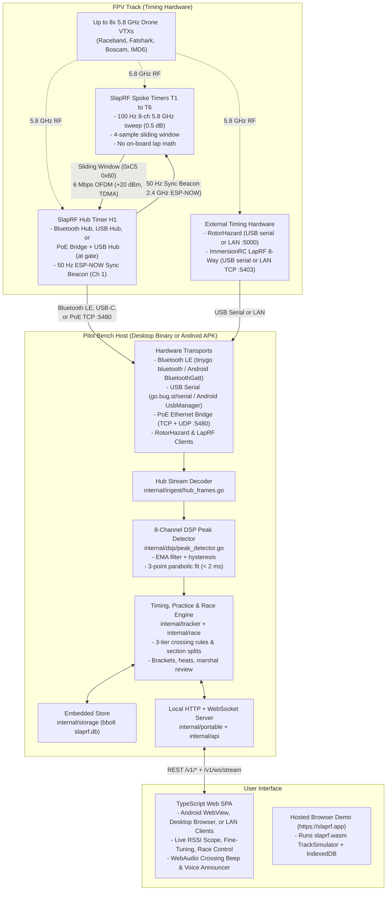
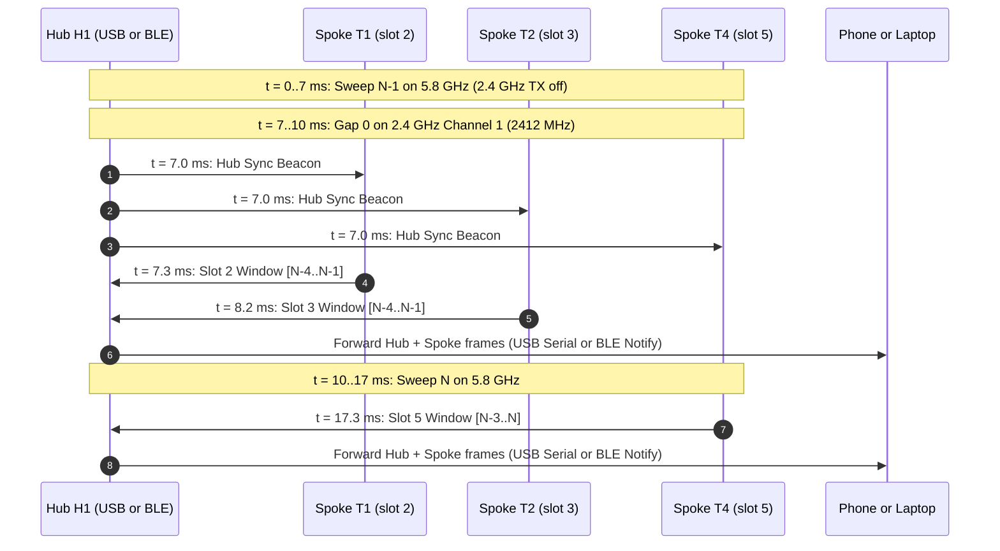
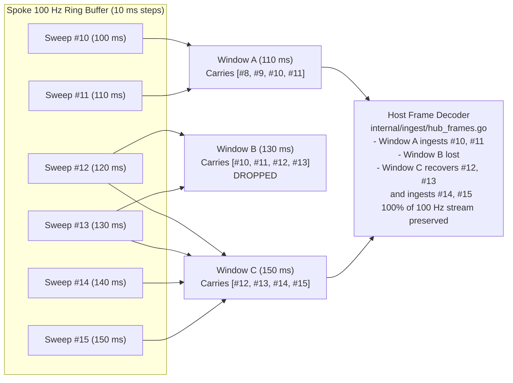
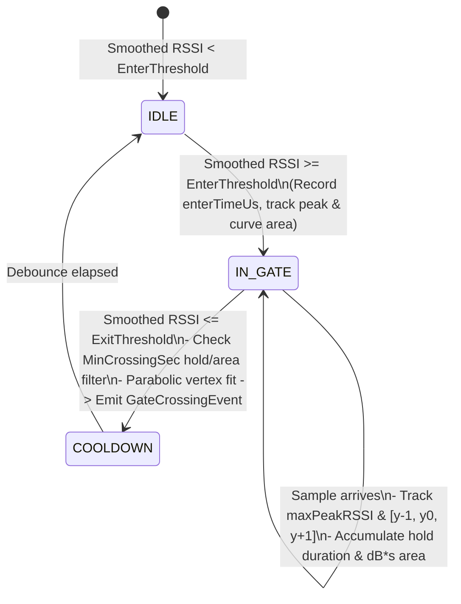
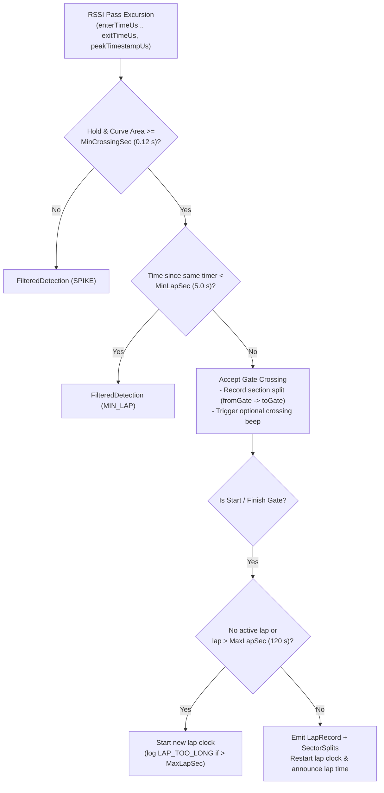
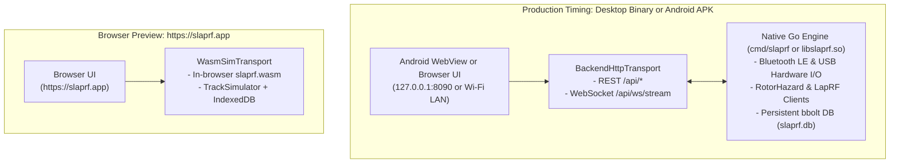

# SlapRF Architecture & Protocol Reference

This document describes the client-server architecture, hardware transports (USB-C, Bluetooth LE, and PoE Ethernet), 5.8 GHz and 2.4 GHz radio schedule, binary wire protocols, digital signal processing (DSP), on-device AI crossing detection, timing rules, firmware image patching, native Android packaging, and WebAssembly browser demo of **SlapRF**.

For local setup, build commands, and test instructions, see **[`docs/DEVELOPER.md`](DEVELOPER.md)**. For low-level transport specifications, see **[`docs/ble-hub-protocol.md`](ble-hub-protocol.md)** (Bluetooth Hub GATT link) and **[`docs/poe-bridge-protocol.md`](poe-bridge-protocol.md)** (ESP32-P4 PoE Ethernet <-> USB Serial Bridge).

## Contents

- **[1. System Overview](#1-system-overview)**
- **[2. End-to-End Data Flow](#2-end-to-end-data-flow)**
- **[3. XIAO ESP32-C5 5.8 GHz SDR & Time-Division Schedule](#3-xiao-esp32-c5-58-ghz-sdr--time-division-schedule)**
- **[4. USB Hub, Bluetooth Hub & PoE Bridge Architecture](#4-usb-hub-bluetooth-hub--poe-bridge-architecture)**
- **[5. Ground-Interference Mitigation & 2.4 GHz Link](#5-ground-interference-mitigation--24-ghz-link)**
- **[6. Binary Wire Formats (`0xC5` Frames & `SLAPRF02`)](#6-binary-wire-formats-0xc5-frames--slaprf02)**
- **[7. DSP Pipeline & Parabolic Peak Interpolation](#7-dsp-pipeline--parabolic-peak-interpolation)**
- **[8. Multi-Gate Timing Rules & Section Analytics](#8-multi-gate-timing-rules--section-analytics)**
- **[9. Host Drivers, Native Mobile Apps & Firmware Flasher](#9-host-drivers-native-mobile-apps--firmware-flasher)**
- **[10. External Timing Hardware & MultiGP Integration](#10-external-timing-hardware--multigp-integration)**
- **[11. Local Native App vs. Browser Demo (`slaprf.app`)](#11-local-native-app-vs-browser-demo-slaprfapp)**

---

## 1. System Overview

SlapRF is built on four main design choices:

1. **Spoke Timers Are Pure Signal Recorders**:
   Spoke timers (`T1` to `T6`) placed at gates on the track do not run peak detection, threshold checks, or lap math. Each Spoke sweeps up to 8 active 5.8 GHz VTX channels at 100 Hz (`0.5 dB` steps) and sends raw RSSI sweeps to the Hub over 2.4 GHz ESP-NOW. The host computer or phone runs all DSP and timing rules (`internal/dsp`, `internal/tracker`). This lets you recalibrate thresholds and adjust timing rules live without reflashing gate hardware.
2. **Single-Radio Dual-Band Multiplexing on XIAO ESP32-C5**:
   Each timer uses one Seeed Studio XIAO ESP32-C5 dual-band (`2.4 GHz` / `5 GHz`) module. Because one RF synthesizer is shared between 5.8 GHz VTX measurement and 2.4 GHz wireless transport, the Hub and all Spokes follow a synchronized 20 ms superframe schedule. No timer transmits on 2.4 GHz while another timer is tuned to 5.8 GHz.
3. **Three Hub Host Transports (Bluetooth LE, USB-C, and PoE Ethernet)**:
   The Hub timer (`H1`) collects wireless ESP-NOW frames from all Spokes and forwards a unified byte stream to the SlapRF host:
   - **Bluetooth Hub (`slaprf-xiao-c5-ble.bin`)**: Runs on a battery at the Start / Finish gate, sweeps 5.8 GHz for that gate, collects Spoke frames over ESP-NOW, and streams telemetry over Bluetooth LE to a phone or laptop at the pilot bench.
   - **USB Hub (`slaprf-xiao-c5.bin`)**: Connects directly to a laptop, Raspberry Pi, or Android phone over a USB-C cable for minimum transport latency. By default, a USB Hub stays off-track as a receiver, or you can assign it to a gate in the **Track** editor (`HUBGATE 1`) if your USB cable reaches the gate.
   - **PoE Ethernet Bridge (`slaprf-p4-poe-bridge.bin` + `slaprf-xiao-c5.bin`)**: Connects a standard USB Hub (`H1`) to the USB-A Host port of a Waveshare `ESP32-P4-WIFI6-POE-ETH` board powered over up to `100 m` of `802.3af` PoE Ethernet (`TCP/UDP :5480`), eliminating gate batteries while delivering `< 0.5 ms` wired LAN latency.
4. **Native Local Engine + Optional Browser Demo**:
   For real timing, hardware I/O, DSP peak detection, race brackets, and `bbolt` database storage (`slaprf.db`) run natively in Go on Desktop (`cmd/slaprf`) or Android (`cmd/slaprf-android`, compiled to `libslaprf.so`). Browser tabs connect locally (`http://127.0.0.1:8090`, LAN, or Android WebView) as UI clients. Separately, `https://slaprf.app` compiles the simulator into WebAssembly (`cmd/slaprf-wasm`) for zero-install preview in a browser.

---

## 2. End-to-End Data Flow

---

## 3. XIAO ESP32-C5 5.8 GHz SDR & Time-Division Schedule

Each Seeed Studio XIAO ESP32-C5 uses its 5 GHz wideband receiver path ([`slaprf_rf58.c`](../firmware/components/slaprf_radio/slaprf_rf58.c)) to measure in-band power across up to 8 configured pilot frequencies (`slot_freqs_mhz[0..7]`, defaulting to Raceband `5658` to `5917 MHz`). During each 10 ms tick, the radio runs 5 ping-pong passes (`500 Hz` raw rate) and combines them with an outlier-rejecting trimmed linear mean into one `0.5 dB` sample per active channel (`100 Hz` output rate).

### Why Time-Division Multiplexing Is Required

The ESP32-C5 has one RF synthesizer shared between the 5 GHz and 2.4 GHz bands:

- While a timer's PLL is tuned to `5658` to `5917 MHz` measuring VTX channels (up to `7 ms` per sweep, ~`6.3 ms` measured on chip v1.0), its 2.4 GHz receiver cannot receive packets.
- If a Spoke transmits on `2412 MHz` (2.4 GHz) while the Hub is sweeping `5.8 GHz`, the Hub misses the packet.

### 20 ms Superframe Schedule (2x 10 ms Sweeps + TDMA Gaps)

To prevent cross-band deafness and packet collisions, the Hub (`H1`) and Spokes (`T1` to `T6`) lock to a **20 ms superframe** made of two 10 ms (`100 Hz`) sweep intervals:

1. **Sweep window (`0..7 ms`)**: Every timer tunes to 5.8 GHz with its transmitter path turned off and records one 8-channel RSSI sample.
2. **2.4 GHz communication gap (`7..10 ms`)**: Every timer returns to 2.4 GHz Wi-Fi Channel 1 (`2412 MHz`).
   - Gap 0 starts with the Hub sync beacon (`0xC5 0x5D`), followed by a `300 us` guard and three `900 us` TDMA slots for Spoke slots `2`, `3`, and `4`.
   - Gap 1 carries three `900 us` TDMA slots for Spoke slots `5`, `6`, and `7`.
   - Each Spoke sends one 4-sample sliding window every 20 ms (`50 Hz` packet rate carrying `100 Hz` samples with `2x` overlap).

---

## 4. USB Hub, Bluetooth Hub & PoE Bridge Architecture

SlapRF builds two XIAO ESP32-C5 timer images from shared 5.8 GHz sensing code plus a dedicated ESP32-P4 PoE Ethernet bridge image:

- **USB & Spoke image (`slaprf-xiao-c5.bin`, [`firmware/slaprf/`](../firmware/slaprf/))**: Used for all Spoke timers and for wired USB or PoE-bridged Hubs.
- **Bluetooth Hub image (`slaprf-xiao-c5-ble.bin`, [`firmware/slaprf_ble/`](../firmware/slaprf_ble/))**: Dedicated Hub image that replaces the live USB host link with NimBLE Bluetooth LE GATT while keeping the same 2.4 GHz ESP-NOW Spoke collector and 5.8 GHz gate sensor.
- **PoE Ethernet Bridge image (`slaprf-p4-poe-bridge.bin`, [`firmware/slaprf_p4_poe_bridge/`](../firmware/slaprf_p4_poe_bridge/))**: Runs on a Waveshare `ESP32-P4-WIFI6-POE-ETH` board, holding its onboard `ESP32-C6` radio in reset (`GPIO54 = 0`), powering Hub `H1` over USB-A from `802.3af` PoE, and bridging raw unescaped serial bytes over `TCP :5480` with out-of-band `UDP :5480` discovery and control (see **[`docs/poe-bridge-protocol.md`](poe-bridge-protocol.md)**).

### How the Bluetooth Hub Coexists with 5.8 GHz Sweeps and ESP-NOW

1. **Identical Wire Protocol over BLE GATT**:
   The Bluetooth Hub exposes service `5d1a0001-5a7e-4c0b-9e5f-534c41505246` with an RX command characteristic (`5d1a0002-...`) and TX stream characteristic (`5d1a0003-...`). It carries the exact same text commands (`STATUS?`, `LIVE 1`, `NETCHANNELS`, `SCAN`) and binary Hub records (`0x1E <len> <frame>`) as the USB Hub.
2. **BLE Connection Interval & Sweep Phase Lock (`BLESYNC`)**:
   On connect, the Hub requests **LE 2M PHY**, **ATT MTU 247**, and a **10 ms connection interval** (falling back to `20 ms` or `30 ms` multiples if chosen by the host OS). Because every multiple of `10 ms` matches the `100 Hz` (`10 ms`) sweep period, the Hub timestamps the BLE controller's packet-completion events and shifts its sweep phase (`phaseUs` target `9300 us`) so BLE connection events always land in the 2.4 GHz gap after the `0..7 ms` 5.8 GHz sweep.
3. **Claim-on-Pair Host Authentication (`AUTH <host_key>`)**:
   Each SlapRF host (desktop or Android app) generates and saves a random 128-bit hex key. When a Bluetooth Hub is in Pairing Mode (freshly flashed, or after holding `BOOT` for 3 seconds), the first host that connects claims the Hub and stores its key in NVS. Later connections from other phones or laptops without that key are rejected so nobody at the field can accidentally connect to an active Hub.

### Technical Comparison: USB Hub vs. Bluetooth Hub vs. PoE Bridge

| Feature | USB Hub (`slaprf-xiao-c5.bin`) | Bluetooth Hub (`slaprf-xiao-c5-ble.bin`) | PoE Bridge + USB Hub (`slaprf-p4-poe-bridge.bin`) |
| :--- | :--- | :--- | :--- |
| **Host Connection** | Wired USB-C serial (`CDC` / `USB-JTAG`) | Wireless Bluetooth LE 5.0 (`2M PHY`, `MTU 247`) | Wired `100 Mbps` Ethernet (`TCP :5480` stream + `UDP :5480` control) |
| **Hub Placement** | Next to the laptop/phone (or on a gate within USB cable reach) | Directly at the Start / Finish gate on a battery; phone or laptop stays at the bench | Directly at the Start / Finish gate up to `100 m` away over Cat5e/Cat6 |
| **Hub Power** | Powered from the host USB port | Powered from a gate LiPo (`5 V` USB-C adapter) or USB power bank | Powered from `802.3af` PoE over the same Ethernet cable (zero gate battery) |
| **Spoke Timers** | Up to 6 wireless ESP-NOW Spokes (`slaprf-xiao-c5.bin`) | Up to 6 wireless ESP-NOW Spokes (`slaprf-xiao-c5.bin`) | Up to 6 wireless ESP-NOW Spokes (`slaprf-xiao-c5.bin`) |
| **Host Transport Latency** | **Lowest (`~1 to 3 ms`)**: frames arrive over wired USB right after each sweep gap | **Low (`~10 to 30 ms`)**: frames wait for the next `10 to 30 ms` BLE connection event | **Lowest (`~2 to 4 ms`)**: `TCP_NODELAY=1` wired LAN frames with zero RF contention |
| **Lap & Split Time Accuracy** | `100 Hz` (`10 ms`) sweep clock with `< 2 ms` parabolic peak fit | **Identical** (`100 Hz` sweep timestamps are recorded on the timers before transport) | **Identical** (`100 Hz` sweep timestamps are recorded on the timers before transport) |
| **Supported Hosts** | Windows, macOS, Linux, Raspberry Pi, Android (USB OTG) | Android, Windows, macOS, Linux | Windows, macOS, Linux, Raspberry Pi, Android (over Wi-Fi/LAN) |
| **Best Use Case** | Short wired runs next to the timing desk | Regular practice, solo sessions, and cable-free phone/laptop setups | Permanent tracks, long Start/Finish runs (`100 m`), and crowded RF race venues |

---

## 5. Ground-Interference Mitigation & 2.4 GHz Link

### Two-Ray Ground Path Loss

When gate timers sit near the ground ($h_t = h_r \approx 0.05\text{ m}$) separated by $50\text{ to }120\text{ m}$, the ground reflection cancels part of the direct wave and increases path loss toward $1/d^4$ ($40\log_{10} d$), while grass absorbs RF energy. At the same time, pilots transmit 2.4 GHz ExpressLRS control packets nearby.

### Four-Layer Link Protection

| Layer | Mechanism | Engineering Effect |
| :--- | :--- | :--- |
| **1. Channel 1 (`2412 MHz`)** | Fixed 2.4 GHz Channel 1 (`WIFI_CHANNEL = 1`) | Longest 2.4 GHz wavelength ($12.43\text{ cm}$) and lowest absorption in damp grass. |
| **2. Power & Modulation** | `+20.0 dBm` TX power with `6 Mbps` OFDM ESP-NOW | ~`0.15 ms` air time per frame so each Spoke window fits cleanly inside a `900 us` TDMA slot. |
| **3. TDMA Slot Scheduling** | Hub 50 Hz beacon + assigned Spoke slots `2..7` | Spokes never transmit at the same time or during 5.8 GHz sweeps. |
| **4. 4-Sample Sliding Window** | Each Spoke sends `[seq-3, seq-2, seq-1, seq]` every 2 sweeps (`20 ms`) | Every 10 ms sweep is sent twice across back-to-back packets. Up to **50% packet loss** produces **0% missing 100 Hz samples** at the host. |

---

## 6. Binary Wire Formats (`0xC5` Frames & `SLAPRF02`)

### 6.1 Hub & Spoke Telemetry Frames

Decoded by [`internal/ingest/hub_frames.go`](../internal/ingest/hub_frames.go). Over USB serial and BLE GATT, each binary Hub frame is wrapped as `0x1E <len: uint8> <frame bytes>` so binary telemetry and `@{"t":...}\n` JSON responses share one stream cleanly.

The primary `0.5 dB` sliding-window frame (`0xC5 0x60`) has a 7-byte header, `n` 9-byte samples (`n = 4` -> `44 bytes`), and a 1-byte XOR checksum:

| Byte Offset | Type | Field | Description |
| :--- | :--- | :--- | :--- |
| `0` | `uint8` | `magic0` | `0xC5` (ESP32-C5 marker) |
| `1` | `uint8` | `magic1` | `0x60` (`0.5 dB` sliding window; legacy `1 dB` window uses `0x59`) |
| `2` | `uint8` | `slot` | Hub TDMA slot (`1` = Hub, `2..7` = Spokes) |
| `3` | `uint8` | `sample_count` | Number of sweeps `n` (`1..6`, oldest to newest) |
| `4..5` | `uint16 LE` | `battery_mv` | Supply voltage in millivolts |
| `6` | `int8` | `noise_floor_dbm` | Ambient 5.8 GHz noise floor in dBm |
| `7 + i*9 ..` | `9 bytes` | `samples[i]` | `seq_num: uint8` + `rssi_code[0..7]: 8x uint8` (`0` = disabled, `1..255` = `-127.5 + 0.5 * code` dBm) |
| `7 + n*9` | `uint8` | `crc8` | XOR checksum over all preceding bytes |

Control and discovery frames:

| Frame | Magic | Direction | Purpose |
| :--- | :--- | :--- | :--- |
| **Hello** | `0xC5 0x5A` | Hub -> Host (USB / BLE) | Maps `slot` to `role`, 32-bit `fingerprint`, `sweep_hz`, and `timer_label[24]` |
| **Join** | `0xC5 0x5B` | Spoke -> Hub (ESP-NOW) | Requests a TDMA slot using the Spoke's 32-bit `fingerprint` and protocol version |
| **Assign** | `0xC5 0x5C` | Hub -> Spoke (ESP-NOW) | Assigns TDMA `slot` (`2..7`) to the Spoke |
| **Sync Beacon** | `0xC5 0x5D` | Hub -> Spokes (ESP-NOW) | Aligns all Spoke sweep clocks and TDMA slots at 50 Hz |
| **Channel Table** | `0xC5 0x5E` | Hub -> Spokes (ESP-NOW) | Broadcasts active pilot 5.8 GHz frequencies (`NETCHANNELS`) to all Spokes |
| **Single Sweep** | `0xC5 0x61` | Timer -> Host | Single `0.5 dB` sweep frame when running standalone live stream (`LIVE 1`) |

### 6.2 160-Byte `SLAPRF02` Flash Configuration Block

Both `slaprf-xiao-c5.bin` and `slaprf-xiao-c5-ble.bin` embed a 160-byte `slaprf_flash_config_t` struct. [`internal/firmware/image.go`](../internal/firmware/image.go) (`PatchImage`) and [`web/src/services/esp_flasher.ts`](../web/src/services/esp_flasher.ts) locate `"SLAPRF02"`, write the board settings, and recompute the ESP-IDF segment checksum and trailing SHA-256 digest:

| Byte Offset | Size | Type | Field | Description |
| :--- | :--- | :--- | :--- | :--- |
| `0..7` | `8 B` | `char[8]` | `magic` | `"SLAPRF02"` |
| `8..10` | `3 B` | `uint8[3]` | `version` | Firmware version (`major`, `minor`, `patch`) |
| `11` | `1 B` | `uint8` | `role` | `1` = Hub (`ROLE_HUB_TIMER`), `2` = Spoke (`ROLE_SPOKE_TIMER`) |
| `12..13` | `2 B` | `uint8[2]` | `reserved0` | Zero |
| `14..17` | `4 B` | `uint32 LE` | `fingerprint` | Unique non-zero 32-bit board ID stamped at flash time |
| `18..33` | `16 B` | `uint16 LE[8]` | `slot_freqs_mhz` | 8 pilot 5.8 GHz frequencies in MHz |
| `34..106` | `73 B` | `uint8[73]` | `reserved1` | Zero |
| `107..130` | `24 B` | `char[24]` | `timer_label` | Null-padded label (for example `"H1"`, `"T1"`) |
| `131..158` | `28 B` | `uint8[28]` | `reserved2` | Zero |
| `159` | `1 B` | `uint8` | `crc8` | XOR checksum over bytes `0..158` |

---

## 7. DSP Pipeline & Parabolic Peak Interpolation

Implemented in [`internal/dsp/peak_detector.go`](../internal/dsp/peak_detector.go), each `(GateTimer, PilotSlot)` pair runs an independent `ChannelDetector`:

1. **Exponential Moving Average (EMA)**:
   $$y_n = \alpha x_n + (1 - \alpha) y_{n-1}, \quad \alpha = 0.42$$
   Smooths brief multipath reflections while keeping the gate pass shape intact.
2. **3-Point Parabolic Peak Fit**:
   Fits a parabola through the peak sample $(t_0, y_0)$ and its neighbors $(t_{-1}, y_{-1})$ and $(t_{+1}, y_{+1})$:
   $$\delta = \frac{1}{2} \cdot \frac{y_{-1} - y_{+1}}{y_{-1} - 2y_0 + y_{+1}}, \quad t_{\text{peak}} = t_0 + \delta \cdot (t_0 - t_{-1})$$
   This gives **`< 2 ms` crossing timestamp resolution** from a `100 Hz` (`10 ms`) sample stream.
3. **Continuous Auto-Calibration & Manual Override**:
   Timers automatically refine per-pilot `Enter` / `Exit` thresholds from clean passes, or the operator can click **Calibrate**, drag the threshold lines directly on the **Signals** chart, or click **Clear calibration** to return to default thresholds.

---

## 8. Multi-Gate Timing Rules & Section Analytics

### 3-Tier Timing Rule Hierarchy

Implemented in [`internal/domain/rules.go`](../internal/domain/rules.go) and [`internal/tracker/crossing_rules.go`](../internal/tracker/crossing_rules.go), detection rules resolve across three tiers (`All timers` global defaults -> `All pilots` at a specific timer -> `Single pilot` at a specific timer), editable directly from the **Signals** Fine-tune panel:

| Rule | JSON Key | Default | Range | Filter / Effect |
| :--- | :--- | :---: | :---: | :--- |
| **Minimum crossing time** | `minCrossingSec` | `0.12 s` | `0.04..1.5 s` | Rejects sharp RF or Wi-Fi spikes (`SPIKE`) that do not stay above threshold long enough. |
| **Minimum lap time** | `minLapSec` | `5.0 s` | `1..120 s` | Rejects re-detections at the same timer (`MIN_LAP`) before the minimum lap time has elapsed. |
| **Maximum lap time** | `maxLapSec` | `120 s` | `6..900 s` | Discards laps longer than this (`LAP_TOO_LONG`, such as crashes or battery swaps) and starts a fresh lap on that crossing. |
| **Beep on crossing** | `beepOnCross` | `false` | `true` / `false` | Plays an immediate synthetic WebAudio tone when a crossing is accepted in Practice or Races. |

### Section Bottleneck & Theoretical Best Lap (`internal/tracker/summaries.go`)

For each pilot and each track section $s \in \{S_1, \dots, S_k\}$:

- **Personal Best Split** $b_s = \min_i t_{s,i}$ and **Mean Split** $\mu_s = \frac{1}{N}\sum_{i=1}^N t_{s,i}$.
- **Consistency (Standard Deviation)**: $\sigma_s = \sqrt{\frac{1}{N}\sum_{i=1}^N (t_{s,i} - \mu_s)^2}$.
- **Average Time Lost per Section**: $\Delta_s = \mu_s - b_s$ (largest $\Delta_s$ identifies the pilot's main bottleneck section).
- **Theoretical Best Lap**: $T_{\text{theo}} = \sum_{s=1}^k b_s$, with **Potential Gain** $= T_{\text{best}} - T_{\text{theo}}$.

---

## 9. Host Drivers, Native Mobile Apps & Firmware Flasher

1. **Desktop Native Transports (`cmd/slaprf`)**:
   - **OS Serial Primitive (`internal/serialport`)**: Cross-platform native serial I/O (`go.bug.st/serial`) shared by `internal/slaprf/usb`, `internal/rotorhazard/usb`, and `internal/laprf/usb`.
   - **SlapRF USB & Bluetooth LE (`internal/slaprf`, `internal/slaprf/usb`, `internal/slaprf/bluetooth`)**: Unified SlapRF connection/session manager (`slaprf.Manager`) with separate USB-C serial (`/v1/slaprf/usb/*`) and native BLE central (`/v1/slaprf/bluetooth/*`, `tinygo.org/x/bluetooth` over WinRT, CoreBluetooth, and BlueZ D-Bus) transports. Exposes discovered Bluetooth Hubs as `ble:<FINGERPRINT>` ports.
2. **Native Android App (`cmd/slaprf-android` + `android/java/app/slaprf/`)**:
   - Built without Gradle by [`cmd/build-android`](../cmd/build-android/main.go).
   - Compiles the full Go timing engine and HTTP/WebSocket server into `libslaprf.so` (`arm64-v8a`, 16 KB page-aligned) listening on loopback `127.0.0.1:18090`.
   - Thin Java shims bridge Android `BluetoothGatt` (`SlapRFBleShim.java`) and Android `UsbManager` (`SlapRFUsbShim.java`) into Go, while an Android `WebView` (`SlapRFHost.java`) renders the embedded UI offline.
3. **Native iOS & iPadOS App (`cmd/slaprf-ios` + `ios/`)**:
   - Built into a sideloadable `slaprf-ios-arm64.ipa` (or Simulator/Device `.app`) by [`cmd/build-ios`](../cmd/build-ios/main.go).
   - Compiles the Go timing engine into a static C archive (`libslaprf.a`, `arm64-apple-ios16.0`) bound to `127.0.0.1:18090` with `DisableUSB: true` (`nativeUsb: false` on `/v1/capabilities`).
   - Swift shims bridge `CoreBluetooth` GATT (`SlapRFBleShim.swift`), `AVAudioEngine` crossing beeps, `AVSpeechSynthesizer` callouts, and `WKWebView` (`SlapRFViewController.swift`), while PoE Bridge (`:5480`), LapRF (`:5403`), RotorHazard, and Pocket LAN (`:8090`) run directly over Go sockets.
4. **Browser WebSerial Firmware Flasher (`web/src/services/esptool_flasher.ts`)**:
   - Runs in Chrome, Edge, or Opera on desktop over WebSerial using `esptool-js`.
   - Embeds both `slaprf-xiao-c5.bin` (USB Hub & Spokes) and `slaprf-xiao-c5-ble.bin` (Bluetooth Hub).
   - Reads `SLAPRF?` before flashing so **Keep** preserves the board's 32-bit fingerprint across updates, disables the ESP32-C5 RTC watchdog during ROM flashing, writes the patched image, and verifies identity on reboot.

---

## 10. External Timing Hardware & MultiGP Integration

- **RotorHazard (USB, `HardwareModeRotorHazardUSB`)**: Connects directly to RotorHazard or RX5808 serial nodes over USB (`internal/rotorhazard/`).
- **RotorHazard (Network, `HardwareModeRotorHazard`)**: Connects over LAN HTTP and Socket.IO (`:5000`) to RotorHazard servers.
- **ImmersionRC LapRF 8-Way (`HardwareModeLapRF`)**: Connects over Ethernet TCP `:5403` using SLIP-framed TLV packets (`internal/laprf/`), and can also expose a `:5403` LapRF server endpoint for third-party software.
- **MultiGP Chapter Sync (`internal/multigp/`)**: Imports chapter pilots, races, and heat sheets from MultiGP APIs and uploads race results.

---

## 11. Local Native App vs. Browser Demo (`slaprf.app`)

SlapRF shares one TypeScript frontend across three runtimes via `ApiTransport` ([`web/src/services/transport.ts`](../web/src/services/transport.ts)):

1. **Desktop Binary (`cmd/slaprf`) & Android App (`cmd/slaprf-android`)**:
   - Run hardware polling, DSP, race clocks, and `slaprf.db` storage on native OS threads without browser tab throttling.
2. **Hosted Browser Demo (`https://slaprf.app`, `cmd/slaprf-wasm`)**:
   - Built by `.github/workflows/pages.yml` into static files plus `slaprf.wasm` for evaluation in any browser with simulated timers, practice sessions, and races.
