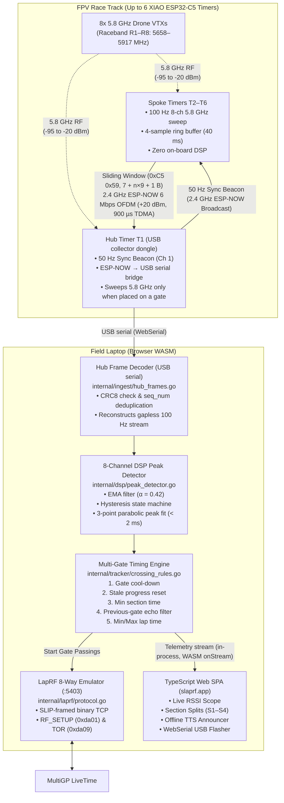
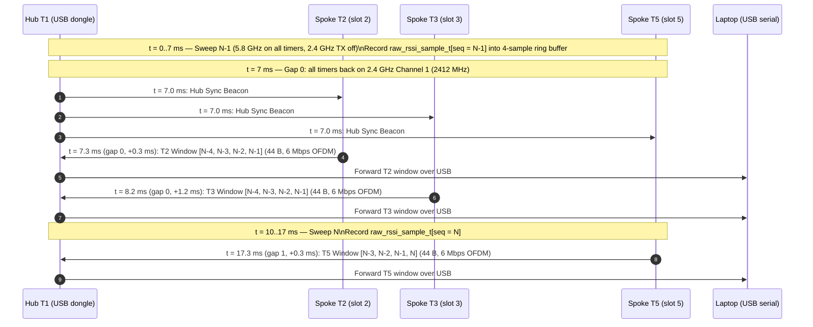
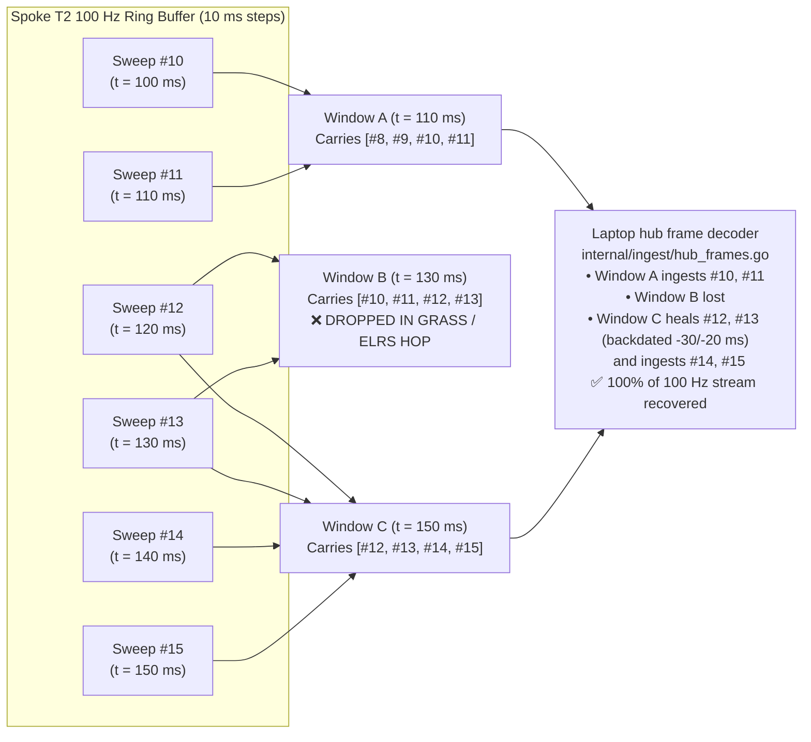
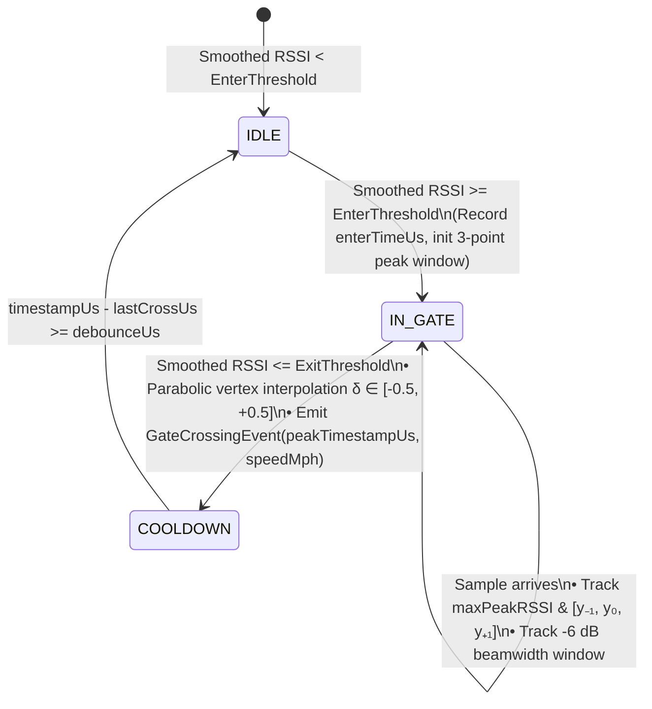
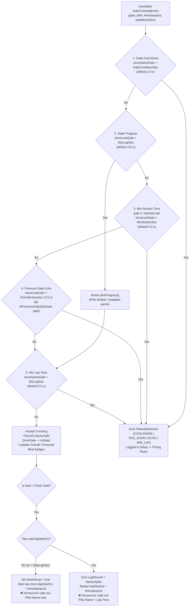
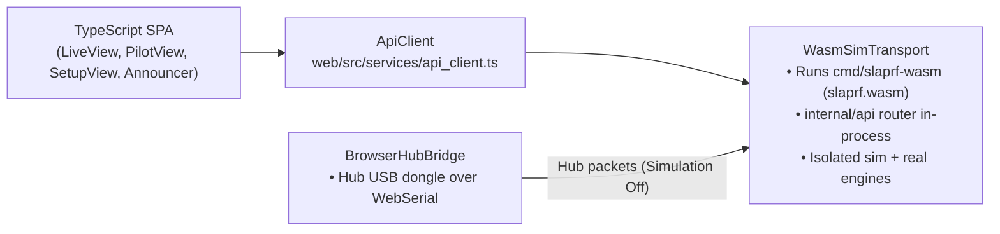

# SlapRF Low-Level Architecture & Protocol Reference

This document details the hardware, RF link layer, binary wire protocols, digital signal processing (DSP), timing engine state machines, browser-native USB firmware patching, and in-browser WebAssembly architecture of **SlapRF**.

For setting up your local development environment, running the live dev server, compiling binaries/WASM, and running the test suite, see **[`docs/DEVELOPER.md`](DEVELOPER.md)**.

## Low-Level Reference Overview

- **[1. System Overview & Design Principles](#1-system-overview--design-principles)** — Why Spokes are pure recording sensors with all DSP centralized on the laptop.
- **[2. End-to-End Data Flow](#2-end-to-end-data-flow)** — Architecture diagram from 5.8 GHz VTX signals across the track to the Web SPA and MultiGP LiveTime.
- **[3. XIAO ESP32-C5 5.8 GHz SDR & Time-Division Schedule](#3-xiao-esp32-c5-58-ghz-sdr--time-division-radio-schedule)** — Single-synthesizer 5.8 GHz / 2.4 GHz multiplexing and the 20 ms superframe schedule.
- **[4. Ground-Interference Mitigation & 2.4 GHz Link Protocol](#4-ground-interference-mitigation--24-ghz-link-protocol)** — Two-ray grass path-loss physics, 6 Mbps OFDM ESP-NOW at `+20 dBm`, 900 µs TDMA slots, and 4-sample sliding-window recovery under 50% packet loss.
- **[5. Binary Wire Formats (`0xC5 0x59` & `SLAPRF02`)](#5-binary-wire-formats-0xc5-0x59-sliding-window--slaprf02)** — Byte-by-byte layouts of the variable-length sliding-window frame, the Hello / Join / Assign / beacon frames, and the 160-byte flash config block.
- **[6. DSP Pipeline & Parabolic Peak Interpolation](#6-dsp-pipeline--sub-frame-parabolic-peak-interpolation)** — Zero-phase EMA smoothing, hysteresis state machine, and `< 2 ms` sub-frame parabolic vertex fitting.
- **[7. Multi-Gate Timing Rules & Section Analytics Engine](#7-multi-gate-timing-rules--section-analytics-engine)** — The 5-stage guardrail pipeline (cool-down, stale progress, min section, previous-gate echo, min/max lap) and bottleneck math.
- **[8. Browser-Native WebSerial ROM Flasher & Firmware Image](#8-browser-native-webserial-rom-flasher--firmware-image)** — Client-side patching of the compiled `.bin` image, board fingerprints, and the SLIP ROM bootloader protocol.
- **[9. ImmersionRC LapRF 8-Way Emulation (`TCP :5403`)](#9-immersionrc-laprf-8-way-emulation-tcp-5403)** — TCP `:5403` LiveTime bridge for official race scoring alongside SlapRF section splits.
- **[10. Web SPA & In-Browser WebAssembly Engine](#10-web-spa--in-browser-webassembly-engine)** — `ApiTransport` and the `slaprf.wasm` in-browser timing engine.

---

## 1. System Overview & Design Principles

SlapRF is built around four core engineering constraints:

1. **Zero Compute on Spoke Timers (Pure Recording Sensors)**:
   Spoke timers (`T2`–`T6`) placed out on the track perform **no peak detection, no threshold filtering, and no lap math**. They act purely as synchronized 100 Hz 8-channel 5.8 GHz RSSI recorders that stream raw dBm sweeps back to the laptop. Centralizing all DSP and timing rules on the laptop (`internal/dsp`, `internal/tracker`) allows live threshold recalibration, retrospective signal inspection, and cross-gate echo rejection without reflashing or reconfiguring field hardware.
2. **Single-Radio Dual-Band Multiplexing on Seeed Studio XIAO ESP32-C5**:
   Each gate timer uses a single `$6.90` dual-band (2.4 GHz / 5 GHz) RISC-V **XIAO ESP32-C5** module. Because a single RF synthesizer is shared between 5.8 GHz VTX power measurement and 2.4 GHz telemetry transport, the Hub (`T1`) and Spokes (`T2`–`T6`) follow a deterministic time-division schedule so no Spoke transmits on 2.4 GHz while the Hub is off-channel sweeping 5.8 GHz.
   **Hub role**: the Hub is a USB collector dongle (timer ID 1, `isHub`). Neither the real nor the simulated engine ever puts it on a gate automatically (`internal/tracker/track.go`: `provisionCollectorHubLocked`, `ProvisionGate`, `AddSimulatedTimer`); Spokes take the gates and the first one becomes start/finish. If the user drags the Hub onto a gate (a normal gate assignment, `AssignedTimerID` = the Hub's timer ID), the Hub also sweeps 5.8 GHz and times that gate. The browser keeps the Hub in sync over USB (`web/src/services/hub_gate_sync.ts`): the Hub's STATUS JSON reports `"hubGate"`, and `HUBGATE 1` / `HUBGATE 0` turns its own sweep + slot-1 telemetry on/off. The flag is runtime-only (off after a Hub reboot), so the browser re-sends it whenever the reported value differs from the course (at most once per second). The simulator follows the same model: the simulated Hub (`H1`) only generates RSSI telemetry while it is on a gate.
3. **Ground-Grazing & 2.4 GHz ELRS Immunity**:
   Gate timers typically sit flat on the grass beneath gates separated by 40–150 m while pilots transmit 250 mW – 1 W of 2.4 GHz ExpressLRS FHSS control packets nearby. SlapRF combines short **6 Mbps OFDM ESP-NOW frames at `+20 dBm`** in a beacon-synchronized TDMA schedule with a **4-sample sliding-window packet sent every 2 sweeps (`2×` overlap Forward Error Correction)** so even **50% packet loss** results in **0% lost 100 Hz telemetry samples** at the laptop.
4. **Zero-Toolchain Deployment**:
   The static site (built with a pure-Go TypeScript bundler, `esbuild`) ships a WebAssembly build of the entire Go timing/physics engine (`slaprf.wasm`), and a client-side `SLAPRF02` firmware binary patcher + WebSerial Espressif ROM bootloader client—requiring zero Node.js, zero Python `esptool`, and zero C toolchains.

---

## 2. End-to-End Data Flow

---

## 3. XIAO ESP32-C5 5.8 GHz SDR & Time-Division Radio Schedule

Each Seeed Studio XIAO ESP32-C5 is designed to use its 5 GHz wideband receiver path to measure in-band power across the 8 configured pilot frequencies (`slot_freqs_mhz[0..7]`, defaulting to Raceband `5658`, `5695`, `5732`, `5769`, `5806`, `5843`, `5880`, `5917` MHz). There is one firmware: a single ESP-IDF project ([`firmware/slaprf/`](../firmware/slaprf/), see [`firmware/README.md`](../firmware/README.md)) with one tuned configuration in [`main/main.c`](../firmware/slaprf/main/main.c), built on the [`firmware/components/slaprf_radio/`](../firmware/components/slaprf_radio/) hardware component. Every timer, Hub or Spoke, runs the same compiled image.

> [!NOTE]
> 5.8 GHz sensing is currently a **placeholder**: [`slaprf_rf58.c`](../firmware/components/slaprf_radio/slaprf_rf58.c) returns the noise floor so the rest of the pipeline can be tested end to end. It is pending a port of the raw-IQ approach (the C5's undocumented baseband debug path) used by ESPARGOS **esp-sdr** and **FPVGateC5MK**: retune the LO to each pilot frequency, capture a short I/Q burst, and compute band power.

### Why Time-Division Multiplexing Is Required

Because the ESP32-C5 has a **single RF synthesizer** shared between the 5 GHz and 2.4 GHz bands:
- While a timer's PLL is tuned to `5658–5917 MHz` measuring the 8 pilot VTX channels (budget `SWEEP_BUDGET_US` = 7 ms per sweep, measured ~6.3 ms on chip v1.0), its **2.4 GHz receiver is deaf**.
- If Spoke `T2` transmits an ESP-NOW packet on `2412 MHz` while Hub `T1` is sweeping `5806 MHz`, `T1` misses the packet completely.

### 20 ms Superframe Schedule (2× 10 ms Sweeps + Synchronized TDMA Gaps)

To eliminate both cross-band deafness and Spoke-to-Spoke packet collisions, the Hub (`T1`) and Spokes (`T2`–`T6`) lock to a **20 ms superframe** (two 10 ms, 100 Hz sweep intervals). Each interval is a sweep (all timers on 5.8 GHz, transmitter off) followed by a ~3 ms gap on 2.4 GHz Channel 1 holding three 900 µs TDMA slots after a 300 µs guard. Gap 0 opens with the Hub beacon; Spoke slots `2–4` transmit in gap 0 and slots `5–7` in gap 1, so every Spoke sends one 4-sample window per superframe. The Hub forwards each received frame to the laptop over USB serial as it arrives. When placed on a gate (`HUBGATE 1`), the Hub also sweeps and forwards its own window (slot `1`) after **every** sweep, since it needs no TDMA slot.

---

## 4. Ground-Interference Mitigation & 2.4 GHz Link Protocol

### Two-Ray Ground Reflection Physics at Gate Level

When timers are placed directly on the grass under gates ($h_t = h_r \approx 0.05\text{ m}$) separated by $d = 50\text{–}120\text{ m}$, the grazing angle $\theta$ approaches $0^\circ$. The ground reflection coefficient $\Gamma$ approaches $-1$ ($180^\circ$ phase inversion), cancelling the direct line-of-sight wave and shifting path loss from free-space $1/d^2$ ($20\log_{10} d$) to **two-ray ground-reflection $1/d^4$ ($40\log_{10} d$)**, while wet grass absorbs additional RF energy.

### Four-Layer Link Hardening

| Layer | Mechanism | Engineering Effect |
| :--- | :--- | :--- |
| **1. Frequency Selection** | Fixed **2.4 GHz Channel 1 (`2412 MHz`)** (`WIFI_CHANNEL = 1`) | Longest 2.4 GHz wavelength ($\lambda = 12.43\text{ cm}$), lowest dielectric absorption in moist grass, and furthest from upper-band Wi-Fi/Bluetooth congestion. |
| **2. PA & PHY Rate** | **`+20.0 dBm` (`80` quarter-dBm)** + **6 Mbps OFDM ESP-NOW** (`LINK_TX_RATE "6m"`; Espressif LR frames are still received) | ~0.15 ms on air per frame, so each window fits a 900 µs TDMA slot and three Spokes share each ~3 ms gap. Link rate and TX power can only be changed from the USB serial console (`LINKRATE`, `TXPOWER`, `LINKRESET`); the values are saved in NVS. |
| **3. USB Collector Hub** | The Hub forwards every frame to the laptop over **USB serial** (WebSerial) | No Wi-Fi hop to the laptop: the 2.4 GHz channel only carries the Hub beacon, Join / Assign frames, and Spoke windows. |
| **4. 4-Sample Sliding-Window FEC** | Each Spoke sends **`[seq-3, seq-2, seq-1, seq]`** (`44 bytes`) once per 20 ms superframe, i.e. every 2 sweeps | Every 10 ms 5.8 GHz sweep is transmitted **twice** in consecutive windows 20 ms apart. **Even if 50% of windows are wiped out** by ground multipath or a pilot's 2.4 GHz ELRS hop, the very next window delivers the missing sweeps with zero gaps. |

### Sliding-Window Recovery Under 50% Packet Loss

---

## 5. Binary Wire Formats (`0xC5 0x59` Sliding Window & `SLAPRF02`)

### 5.1 Sliding-Window Telemetry Frame (`timer_window_frame_t`, Magic `0xC5 0x59`)

Defined in [`firmware/slaprf/main/main.c`](../firmware/slaprf/main/main.c) and decoded by [`internal/ingest/hub_frames.go`](../internal/ingest/hub_frames.go). The frame is variable-length: a 7-byte header, `n` 9-byte samples, and a trailing crc8, i.e. `7 + n×9 + 1` bytes. The firmware sends `n = 4` (`WINDOW_SAMPLES`, `44 B`); the laptop accepts `n = 1..6` (`MaxWindowSamples`, `62 B` max):

| Byte Offset | Type | Field | Description |
| :--- | :--- | :--- | :--- |
| `0` | `uint8` | `magic0` | `0xC5` (ESP32-C5 frame marker) |
| `1` | `uint8` | `magic1` | `0x59` (`FRAME_MAGIC_WINDOW`) |
| `2` | `uint8` | `slot` | Hub-assigned TDMA slot (`1` = Hub, `2..7` = Spokes) |
| `3` | `uint8` | `sample_count` | Number of sweeps `n` in `samples` (`1..6`, oldest to newest) |
| `4..5` | `uint16 LE` | `battery_mv` | Supply voltage in millivolts (e.g., `4120` mV) |
| `6` | `int8` | `noise_floor_dbm` | Ambient 5.8 GHz noise floor in dBm (e.g., `-92`) |
| `7 + i×9 ..` | `9 bytes` | `samples[i]` | `[seq_num: uint8, rssi_dbm[0..7]: 8x int8]` for `i = 0..n-1` |
| `7 + n×9` | `uint8` | `crc8` | XOR checksum over all preceding bytes |

Spokes have no fixed slot; a short handshake maps each Hub slot to the board's stable fingerprint:

| Frame | Magic | Size | Direction | Payload |
| :--- | :--- | :--- | :--- | :--- |
| **Join** | `0xC5 0x5B` | `34 B` | Spoke → Hub (ESP-NOW) | `fingerprint (uint32 LE)`, `role`, `reserved0` (`0`), `sweep_hz`, `timer_label[24]`, `crc8`; repeated until assigned |
| **Assign** | `0xC5 0x5C` | `8 B` | Hub → Spoke (ESP-NOW) | `fingerprint (uint32 LE)`, `slot (2..7)`, `crc8` |
| **Hello** | `0xC5 0x5A` | `36 B` | Hub → Laptop (USB serial) | `slot`, `role`, `fingerprint (uint32 LE)`, `reserved0` (`0`), `sweep_hz`, `timer_label[24]`, `reserved`, `crc8` |
| **Sync beacon** | `0xC5 0x5D` | `4 B` | Hub → Spokes (ESP-NOW broadcast) | `seq`, `crc8`; Spokes transmit `(slot - 2)` TDMA slots after it |

The laptop keys timers by fingerprint (`%08X`): until a Hello arrives for a slot, the slot number is used as the timer ID directly.

### 5.2 160-Byte `SLAPRF02` Flash Configuration Block

The firmware's `main.c` embeds `slaprf_flash_config_t`. [`internal/firmware/image.go`](../internal/firmware/image.go) (`PatchImage`) and [`web/src/services/esp_flasher.ts`](../web/src/services/esp_flasher.ts) locate it by its magic (at `0x0100` in the placeholder image), stamp it, and repair the ESP-IDF image checksum / appended SHA-256. Radio and sweep tuning is compiled into the firmware (link rate and TX power can be overridden from the USB serial console); the block only carries per-board and per-event settings (all multi-byte fields little-endian):

| Byte Offset | Size | Type | Field | Description |
| :--- | :--- | :--- | :--- | :--- |
| `0..7` | `8 B` | `char[8]` | `magic` | `"SLAPRF02"` (`53 4C 41 50 52 46 30 32`) |
| `8..10` | `3 B` | `uint8[3]` | `version` | Firmware build version (major, minor, patch) |
| `11` | `1 B` | `uint8` | `role` | `1` = Hub Timer (`ROLE_HUB_TIMER`), `2` = Spoke Timer (`ROLE_SPOKE_TIMER`) |
| `12` | `1 B` | `uint8` | `reserved0` | Reserved (written `0`, ignored on read) |
| `13` | `1 B` | `uint8` | `wifi_mode` | Hub only: `0` = Host `"SlapRF"` AP, `1` = Join `wifi_ssid` |
| `14..17` | `4 B` | `uint32 LE` | `fingerprint` | Random per-board identity stamped at flash time (never `0`) |
| `18..33` | `16 B` | `uint16 LE[8]` | `slot_freqs_mhz` | 8 pilot 5.8 GHz frequencies in MHz (`5600..5950`, else Raceband default) |
| `34..66` | `33 B` | `char[33]` | `wifi_ssid` | Null-terminated Wi-Fi SSID (Hub Timer only) |
| `67..106` | `40 B` | `char[40]` | `wifi_pass` | Null-terminated Wi-Fi password (Hub Timer only) |
| `107..130` | `24 B` | `char[24]` | `timer_label` | Null-padded timer name (e.g., `"H1"`, `"S3"`) |
| `131..158` | `28 B` | `uint8[28]` | `reserved` | Zero |
| `159` | `1 B` | `uint8` | `crc8` | XOR checksum over bytes `[0..158]` |

---

## 6. DSP Pipeline & Sub-Frame Parabolic Peak Interpolation

Implemented in [`internal/dsp/peak_detector.go`](../internal/dsp/peak_detector.go), each `(GateTimer, PilotSlot)` pair runs an independent `ChannelDetector` on the incoming sample stream (100 Hz / `10 ms` from the firmware; the built-in simulator runs at 50 Hz):

1. **Zero-Phase-Lag Exponential Moving Average (EMA)**:
   $$y_n = \alpha x_n + (1 - \alpha) y_{n-1}, \quad \alpha = 0.42$$
   Suppresses high-frequency multipath spikes from carbon-fiber frames and chain-link fences while preserving the bell-shaped inverse-square gate approach envelope.
2. **3-Point Parabolic Vertex Interpolation (`parabolicPeakTimestamp`)**:
   At 60 mph (`26.8 m/s`), a quad moves `27 cm` between 10 ms samples. Fitting a parabola through the discrete peak sample $(t_0, y_0)$ and its immediate neighbors $(t_{-1}, y_{-1})$ and $(t_{+1}, y_{+1})$ yields the fractional sample offset $\delta \in [-0.5, +0.5]$:
   $$\delta = \frac{1}{2} \cdot \frac{y_{-1} - y_{+1}}{y_{-1} - 2y_0 + y_{+1}}, \quad t_{\text{peak}} = t_0 + \delta \cdot (t_0 - t_{-1})$$
   This achieves **`< 2 ms` crossing timestamp precision** from a 100 Hz (`10 ms`) sample stream.
3. **Gate Speed Estimation**:
   Measures the `-6 dB` beamwidth $\Delta t_{-6\text{dB}}$ (time spent within `6 dB` of peak RSSI) to estimate the crossing speed through the gate aperture.

---

## 7. Multi-Gate Timing Rules & Section Analytics Engine

Every candidate crossing emitted by `ChannelDetector` passes through the 5-stage timing rule pipeline in [`internal/tracker/crossing_rules.go`](../internal/tracker/crossing_rules.go) (using global rules merged with any per-gate overrides):

### Section Bottleneck & Theoretical Best Lap Math (`internal/tracker/summaries.go`)

For each pilot and each track section $s \in \{S_1, \dots, S_k\}$:
- **Personal Best Split** $b_s = \min_i t_{s,i}$ and **Mean Split** $\mu_s = \frac{1}{N}\sum_{i=1}^N t_{s,i}$.
- **Consistency (Standard Deviation)**:
  $$\sigma_s = \sqrt{\frac{1}{N}\sum_{i=1}^N (t_{s,i} - \mu_s)^2}$$
- **Average Time Lost per Section**: $\Delta_s = \mu_s - b_s$ (the section with the highest $\Delta_s$ is highlighted as the pilot's primary bottleneck).
- **Theoretical Best Lap**: $T_{\text{theo}} = \sum_{s=1}^k b_s$, with **Potential Gain** $= T_{\text{best}} - T_{\text{theo}}$.

---

## 8. Browser-Native WebSerial ROM Flasher & Firmware Image

Implemented in [`web/src/services/esp_flasher.ts`](../web/src/services/esp_flasher.ts) and [`web/src/widgets/TimerFlasher.ts`](../web/src/widgets/TimerFlasher.ts), the USB flasher operates **100% inside the browser** without requiring a Go backend:

1. **Single Firmware Image & Static `.bin` Fetch (`buildOrPatchFirmwareBin`)**:
   - There is one firmware image and nothing to choose: every timer, Hub or Spoke, is flashed with `slaprf-xiao-c5.bin`, built from [`firmware/slaprf/`](../firmware/slaprf/).
   - CI ([`.github/workflows/firmware.yml`](../.github/workflows/firmware.yml)) or [`firmware/tools/build_local.ps1`](../firmware/tools/build_local.ps1) compiles it into a merged flash image at `web/firmware/slaprf-xiao-c5.bin` (committed). `cmd/build-web` copies it to `_site/firmware/` (or writes a placeholder image if it hasn't been built, see [`web/firmware/README.md`](../web/firmware/README.md)), and the service worker precaches it.
2. **Client-Side `SLAPRF02` Patching of the Compiled Image**:
   - When the user clicks **Flash to USB** or **Download .bin**, the browser fetches `FIRMWARE_IMAGE_URL` (`./firmware/slaprf-xiao-c5.bin`), locates the 160-byte `SLAPRF02` block, and stamps `role`, `fingerprint`, `timer_label`, `wifi_ssid`, `wifi_pass`, and the active 8-channel `slot_freqs_mhz` (see [§5.2](#52-160-byte-slaprf02-flash-configuration-block)).
   - It then repairs the ESP-IDF app image (at `0x10000` in a merged image, or `0x0` for a bare app): the segment XOR checksum (`seed 0xEF`) and, if enabled, the appended SHA-256 digest.
3. **Board Fingerprints (Keep / New)**:
   - Every board carries a random, non-zero 32-bit fingerprint that the laptop uses as its stable timer identity (Spokes have no fixed slot; the Hub assigns one at join time).
   - With **Keep** (default), the flasher queries the running firmware over USB (`SLAPRF?`) before erasing and re-stamps the board's existing fingerprint (`withFingerprint`), so the app keeps treating it as the same timer. With **New**, or if the board doesn't answer, a freshly generated fingerprint is used.
4. **WebSerial Espressif ROM Bootloader Protocol (`navigator.serial`)**:
   - Toggles USB-JTAG `DTR` / `RTS` lines to reset the XIAO ESP32-C5 (`VID 0x303A`) into ROM Download Mode.
   - Exchanges SLIP-framed (`0xC0 ... 0xC0`) ROM bootloader commands: `ESP_SYNC (0x08)`, `ESP_SPI_ATTACH (0x0D)`, `ESP_FLASH_BEGIN (0x02)`, 1 KB `ESP_FLASH_DATA (0x03)` blocks written from flash offset `0x0`, and `ESP_FLASH_END (0x04)`, then hard-resets the board into the new firmware.
5. **Build Detection**:
   - **Over USB (`Read timer from USB`)**: Reads the `SLAPRF02` block from the connected XIAO ESP32-C5 and shows its role, fingerprint, and build version, flagging when an update to the current build is available.
   - **In Setup → Timers (`TimersList.ts`)**: Displays each discovered timer's firmware build alongside a **`Latest`** or **`Update → <current build>`** badge.

---

## 9. ImmersionRC LapRF 8-Way Emulation (`TCP :5403`)

Implemented in [`internal/laprf/protocol.go`](../internal/laprf/protocol.go) and [`internal/laprf/server.go`](../internal/laprf/server.go), SlapRF acts as a drop-in companion to **MultiGP LiveTime**:

- **Framing**: SLIP-encoded (`0xC0` delimiters, `0xDB 0xDC` / `0xDB 0xDD` escaping) little-endian TLV packets with a 16-bit CRC-CCITT (`poly 0x1021`, reflected) in header bytes `[3..4]`.
- **Inbound from LiveTime**:
  - `laprf_type_rf_setup (0xDA01)`: Syncs enabled pilot slots, 5.8 GHz frequencies (`0x25`), attenuation gain (`0x24`), and enter thresholds (`0x26`) into the SlapRF timing engine.
  - `laprf_type_state_ctrl (0xDA08)`: Arms or disarms race scoring (`0x20`).
  - `laprf_type_time (0xDA07)`: Replies with the engine's monotonic microsecond RTC clock (`0x02`).
- **Outbound to LiveTime**:
  - `laprf_type_passing (0xDA09)`: Emitted whenever an accepted crossing occurs at the **Start / Finish** gate (`IsStartFinish == true`), delivering `PassingNumber (0x01)`, `RTC Time Us (0x02)`, `Decoder ID (0x03)`, `Pilot Slot 1..8 (0x04)`, `Peak Height (0x05)`, and `Flags (0x06)`.
  - `laprf_type_status (0xDA0A)`: Periodic 1 Hz heartbeat reporting gate battery voltage (`0x01`) and per-slot background RSSI (`0x21`).

---

## 10. Web SPA & In-Browser WebAssembly Engine

All app logic runs in the browser. Implemented in [`web/src/services/transport.ts`](../web/src/services/transport.ts), [`wasm_transport.ts`](../web/src/services/wasm_transport.ts), and [`browser_hub_bridge.ts`](../web/src/services/browser_hub_bridge.ts), the TypeScript frontend talks to a single `ApiTransport` (`WasmSimTransport`) for both modes:

- **Simulation Mode**: the built-in 50 Hz track simulator feeds the isolated simulation engine.
- **Real-World Hardware Mode**: `BrowserHubBridge` feeds packets from the Hub (USB-C, WebSerial) into the isolated real-world engine.
- Both run the exact same Go packages (`internal/domain`, `internal/dsp`, `internal/tracker`, `internal/ingest`, `internal/api`) compiled to WebAssembly (`GOOS=js GOARCH=wasm`), so the full dashboard and USB flasher run from the static site (https://slaprf.app). MultiGP LiveTime (LapRF TCP `:5403`) is reached through the small `slaprf-relay` helper (`cmd/slaprf-relay`), which copies bytes between LiveTime's TCP socket and a loopback WebSocket; the LapRF emulator itself runs in the WASM engine.
