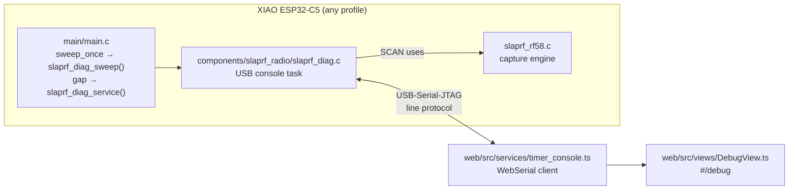

# Debug page: design and hand-off spec

Status: **design done, initial implementation committed (`a6adff0`), not yet verified on hardware.**
This document is the brief for whoever completes it. Read it top to bottom before changing code.

## 1. Goal

A top-level **Debug** page (`#/debug`, sidebar entry with a bug icon) for bench and field troubleshooting of a single timer **connected over USB**. It replaces the ad-hoc serial scripts used during bring-up. Network-wide health for every timer on the course is a separate, later feature (§7).

## 2. Architecture

### Files
| Area | File | Role |
|---|---|---|
| Firmware | `firmware/components/slaprf_radio/slaprf_diag.c` | USB console: command parser, status JSON, live stream, scan, log mirror |
| Firmware | `firmware/components/slaprf_radio/include/slaprf_radio.h` | `slaprf_diag_start/sweep/set_slot/service`, `slaprf_rf58_info` |
| Firmware | `firmware/tools/main_template.c` → `firmware/*/main/main.c` | Calls the hooks. **Edit the template (or per-profile settings in `firmware/tools/gen_main.ps1`), then regenerate** with `powershell -ExecutionPolicy Bypass -File firmware\tools\gen_main.ps1`; never hand-edit the four `main.c` |
| Web | `web/src/services/timer_console.ts` | WebSerial open/read/write, frame demux (JSON / log text / binary config) |
| Web | `web/src/views/DebugView.ts` | Page UI |
| Web | `web/src/core/router.ts`, `layout/AppShell.ts`, `core/icons.ts` | Route `debug`, view factory, `icons.bug` |
| Web | `web/styles/views.css` (end of file, `.debug-*`) | Styles |

Bench helper: `firmware/tools/benchpatch/main.go.txt` stamps a role, fingerprint and a custom channel table (any 5180–5917 MHz) into a merged image. Copy it to `cmd/_benchpatch/main.go`, run it, then delete it.

## 3. Wire protocol (USB, 115200 baud is nominal; it's native USB)

Host → timer: ASCII command + `\n`. Timer → host: lines starting with `@` carry JSON. The raw 160-byte `SLAPRF02` block is sent unframed, in answer to `SLAPRF?`. Any other line is log text.

| Command | Reply |
|---|---|
| `SLAPRF?` | raw 160-byte config block (the flasher depends on this, so **keep it byte-exact**) |
| `STATUS?` | `@{"t":"status","fw","role","profile","fp","label","uptimeMs","reset","heapFree","heapMin","sweepHz","sweeps","sweepUs","sweepUsMax","rf":{"ok","gain","gainMax","floorDb"},"channel","slot","freqs":[8]}` |
| `LIVE 1` / `LIVE 0` | `@{"t":"ok",...}`, then `@{"t":"live","us","dbm":[8],"pk":[8]}` at about 10 Hz (`pk` = peak since the previous line) |
| `SCAN a b s` | `@{"t":"scan","start","step","dbm":[n]}`, max 200 points, 5180–5917 MHz. Each point is the peak of 4 captures. It runs from the **main loop** during a 2.4 GHz gap (`slaprf_diag_service()`), so it pauses the TDMA schedule for about 60–90 ms |
| `LOG 1` / `LOG 0` | mirrors `ESP_LOG*` output onto USB (UART0 keeps logging regardless) |
| `REBOOT` | `@{"t":"ok","cmd":"reboot"}` then `esp_restart()` |
| other | `@{"t":"err","msg":"…"}` |

Rules: one line per message, no embedded newlines in JSON, and keep each line under about 700 bytes (the scan line can reach about 1.1 KB, which is OK). Never make the console block the main loop.

## 4. UI (implemented as described; refine, don't redesign)

The page uses the same `.settings` / `.settings-section` / `.card` layout as Settings. It has five sections:
1. **Connect a timer:** a Connect button (WebSerial, Espressif VID filter, "Show all USB serial ports" toggle), plus Read config / Restart timer / Disconnect when connected. On connect the page sends `STATUS?`, polls it every 2 s, and starts `LIVE 1`.
2. **Status:** a key/value grid (timer, firmware profile and version, fingerprint, uptime, last restart, memory, sweep timing against the budget, 5.8 GHz boot check, 2.4 GHz channel, channel table).
3. **Live 5.8 GHz readings:** 8 horizontal bars from −100 to −30 dBm, with a peak tick, Raceband labels (R1–R8) and a Pause/Resume button.
4. **Spectrum scan:** From/to/step inputs, a Scan button, and an SVG line chart with Raceband markers and a peak label.
5. **Log:** Start/Stop log, Clear, and a scrolling `<pre>` (last 400 lines) that auto-scrolls when already at the bottom.

## 5. Remaining work (in priority order)

### 5.1 Bench verification (needs a board; do first)
Board: XIAO ESP32-C5 v1.0 on COM3, flashed with `firmware/open-ground` that includes `slaprf_diag.c`. Power-cycle after flashing: USB resets currently lock up until replug (see §6).
- [ ] Open `http://localhost:8090/#/debug` in Chrome (run `.\slaprf.exe -open=false`; it bundles the TS on the fly), click Connect, pick the Espressif port.
- [ ] Status populates and refreshes. Check `rf.ok=true`, `floorDb` ≈ −89, sweep ≈ 6 ms at 50 Hz, `reset` makes sense.
- [ ] Live bars move about 10×/s. With no VTX all 8 bars sit around −89 dBm.
- [ ] Scan with defaults (148 points) returns within about 1 s. The board's own home Wi-Fi should show a bump around 5220–5240 MHz.
- [ ] Log: Start shows `ESP_LOG` lines; Stop stops them.
- [ ] Read config logs a `[config]` line (fingerprint `BE7C0001` if flashed with the benchpatch helper).
- [ ] Restart timer: the page sees the reboot (port may drop; it must recover cleanly or show Disconnected).
- [ ] **Opening the port must not reset the chip.** If it does, adjust `setSignals` in `timer_console.ts`.
- [ ] Unplug while connected: the page shows Disconnected and doesn't throw.

### 5.2 Web polish
- [ ] **Live bars:** update the existing elements' `style.width` / text instead of rewriting `innerHTML` 10×/s (keeps the Pause button clickable, avoids layout thrash).
- [ ] Listen for `navigator.serial` `disconnect` events. Offer **reconnect to the last port** via `navigator.serial.getPorts()` without the picker.
- [ ] Disable the action buttons while a command is in flight; show "Connecting…".
- [ ] Spectrum chart: hover read-out (MHz and dBm at the cursor); keep the last scan visible while re-scanning; optional "hold max" across scans.
- [ ] Mobile layout check at 375 px (bars, scan inputs, chart). The app has `table_scroll` / mobile patterns already.
- [ ] Explain in the UI when WebSerial isn't available (mobile browsers), as the Flasher does.

### 5.3 Firmware additions
- [ ] `CHANNELS f1,…,f8`: temporary channel table in RAM until reboot, for bench tests without reflashing. Validate 5180–5917.
- [ ] `IDENT`: blink the user LED for 5 s. Find the XIAO ESP32-C5 user LED GPIO in the Seeed schematic; skip if there isn't one.
- [ ] Status: add link stats once they exist (beacons missed, frames dropped), Spoke join state, and the `DBM_OFFSET` calibration value.
- [ ] Scan: optionally stream progress for long scans. It currently returns one line at the end.
- [ ] Keep the `slaprf_diag_sweep()` hot path cheap. It runs every sweep on the main task; only format strings when `LIVE` is on.

### 5.4 Docs
- [ ] Add the console protocol (§3) to `firmware/README.md` and `docs/DEVELOPER.md`, and the Debug page to `docs/ARCHITECTURE.md` (§8 flasher area).

## 6. Known hardware issues (context, not part of this task)
- After a USB/RTS reset, the first boot crashes in `select_rtc_slow_clk` and recovers by itself. That's chip / ESP-IDF behaviour: it also happens with the capture engine off.
- With the capture engine **on**, a USB reset instead lands in a ROM watchdog loop until power-cycled. The root cause hasn't been found. The bank release in `stock_capture()` / the shutdown hook didn't fix it. Avoid USB-triggered resets during testing: flash with `--after no_reset`, then replug.

## 7. Later: network health (part 2, separate task)
Each timer sends a small health frame through the Hub every 2 s (new magic `0xC5 0x5E`: uptime, reset reason, max sweep µs, beacon misses, dropped frames, heap, noise floor). The laptop adds a per-timer **Health** drawer on the Timers list. This needs `internal/ingest/wifi_udp.go` decoding plus a field on `DetectedPuck`.

## 8. Conventions (must follow)
- **Builds:** Go uses `-ldflags="-s -w"`; no Node/npm (TS is bundled by Go esbuild). Firmware uses ESP-IDF **v5.5.1** only: `firmware\tools\build_local.bat <profile>`.
- **Before commit:** bump the cache-buster `?v=` in `web/index.html` on web changes (currently `v=69`), and run `go test -ldflags="-s -w" ./...`.
- **Code hygiene:** keep existing comments; no new lint warnings (`-Werror=all` in ESP-IDF); no screenshots for verification unless the user asks.
- **Git:** `$env:PATH += ";C:\Users\miguel\AppData\Local\Programs\MinGit\cmd"`. Commit to `main` with descriptive messages.
