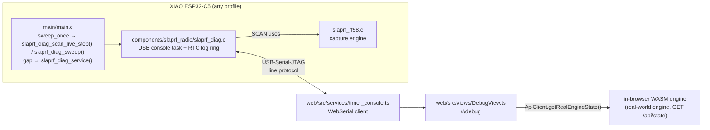

# Debug page: design and hand-off spec

Status (2026-11-08): **firmware console complete and verified on hardware; web page and §5
canvas charts implemented (`web/src/views/debug/charts.ts` + `DebugView.ts`: signal over time at
50 Hz, per-channel noise table, upgraded canvas spectrum scan with average/max-hold/Wi-Fi UNII
overlay & top-5 peak list, scrolling waterfall spectrogram, 5-min health sparklines, CSV/PNG
export).**
This is the brief for whoever continues. Read it top to bottom before changing code.

## 1. Goal

A top-level **Debug** page (`#/debug`, sidebar entry with a bug icon) for bench and field
troubleshooting of a single timer **connected over USB**. Every troubleshooting step done by hand
during bring-up (serial scripts, reflashing with test channels, power-cycling to read logs)
should be possible from this page. Network-wide health for every timer on the course is a
separate, later feature (§8).

## 2. Architecture

### Files
| Area | File | Role |
|---|---|---|
| Firmware | `firmware/components/slaprf_radio/slaprf_diag.c` | USB console: commands, status JSON, live stream, scans, boot-log ring, temporary channels, receiver switch |
| Firmware | `firmware/components/slaprf_radio/include/slaprf_radio.h` | `slaprf_diag_*` hooks, `slaprf_rf58_info` |
| Firmware | `firmware/tools/main_template.c` → `firmware/*/main/main.c` | Calls the hooks. **Edit the template, then regenerate** with `powershell -ExecutionPolicy Bypass -File firmware\tools\gen_main.ps1`; never hand-edit the four `main.c` |
| Web | `web/src/services/timer_console.ts` | WebSerial open/read/write, frame demux, `request()` waiters, `restartAndReconnect()` |
| Web | `web/src/views/DebugView.ts` | Page UI & coordinator |
| Web | `web/src/views/debug/charts.ts` | Canvas charts: signal over time, noise stats, spectrum scan, waterfall, health sparklines, CSV/PNG export |
| Web | `web/src/core/router.ts`, `layout/AppShell.ts`, `core/icons.ts` | Route `debug`, view factory, `icons.bug` |
| Web | `web/styles/views.css` (end of file, `.debug-*`) | Styles |
| Web | `web/src/services/api_client.ts` `getRealEngineState()` | Real-world engine state from the in-browser WASM engine (`/api/state`; `null` while the simulator runs). DebugView derives the self-test's "Reaches the timing engine" check and the frames/s sparkline from it |
| Tools | `firmware/tools/console_check.py COM3` | Protocol regression test (all commands) |
| Tools | `firmware/tools/noise_stats.py COM3 [s]` | Per-channel noise / hit statistics from `LIVE 2` |
| Tools | `firmware/tools/benchpatch/main.go.txt` | Stamps role, fingerprint, channel table into a merged image (copy to `cmd/_benchpatch/main.go`, run, delete) |

## 3. Wire protocol

Native USB (baud rate nominal). Host → timer: ASCII command + `\n`. Timer → host: lines starting
with `@` carry JSON; the raw 160-byte `SLAPRF02` block is sent unframed in answer to `SLAPRF?`;
any other line is log text. Refused commands reply `@{"t":"err","msg":"…"}`; `timer_console.ts`
rejects pending `request()`s with that message.

| Command | Reply |
|---|---|
| `SLAPRF?` | raw 160-byte config block (the flasher depends on it: **keep byte-exact**) |
| `STATUS?` | `@{"t":"status","fw","role"(1=Hub),"profile","fp","label","uptimeMs","reset","boots","heapFree","heapMin","sweepHz","sweeps","sweepUs","sweepUsMax","sweepBudgetUs","rf":{"ok","enabled","gain","gainMax","floorDb"},"chip":{"model","rev","mac","flashMB"},"net":{"mode":"ap"/"ap+sta"/"sta"/"off","stations"},"channel","slot","scanLive","freqsTemporary","freqs":[8]}` |
| `LIVE 1` / `LIVE 2` / `LIVE 0` | `@{"t":"live","n","us","dbm":[8],"pk":[8],"hits":[8],"floor":[8]}`. **1** ≈ 10 lines/s, `pk` = peak since previous line. **2** = every sweep (50/s; `pk` = reading). `n` = sweep counter (gaps = dropped lines; 50 per second, use it as the time base). `floor` = typical noise per channel (−127 until learned). `hits` = readings > floor + 10 dB since the previous line. Lines are best-effort: dropped, never blocking, if USB is busy |
| `SCAN a b s` | one-shot: `@{"t":"scan","start","step","dbm":[n]}`; ≤ 200 points within 5180–5917 MHz; peak of 4 captures per point; pauses timing ~0.1–0.5 s |
| `SCAN LIVE a b s` | continuous: each 20 ms sweep slot measures the next chunk of the band instead of the pilot channels; streams `@{"t":"scan","live":true,"passMs","start","step","dbm":[n]}` per pass (full band 148 points ≈ 320 ms/pass ≈ 3 passes/s). **Lap timing pauses; Wi-Fi is unaffected** (verified: 50 frames/s to the laptop throughout). Live readings show −127 meanwhile |
| `SCAN STOP` | ends the continuous scan |
| `LOG 1` / `LOG 0` | mirrors `ESP_LOG*` output onto USB (UART0 keeps logging regardless) |
| `BOOTLOG?` / `LASTLOG?` | `@{"t":"bootlog","which":"current"/"last","boots","reset","text"}`. 3 KB RTC ring captured from before `app_main`; `last` survives software resets, panics and watchdogs (not power-off). Non-ASCII / ANSI bytes are dropped |
| `CHANNELS f1,…,f8` / `CHANNELS RESET` | temporary channel table (5180–5917 MHz) until restart; noise floors relearn |
| `RF 1` / `RF 0` | 5.8 GHz receiver on/off (off: readings −127, scans refused) |
| `REBOOT` | `@{"t":"ok","cmd":"reboot"}` then restart (USB re-enumerates; use `restartAndReconnect()`) |

Rules: one line per message, no embedded newlines in JSON; large replies are chunked by the
firmware (the USB driver silently rejects single writes larger than its 2 KB buffer). Never make
the console block the sweep task.

## 4. Current UI (implemented; refine, don't redesign)

Same `.settings` / `.settings-section` / `.card` layout as Settings. Sections:
1. **Connect a timer**: WebSerial (Espressif VID filter, "show all ports"), Read config, Disconnect. On connect: `STATUS?` every 2 s + `LIVE 1`.
2. **Self-test**: 11 checks (console, identity, receiver, sweep timing, live rate, scan, saved config, memory, last restart (+ previous boot log if crashed), Wi-Fi, reaches-this-laptop via `/api/debug/timer`, skipped on static Pages). Copy report.
3. **Status**: key/value grid.
4. **Live 5.8 GHz readings**: 8 bars (in-place DOM updates), peak tick, hits; receiver toggle; "Try other channels" editor.
5. **Spectrum scan**: range inputs, one-shot **Scan**, **Live** (continuous) with max-hold trace; SVG chart with Raceband markers.
6. **Restarts & boot logs**: Restart & capture boot log (auto-reconnect), This/Previous boot's log, Restart test ×N (flags crashes and extra restarts during boot via the `boots` counter).
7. **Live log**.

## 5. Next task: charts (web only — firmware data is already there)

Goal: show as much as possible about what the receiver sees **over time**. All charts on
`<canvas>` (not SVG/innerHTML: data arrives at 50 lines/s and 3 scans/s), drawn in one
`requestAnimationFrame` loop that only redraws charts that got new data. Device-pixel-ratio aware.
Colours from CSS tokens (`web/styles/tokens.css`: `--accent`, `--good`, `--warn`, `--bad`,
`--text-3`, `--border`); read them once with `getComputedStyle`.

Put the chart code in a new `web/src/views/debug/` folder (e.g. `charts.ts` with small reusable
helpers: axes, time series, heat-map colour scale), keep `DebugView.ts` as the coordinator.

### 5.1 Signal over time (most important)
- New card under Live readings. While the card is visible, switch the stream to `LIVE 2`
  (every sweep); go back to `LIVE 1` when hidden/paused (`IntersectionObserver`). Keep the bars
  working from either mode (in `LIVE 2`, `pk` = reading).
- One line per channel, last 30 s (window selector 10 s / 30 s / 2 min; ring buffer of
  `{n, dbm[8], floor[8]}`, x-axis from `n` / 50 Hz, so dropped lines leave gaps instead of
  squashing time). Channel toggles (R1–R8 chips, colour-coded; default all on).
- Overlays: each channel's `floor` (dotted), floor + 10 dB "hit" line, and the **enter
  threshold** of the pilot on that frequency when the server is reachable (`GET /api/state` →
  `pilots[]` with `frequencyMhz`, `enterThreshold`, `exitThreshold`; match on frequency; skip
  silently if not available).
- Freeze button (stops scrolling, keeps receiving) and hover read-out (time, channel, dBm).

### 5.2 Per-channel noise table
Under the over-time chart, computed from its ring buffer: mean, standard deviation, max,
floor, hits/s, % of time ≥ enter threshold ("would trigger"), dropped lines. Highlight a channel
whose would-trigger rate is > 0 with no drone flying (that's a false-lap risk). Matches what
`firmware/tools/noise_stats.py` prints; use it to cross-check.

Reference numbers (2026-11-08, home with 5 GHz Wi-Fi, no VTX): all channels mean ≈ −91 dBm,
sd ≈ 1.0–1.6; R4 (5769) sd 4.4, max −61, 1.5 hits/s from Wi-Fi; nothing ≥ −58 dBm.

### 5.3 Waterfall (spectrogram)
- Under the spectrum chart, visible while **Live** scan runs: frequency on x (same axis as the
  spectrum chart), time scrolling downward, colour = dBm (−100 → −40, perceptual palette from
  dark to `--accent`/white). One row per pass (~3/s); keep the last ~200 rows. Draw by shifting
  an offscreen canvas one row and painting the new row (`ImageData`), not a full redraw.
- Raceband markers and Wi-Fi channel blocks on the axis (see 5.5). Hover: MHz, dBm, age.
- Also feed one-shot scans into it (one row each), so the user can build a history by clicking Scan.

### 5.4 Spectrum chart upgrades
- Port to canvas; add an **average** trace (running mean over passes) next to live and max-hold;
  hover read-out; keep the last result visible during a new scan.
- Peak list: top 5 peaks (≥ 6 dB above the median) with MHz, dBm, and the nearest Raceband/Wi-Fi channel.

### 5.5 Band overlay (shared by spectrum, waterfall)
Shaded blocks + labels for 5 GHz Wi-Fi channels in 5180–5917: UNII-1/2 (36–64: 5170–5330),
UNII-2e (100–144: 5490–5730), UNII-3 (149–165: 5735–5835), and the Raceband R1–R8 markers
(5658, 5695, 5732, 5769, 5806, 5843, 5880, 5917). Note in the UI that R3–R6 overlap UNII-3.

### 5.6 Health over time
Small sparkline strip (last 5 min, from the 2 s `STATUS?` poll and the live stream):
sweep duration (`us` vs `sweepBudgetUs`, mark overruns), free heap, frames/s reaching the
laptop (`/api/debug/timer` `framesRx` delta, poll every 2 s while on the page; hide on static
Pages), live-line rate / dropped lines.

### 5.7 Export
"Download data" for each chart: CSV (signal over time: `n,ms,R1..R8,floor1..8`; scans: one row
per pass) and PNG (`canvas.toBlob`). Include timer label/fp and timestamp in file names.

### 5.8 Acceptance
- Board connected, page idle on Signal over time for 5 min: no growing memory (bounded ring
  buffers), CPU modest, 50 lines/s shown with 0 dropped (`n` continuous).
- Live scan + waterfall for 5 min: smooth, ~3 rows/s.
- A VTX powered on near the timer shows as a step on its channel in Signal over time, a peak in
  the spectrum and a vertical stripe in the waterfall.
- Mobile (375 px): charts stack and stay readable; WebSerial missing → explanation (as now).
- Leaving the page stops `LIVE`, `SCAN LIVE` and polling (already done for the existing ones).

## 6. Other remaining work
- [ ] Browser verification by the user of the current page (self-test, restart & capture, restart test, live scan).
- [ ] `IDENT`: blink the user LED for 5 s (find the XIAO ESP32-C5 user LED GPIO; skip if none).
- [ ] Decode crash: coredump partition + `esp_core_dump_get_summary`, ship the ELF next to images, symbolise in Go (DWARF) via a server endpoint.
- [ ] Status: link stats once they exist (beacons missed, frames dropped), Spoke join state, `DBM_OFFSET`.
- [ ] Sweep budget: worst case ≈ 7.5 ms against 7 ms. Raise `SWEEP_BUDGET_US` (check slot static-asserts) or add the faster PLL-only hop (FPVGateC5MK RADIO_INTERNALS §6). Would also allow a rolling scan during timing.
- [ ] Boot-log ring is only 3 KB and fills within ~1 s of boot (Wi-Fi warnings); consider 6–8 KB of RTC memory.
- [ ] Docs: protocol (§3) into `firmware/README.md` and `docs/DEVELOPER.md`; Debug page into `docs/ARCHITECTURE.md`.

## 7. Known hardware issues (context)
- After a USB/RTS reset, the first boot can crash in `select_rtc_slow_clk` and recover by itself (chip / ESP-IDF behaviour; also with the capture engine off). The restart test shows it as "restarted 1 extra time while starting".
- ROM watchdog loop after USB reset was only seen on the smoke/logging build (secondary USB console); the production build recovers. Confirm by repeating USB resets on both builds.
- Each reflash drops the PC off the Hub's SlapRF Wi-Fi; Windows doesn't rejoin by itself.

## 8. Later: network health (separate task)
Each timer sends a small health frame through the Hub every 2 s (new magic `0xC5 0x5E`: uptime, reset reason, max sweep µs, beacon misses, dropped frames, heap, noise floor). The laptop adds a per-timer **Health** drawer on the Timers list (`internal/ingest/wifi_udp.go` decoding + a field on `DetectedTimer`).

## 9. Conventions (must follow)
- **Builds:** Go always with `-ldflags="-s -w"`; no Node/npm (TS is bundled by Go esbuild, which does **not** type-check: be careful with types). Web: `go run -ldflags="-s -w" ./cmd/build-web -web ./web -out ./_site`. Dev server: `go run -ldflags="-s -w" ./cmd/devserver` (dev-only, port 8090; bundles the TS and rebuilds the WASM engine on the fly). Firmware: ESP-IDF **v5.5.1** only, `firmware\tools\build_local.bat <profile>`.
- **Before commit:** bump the cache-buster `?v=` in `web/index.html` on web changes (currently `v=71`), run `go test -ldflags="-s -w" ./...`.
- **Files:** UTF-8; don't round-trip source through PowerShell 5 `Get-Content` (it mangles `·`, `…`, `—`). Use the editor tools.
- **Code hygiene:** keep existing comments; no new lint warnings (`-Werror=all` in ESP-IDF); user-facing copy in plain language; no screenshots for verification unless the user asks.
- **Server mode:** the server starts in simulator mode; `POST /api/sim/toggle` switches to real timers.
- **Git:** `$env:PATH += ";C:\Users\miguel\AppData\Local\Programs\MinGit\cmd"`. Commit to `main` with descriptive messages.
