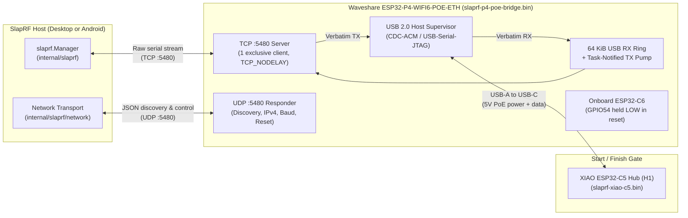

# SlapRF PoE Ethernet Bridge Protocol & Implementation Reference

Applies to the ESP32-P4 PoE Bridge firmware image `slaprf-p4-poe-bridge.bin` (`v0.2.3+`) built from [`firmware/slaprf_p4_poe_bridge/`](../firmware/slaprf_p4_poe_bridge/) for the Waveshare `ESP32-P4-POE-ETH` and `ESP32-P4-WIFI6-POE-ETH` boards (`ESP32-P4` rev v3.2 + `IP101GRI` `100 Mbps` RMII PHY + USB 2.0 Host). The USB Hub firmware on the attached Seeed Studio XIAO ESP32-C5 (`firmware/slaprf/`, `slaprf-xiao-c5.bin`) requires zero changes.

---

## 1. Design Summary

The PoE Bridge separates **serial byte transport** from **bridge discovery and management** across two independent planes on port **`5480`**:

1. **Data Plane (`TCP :5480`, Pure Unescaped Serial Stream)**:
   - Every byte written by the host to `TCP :5480` is forwarded verbatim to the USB serial device attached to the Type-A host port.
   - Every byte received from the attached USB serial device is pushed into a `64 KiB` ring buffer and sent verbatim over `TCP :5480` with `TCP_NODELAY = 1` (`< 0.5 ms` LAN latency).
   - The bridge never parses, frames, or injects bytes into an active `TCP :5480` stream. Over `TCP :5480`, SlapRF exchanges the exact same newline-terminated commands (`STATUS?\n`, `NETCHANNELS ...\n`, `SCAN ...\n`) and binary Hub records (`0x1E <len> <0xC5 ...>`) as a local USB-C cable.
   - Because the data plane is protocol-agnostic, the bridge also works with any standard `CDC-ACM` or `USB-Serial-JTAG` device.
2. **Control & Discovery Plane (`UDP :5480` + USB-C `UART0`)**:
   - Out-of-band UDP datagrams on `:5480` handle LAN discovery, live link/USB telemetry, DHCP vs. static IPv4 setup, baud rate changes, `DTR`/`RTS` control lines, atomic `USB-Serial-JTAG` timer reboot (`RESET_USB`), byte counter resets, and remote bridge reboots without interrupting or polluting the TCP serial stream.



---

## 2. Hardware Pin Map & Radio Isolation

On `ESP32-P4-WIFI6-POE-ETH` boards, an auxiliary `ESP32-C6` Wi-Fi/BLE module is wired on the PCB. At step 1 of `app_main()`, the firmware drives `GPIO54` (`P4_C6_RST_GPIO`) **LOW** with pull-down enabled so the `ESP32-C6` remains powered down in hardware reset and emits zero `2.4 GHz` or `5 GHz` RF energy near the gate timer antenna.

| Function | ESP32-P4 GPIO / Interface | Notes |
| :--- | :--- | :--- |
| `ESP32-C6` Reset Hold | `GPIO54` (`OUTPUT`, level `0`, pull-down) | Keeps onboard Wi-Fi/BLE co-processor powered off |
| RMII `MDC` / `MDIO` | `GPIO31` / `GPIO52` | SMI management bus to `IP101GRI` PHY (`ESP_ETH_PHY_ADDR_AUTO`) |
| RMII `PHY_RST` | `GPIO51` | Hardware reset pin for `IP101GRI` |
| RMII `REF_CLK` (`50 MHz`) | `GPIO50` (`EMAC_CLK_EXT_IN`) | External `50 MHz` RMII clock input |
| RMII `TX_EN` / `TXD0` / `TXD1` | `GPIO49` / `GPIO34` / `GPIO35` | `100 Mbps` Ethernet transmit lanes |
| RMII `CRS_DV` / `RXD0` / `RXD1` | `GPIO28` / `GPIO29` / `GPIO30` | `100 Mbps` Ethernet receive lanes |
| USB-A Host Port | USB 2.0 OTG High-Speed Host (`iface 0..2`) | Supplies `5 V` PoE-derived VBUS and hosts Hub `H1` |
| USB-C Console & Flash Port | `UART0` (`115200 8N1`, onboard USB-UART) | Firmware flashing (`esptool` `esp32p4`) + local `@`-JSON console |

---

## 3. Raw TCP `:5480` Data Plane

### Socket Parameters & Ring Buffer

- **Listen port**: `0.0.0.0:5480` (`SO_REUSEADDR = 1`).
- **Client socket options**:
  - `TCP_NODELAY = 1` (disables Nagle buffering so `46-byte` Hub frames leave immediately).
  - `SO_KEEPALIVE = 1` with `TCP_KEEPIDLE = 3 s`, `TCP_KEEPINTVL = 1 s`, `TCP_KEEPCNT = 2` (reclaims silent cable pulls or Wi-Fi drops in ~`5 s`).
  - `SO_SNDTIMEO = 120 ms` (bounds worst-case socket stalls; after 2 `EAGAIN` retries, `tcp_tx_pump_task` calls `shutdown(fd, SHUT_RDWR)` so `tcp_server_task` closes and frees the slot).
- **USB RX -> TCP TX path**:
  - `cdc_rx_callback` pushes incoming USB bulk IN packets into `g_rx_ring` (`65,536` bytes; oldest bytes drop on overflow when a client stalls, or are discarded immediately when `g_tcp_client_count == 0`) and wakes `tcp_tx_pump_task` via `xTaskNotifyGive`.
  - `tcp_tx_pump_task` drains up to `1,460` bytes (one Ethernet TCP MSS) per `send()` call.
- **TCP RX -> USB TX path**:
  - `tcp_server_task` reads up to `1,024` bytes from the client socket and calls `cdc_acm_host_data_tx_blocking` (`500 ms` timeout per `1,024 B` chunk) serialized by `g_cdc_tx_mu`.

### Exclusive Single-Client Protection (`MAX_TCP_CLIENTS = 1`)

Because the bridge fronts a single physical USB serial device, only **1 concurrent TCP client** is permitted:

1. On `accept()`, `tcp_server_task` first probes any existing client slot with a non-blocking `recv(efd, &b, 1, MSG_PEEK | MSG_DONTWAIT)`. If the previous peer already closed (`recv == 0` or fatal socket error), its slot is closed and reclaimed immediately so fast host reconnects succeed without waiting for keepalive expiry.
2. If slot `0` is still actively owned by another host, the bridge writes a single error line to the **new** socket (`40 ms` `SO_SNDTIMEO`) and closes **only** the new socket:
   ```json
   @{"t":"err","code":"BUSY","peer":"10.0.0.55"}
   ```
   The active timing session on `10.0.0.55` receives zero injected bytes and experiences zero interruption.

---

## 4. Out-of-Band UDP `:5480` Discovery & Control Protocol

Send UTF-8 ASCII commands (trailing `\r`/`\n`/spaces optional) as a single UDP datagram to `<bridge_ip>:5480` (or `255.255.255.255:5480` / subnet broadcast for discovery). Every command sends a single UTF-8 JSON UDP datagram back to the requester's source `(IP, port)`.

### Supported UDP Commands

| Command | Arguments | Reply JSON | Behavior |
| :--- | :--- | :--- | :--- |
| `DISCOVER?` | none *(aliases: `SLAPRF_DISCOVER?`, `STATUS?`, `BRIDGE?`, `NETCFG?`)* | Full `{"t":"bridge",...}` status object | Safe to broadcast at any time; never touches USB or TCP state. |
| `NETCFG DHCP` | none | `{"ok":true,"mode":"dhcp"}` | Persists `static=0` in NVS (`poe_bridge`), replies first (`25 ms` delay), then restarts DHCP client (+ AutoIP fallback). |
| `NETCFG STATIC <ip> <mask> [gw]` | IPv4 dotted quads (`gw` defaults to `0.0.0.0`) | `{"ok":true,"mode":"static","ip":"...","netmask":"...","gateway":"..."}` | Validates IPv4 addresses, saves to NVS, replies before switching interface IP so the caller always receives the ACK on the old IP. |
| `BAUD <rate>` | `1200` .. `4000000` (default `115200`) | `{"ok":true,"baud":115200}` | Saves `baud` in NVS and applies `cdc_acm_host_line_coding_set` (`8N1`) live if a USB device is attached. |
| `CTRL [dtr=0\|1] [rts=0\|1] [baud=<n>]` | Space-separated key/values | `{"ok":true}` | Updates USB `SET_CONTROL_LINE_STATE` (`DTR`/`RTS`) and optional baud rate out-of-band. |
| `RESET_USB` | none | `{"ok":true,"cmd":"RESET_USB"}` | Runs the atomic 5-step `USB-Serial-JTAG` / UART SPI-flash application reset sequence (`~380 ms`). Returns `"ok":false` if no USB device is attached. |
| `RESET_COUNTERS` | none | `{"ok":true}` | Resets `rxBytes` and `txBytes` counters to `0`. |
| `REBOOT` | none | `{"ok":true,"cmd":"REBOOT"}` | Sends UDP ACK, waits `80 ms`, and calls `esp_restart()`. |

### Status & Discovery JSON Payload (`t = "bridge"`)

```json
{
  "t": "bridge",
  "proto": "usb-serial-eth",
  "ver": 1,
  "board": "ESP32-P4-WIFI6-POE-ETH",
  "bridgeFw": "0.2.3",
  "port": 5480,
  "upMs": 565096,
  "usbConnected": true,
  "usbVid": "303A",
  "usbPid": "1001",
  "baud": 115200,
  "dtr": true,
  "rts": false,
  "ip": "10.0.0.28",
  "netmask": "255.255.255.0",
  "gateway": "10.0.0.1",
  "mac": "80:F1:B2:D5:C3:88",
  "staticIp": "0.0.0.0",
  "staticNetmask": "255.255.255.0",
  "staticGateway": "0.0.0.0",
  "linkUp": true,
  "linkSpeedMbps": 100,
  "fullDuplex": true,
  "dhcp": true,
  "tcpConnected": true,
  "tcpClients": 1,
  "maxClients": 1,
  "tcpPeer": "10.0.0.55",
  "rxBytes": 184320,
  "txBytes": 256
}
```

### Host Discovery Strategy (`internal/slaprf/network/transport.go`)

1. **Wave 1 (Fast Broadcast, `~220 ms`)**: Sends `SLAPRF_DISCOVER?` to `255.255.255.255:5480` and each active IPv4 interface's directed broadcast address (for example `10.0.0.255:5480`) twice (`35 ms` apart) and collects replies for `180 ms`. On standard LANs, bridges reply in `< 5 ms`.
2. **Wave 2 (Fallback `/24` Unicast Sweep)**: Executed **only** if Wave 1 finds zero bridges (for example across Wi-Fi APs with client/broadcast isolation enabled), pacing unicast probes across `/24` neighbors in batches of 32 (`4 ms` pause) so the kernel ARP unresolved queue (`unres_qlen`) never overflows on Wi-Fi interfaces.

---

## 5. USB Host Supervisor & `USB-Serial-JTAG` Reset Sequence

### Device Enumeration (`usb_cdc_supervisor_task`)

- Probes USB interfaces `0` (`1000 ms` timeout), `1` (`150 ms`), and `2` (`150 ms`) with `CDC_HOST_ANY_VID` / `CDC_HOST_ANY_PID` (`1024 B` IN/OUT bulk buffers).
- On attach, applies `8N1` line coding (`g_cfg.baud_rate`, default `115200`) and asserts `(DTR=1, RTS=0)` so XIAO ESP32-C5 `USB-Serial-JTAG` (`303A:1001`) begins streaming immediately.
- On physical unplug (`CDC_ACM_HOST_DEVICE_DISCONNECTED`), clears `g_cdc_dev`, closes the CDC handle, and loops to wait for the next plug-in without dropping the Ethernet link.

### Why `RESET_USB` Uses a 5-Step Line-State Sequence

Espressif's built-in `USB-Serial-JTAG` peripheral (`303A:1001` on ESP32-C3, ESP32-C5, ESP32-C6, ESP32-S3, and ESP32-P4) implements an internal finite state machine on `SET_CONTROL_LINE_STATE` (`DTR`, `RTS`):

- Transitioning directly from normal operation `(DTR=1, RTS=0)` to `(DTR=0, RTS=1)` asserts `CHIP_RST` with bootstrap `IO0=0`, **latching the attached XIAO ESP32-C5 into ROM bootloader `waiting for download` mode**.
- To reset an attached ESP32-C5 into normal **SPI-flash application firmware** (`IO0=1`), `reset_attached_usb_device()` executes the 5-step sequence below on the ESP32-P4, releasing `g_cdc_tx_mu` between delays so USB disconnect/re-enumeration callbacks on the USB Host task can never deadlock:

| Step | `DTR` | `RTS` | Hold Delay | Hardware Effect on ESP32-C5 `USB-Serial-JTAG` |
| :---: | :---: | :---: | :---: | :--- |
| 1 | `0` | `0` | `50 ms` | Clears prior line-state latch (`IDLE`) |
| 2 | `1` | `1` | `60 ms` | Arms `IO0 = 1` (SPI-flash boot strap) without asserting reset |
| 3 | `0` | `1` | `120 ms` | Asserts `CHIP_RST` while holding `IO0 = 1` |
| 4 | `0` | `0` | `150 ms` | Releases `CHIP_RST`; ESP32-C5 boots application from SPI flash |
| 5 | `1` | `0` | done | Re-asserts `DTR = 1` so CDC TX streaming resumes |

When `POST /v1/slaprf/network/bridge:action` (`{"action":"reset-usb"}`) completes on the SlapRF server, `handleNetworkBridgeAction` resets `realHubRx` and sends `STATUS?` after `350 ms` so Hub `H1`'s boot `HELLO` frame immediately triggers a fresh `NETCHANNELS` push.

---

## 6. IPv4 Modes, Direct-Cable AutoIP & NVS Storage

### DHCP + RFC 3927 Link-Local Fallback (`169.254.x.x/16`)

By default (`dhcp: true`), the bridge starts the lwIP DHCPv4 client on `ETH_DEF`. If no DHCP reply arrives within `4,500 ms` while `ETHERNET_EVENT_CONNECTED` is active (for example when a laptop is plugged directly into a passive/802.3af PoE injector at a field with no router), `autoip_fallback_task` assigns a deterministic link-local address derived from the board's factory MAC (`169.254.<mac[4]>.<mac[5]>`, netmask `255.255.0.0`) while leaving DHCP active in the background in case a router comes online later.

### NVS Keys (Namespace: `poe_bridge`)

| NVS Key | Type | Default | Description |
| :--- | :--- | :--- | :--- |
| `static` | `u8` | `0` | `0` = DHCP (+ AutoIP fallback), `1` = Static IPv4 |
| `ip` | `str` | `""` | Static IPv4 address (`esp_ip4addr_aton` validated) |
| `mask` | `str` | `""` | Static IPv4 subnet mask |
| `gw` | `str` | `"0.0.0.0"` | Static IPv4 gateway |
| `baud` | `u32` | `115200` | USB-A CDC-ACM line-coding baud rate (`1200..4000000`) |

---

## 7. Local UART0 Console & SlapRF Host Endpoints

### USB-C `UART0` Console (`115200 8N1`)

Connecting to the ESP32-P4's USB-C port at `115200` baud accepts the same ASCII commands (`STATUS?`, `BRIDGE?`, `NETCFG?`, `NETCFG DHCP`, `NETCFG STATIC <ip> <mask> <gw>`, `BAUD <n>`, `RESET_USB`, `RESET_COUNTERS`, `REBOOT`) and prefixes JSON replies with `@` (`@{"t":"bridge",...}\n`), matching SlapRF's serial console convention.

### Host Port Naming & `/v1` REST Endpoints

- **Target format in `slaprf.Manager`**: `<ipv4>:5480` (defaulting port to `5480` when omitted, persisted under `slaprf.net.targets`).
- **REST routes (`internal/portable/network_handlers.go` & `internal/api/hardware_multigp_handlers.go`)**:
  - `GET /v1/slaprf/network/devices`: Runs UDP `:5480` discovery and returns `DiscoveredDevice[]` + pool snapshot.
  - `GET /v1/slaprf/network/bridge?target=<ip:port>`: Queries live `BridgeStatus` over UDP `:5480` for the **PoE Bridge** (`#/poe`) screen.
  - `POST /v1/slaprf/network/bridge:action`: Executes `netcfg-dhcp`, `netcfg-static`, `set-baud`, `ctrl`, `reset-usb`, `reset-counters`, or `reboot`.
  - `POST /v1/slaprf/network/connections` / `DELETE /v1/slaprf/network/connections/{slotIndex}`: Opens or closes the exclusive `TCP :5480` Hub stream.
