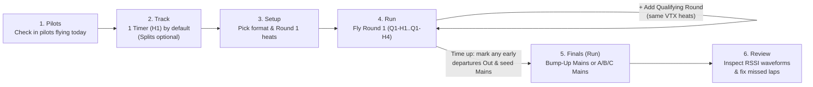

# Race & Track UX Improvement Plan (Club Race Director Feedback)

> [!NOTE]
> Thank you for the live first-impression walkthrough! Keeping **Practice** separate from **Race**, the **Race Templates**, and the **Flight Line** live race table all worked well, while the walkthrough highlighted five clear areas where terminology, defaults, and club-night qualifying workflows need to be simpler and more predictable.

---

## 1. Summary of Walkthrough Feedback

| # | Area | Feedback Observed | Planned Fix |
| :--- | :--- | :--- | :--- |
| **1** | `Race -> Pilots` | Unclear whether toggling pilots ON automatically assigns them to heats, and what step comes next. | Add a 1-line check-in explanation and a **`Next: Setup Heats ->`** button in the **Pilots** header. |
| **2** | `Race -> Track` | Showing 4 demo timers (`T1`, `T2`, `H1`, `T3`) and `S1`/`S2`/`S3` section splits made setting up a **single Start/Finish timer** confusing. | Add a **`Single Timer (Start / Finish)`** vs. **`Multiple Timers (Section Splits)`** toggle at the top of **Track**, defaulting to **Single Timer** (`H1`). |
| **3** | `Setup` & Spoken Callouts | `Q2-1` looked like *"Qualifier 2, Round 1"* instead of *"Round 2, Heat 1"*, repeating `2 rounds · 1 heat/pilot` inside every round column made `Qualifying R2` look like a separate stage, and `Add Heat` was hidden inside the round hamburger menu. | Rename short codes to **`Q1-H1`**, **`Q1-H2`**, **`Q2-H1`** (`CTA-G1` for Chase the Ace games), label columns **`Qualifying · Round 1`** (`Round 1 of 2 · 4 heats`), place a direct **`+` (Add Heat)** button on every round header (`[+] [Delete] [Menu]`), and speak `"Qualifying Round 1, Heat 1"` clearly. |
| **4** | `Marshal` vs. `Overview` | Hard to find where to press *"3, 2, 1, Go"* (called **Marshal** in Race and **Overview** in Practice), easy to lose a running heat while on another tab, and *"Marshal"* in FPV racing usually means post-heat RSSI review. | Rename **both** live cockpits (`Marshal` in Race and `Overview` in Practice) to **`Run`**, place **`Run`** at the front of the tab bar, and make the top `LIVE` banner a 1-click **`Open Run ->`** jump button. |
| **5** | Club Qualifying & Finals | At weekly club/whoop races, you do not know upfront whether you will fit 3 rounds or 8 rounds before time runs out; also need fixed VTX heat lineups across rounds, B/C or Bump-Up Mains for all pilots (not just Top 4), and clean handling when a pilot leaves early before Finals. | Add a 1-click **`+ Add Qualifying Round`** button (with **Keep Same Heat Lineups & VTX Channels** mode), auto-reseed unstarted Mains when a pilot is marked **Out (`AWY`)**, and surface **All-Pilot Mains / Bump-Up Mains** directly on Finals. |

---

## 2. Target Club Race Workflow

---

## 3. Detailed Design & Implementation Plan

### Phase 1: Unified `Run` Tab & Live Heat Banner
- **Unified Tab Naming**:
  - Rename **Marshal** in Race ([RacesView.ts](../web/src/views/RacesView.ts)) and **Overview** in Practice ([PracticeView.ts](../web/src/views/PracticeView.ts)) to **`Run`**.
  - Keep **Review** as the dedicated post-heat RSSI waveform marshaling tab (`Add Crossing`, `Invalidate Lap`, `+Penalty`).
- **Front-of-Bar Placement & Empty State**:
  - Place **`Run`** first in both workspaces:
    - **Race**: `Run | Pilots | Track | Setup | Schedule | Standings | Review | Signals | Analytics`
    - **Practice**: `Run | Pilots | Track | Laps | Review | Trends | Signals | Analytics | AI Training`
  - When a brand-new race has no heats generated yet, keep **`Run`** clickable (not disabled) and display a guided 3-step checklist card (`1. Check In Pilots -> 2. Confirm Track -> 3. Pick Format in Setup`).
- **Never Lose an Active Heat**:
  - Whenever a heat is in `Countdown`, `Active`, or `Review` while you are viewing another tab (`Pilots`, `Track`, `Setup`), turn the top status strip into a 1-click button (`LIVE · Q1-H1 (01:42) · Go to Run ->` on desktop; compact `LIVE · Q1-H1 · Run` on mobile portrait).

---

### Phase 2: Clear Round, Heat & Game Labels (`Q1-H1`, `CTA-G1`) With Compact Mobile Acronyms
- **Explicit `H` (Heat) and `G` (Game) Short Codes** ([generator.go](../internal/race/generator.go), [progression.go](../internal/race/progression.go)):
  - Qualifying heats: **`Q1-H1`**, **`Q1-H2`**, **`Q1-H3`**, **`Q1-H4`**, then **`Q2-H1`**, **`Q2-H2`** (Qualifier Round 2, Heat 2).
  - Elimination / Mains heats: **`W1-H1`**, **`L1-H1`**, **`SF-H1`**, **`C-H1`**, **`B-H1`**, **`A-H1`**.
  - Chase the Ace Finals games: **`CTA-G1`**, **`CTA-G2`**, **`CTA-G3`** (*Game 1*, *Game 2*, ...).
  - *(Only 1 character wider than `Q1-1`, keeping mobile portrait tables and pills tight while making Round vs. Heat unambiguous. Internal database IDs remain backwards-compatible.)*
- **Responsive Desktop vs. Mobile Portrait Copy** ([BracketDiagram.ts](../web/src/widgets/BracketDiagram.ts), [MobileRaceEditor.ts](../web/src/widgets/MobileRaceEditor.ts), [TrackEditor.ts](../web/src/widgets/TrackEditor.ts)):
  - Preserve compact acronyms on mobile portrait (`<= 860px`) so controls never wrap or clip on narrow phone screens:

  | UI Element | Desktop Label | Mobile Portrait Label |
  | :--- | :--- | :--- |
  | **Heat Pill / Chip** | `Q1-H1` / `CTA-G1` | `Q1-H1` / `CTA-G1` |
  | **Qualifying Column Header** | `Qualifying · Round 1` (`Round 1 of 2 · 4 heats`) | `Qual R1` (`R1/2 · 4H`) |
  | **Add Round Button** | `+ Add Qualifying Round` | `+ Round` |
  | **Track Mode Toggle** | `Single Timer (Start / Finish)` / `Multiple Timers (Splits)` | `1 Timer` / `Splits` |
  | **Live Jump Banner** | `LIVE · Q1-H1 (01:42) · Go to Run ->` | `LIVE · Q1-H1 · Run` |

- **Spoken Callout Clarity** ([announcer.ts](../web/src/services/announcer.ts)):
  - Expand `Q1-H1` in TTS audio only (`"Qualifying Round 1, Heat 1"`) so spoken callouts are clear without adding screen width.

---

### Phase 3: Simplified `Track` Tab (`1 Timer` vs. `Multiple Timers`)
- **Two-Mode Selector at the Top of `Track`** ([TrackEditor.ts](../web/src/widgets/TrackEditor.ts)):
  1. **`Single Timer (Start / Finish)`** *(Default)*:
     - Automatically assigns Hub `H1` (or the sole connected timer) as the **Start / Finish Gate**.
     - Hides the multi-gate `S1`/`S2`/`S3` drag-and-drop track line and `Unassigned timers` box completely.
     - Shows a single confirmation bar (`Start / Finish Gate: Hub H1 · Lap timing ready`) with a dropdown if you want to pick a different timer.
  2. **`Multiple Timers (Section Splits)`**:
     - Expands the drag-and-drop split-gate course line (`Start/Finish` + `S1`, `S2`, `S3`) and `Unassigned timers` tray for multi-gate tracks.
- **Cleaner Browser Demo Default**:
  - Default new races in Browser Demo mode to **Single Timer (`H1`)** so evaluators testing single-gate club racing do not have to manage extra demo Spoke timers (`T1`..`T3`).

---

### Phase 4: Open-Ended Club Qualifying (`+ Add Round`, Fixed VTX Heats & Early Departures)
- **1-Click `+ Add Qualifying Round` (No Need to Pre-Build 8 Rounds Upfront)** ([event_controller.go](../internal/tracker/event_controller.go), [qualifier_rotation.go](../internal/race/qualifier_rotation.go)):
  - Start Qualifying with **1 or 2 rounds** and display a prominent **`+ Add Round`** button both on the Qualifying header in **Setup** and in the **Run** cockpit as soon as the last heat of a round finishes (`+ Add Qualifying Round` or `Proceed to Finals ->`).
- **Fixed Heat Lineups & VTX Channels Option**:
  - Support two lineup modes when adding Qualifying rounds:
    - **`Keep Same Heats & VTX Channels`** *(Recommended for club / whoop nights)*: Heat 1..Heat N keep the exact same pilot groups and VTX channels in Round 2, Round 3, ... Round 8 so pilots never have to change VTX frequencies between rounds.
    - **`Balanced Opponent Rotation`**: Mixes opponents across rounds while minimizing channel swaps.
- **Early Pilot Departure Before Finals (`Out / AWY`)**:
  - If a pilot flies Qualifying and has to leave early before Finals, marking them **`AWY` (Out)** on **Pilots** (before the first Finals heat starts) automatically shifts remaining qualifiers up so Finals seats do not sit empty.

---

### Phase 5: All-Pilot Mains, Bump-Ups & Chase the Ace Clarity
- **Finals Participation Selector Right on the `Finals` Card** ([RacesView.ts](../web/src/views/RacesView.ts), [RoundModals.ts](../web/src/widgets/RoundModals.ts)):
  - Instead of locking `Qualifying + Chase the Ace` to **Top 4 Only**, provide a 1-click Finals structure selector:
    - **`All Pilots · Bump-Up Mains (C-Main -> B-Main -> A-Main)`** *(lower mains race first; top 1 or 2 finishers bump up into the next Main, with optional Chase the Ace on A-Main)*.
    - **`All Pilots · A / B / C Division Mains`** *(every pilot races a Finals Main grouped by qualifying pace)*.
    - **`Top Contenders Only (Top 4 / Top 6 / Top 8 A-Main)`**.
- **Chase the Ace Game Spawning Note**:
  - Show a clear note on `CTA-G1` (`New games spawn automatically after each confirmed heat until a contender reaches 2 Wins`) so it is obvious how extra Chase the Ace rounds appear.

---

### Phase 6: 90-Second Guided Race Setup Video
- Record a concise `90-second` walkthrough video embedded in the [Race Events Guide](https://slaprf.app/docs/journeys/race-events/) (and linked from `Race -> Setup`) covering:
  1. Checking in club pilots (`Pilots`),
  2. Keeping `Track` on **Single Timer (`H1`)**,
  3. Running open-ended club Qualifying rounds (`+ Add Round` with fixed VTX channels), and
  4. Seeding **Bump-Up / Chase the Ace Finals**, running heats in **`Run`**, and checking missed laps in **`Review`**.

---

## 4. Questions for Review
1. **Default Qualifying Lineups**: For club races, would you prefer **`Keep Same Heats & VTX Channels`** as the default when clicking **`+ Add Qualifying Round`** (with opponent re-mixing as an option), or vice versa?
2. **Bump-Up Mains into Chase the Ace**: For 12–16 pilot whoop nights, do you usually run **C-Main -> B-Main (1 or 2 bump-ups) -> Chase-the-Ace A-Main**, or separate A / B / C Mains without bump-ups?
3. **Anything Else in `Run` or `Review`**: Was there anything else during heat staging, countdown, or post-heat lap editing that felt extra clicks away compared to RotorHazard?
